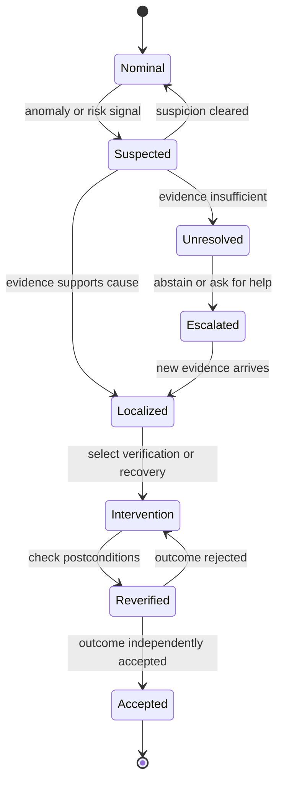

# Reliable scientific agents: a two-paper research program

_Implementation-linked research direction for the LLM Systems Lab · 2026-08-01_

---

Companion specifications: [workspace map](README.md),
[implementation plan](IMPLEMENTATION_PLAN.md),
[experiment plan](EXPERIMENT_PLAN.md), and
[writing/submission plan](WRITING_AND_SUBMISSION_PLAN.md).

## 📋 Research position

The program should produce **two substantial, cumulative papers**, not three
partially overlapping papers and not one oversized systems paper:

1. **Paper R1 — Measurement and warning:** a reproducible benchmark of failure
   dynamics in long-horizon scientific agents, paired with calibrated early
   warning and root-cause attribution baselines.
2. **Paper R2 — Intervention and learning:** a process-supervised method for
   cost-sensitive verification, verified recovery, and post-training from
   adjudicated recovery trajectories.

The central scientific object is the **trajectory**, not the chatbot response.
A governed runtime records intended actions, observed effects, evidence,
verifier outcomes, interventions, and final scientific consequences. R1 turns
those records into an empirical science of failure. R2 uses the frozen R1
contract to learn when to verify, how to recover, and how to improve without
silently increasing risk on clean tasks.

The program is therefore narrower than “reliable agents” and stronger than a
generic agent framework:

> **Calibrated, execution-grounded scientific agents that predict failure,
> attribute its cause, purchase evidence selectively, recover under explicit
> risk and cost constraints, and learn only from independently verified
> outcomes.**

This position builds on the lab's existing strengths in calibration,
risk–coverage analysis, nonstationary scientific workflows, typed agent
execution, durable provenance, independent validation, fault injection, and
open-model post-training. It also responds to a crowded literature: failure
taxonomies, trajectory diagnosis, intervention frameworks, scientific-agent
benchmarks, and execution-feedback training already exist.[^mast2025]
[^agentrx2026][^aegis2025][^mlrbench2025][^sciagentarena2026] The contribution
must therefore be the conjunction of **failure dynamics, advance warning,
recoverability, verified intervention, and process-supervised transfer**, not
the existence of another taxonomy or repair loop.

## 🎯 Program thesis and paper boundary

### Central research question

> Can a scientific agent predict that its trajectory is becoming unreliable
> before terminal failure, identify the likely causal fault, choose a
> cost-effective verification or recovery action, and learn that behavior from
> evidence that is independent of its own claims?

At step `t`, the system may choose:

```text
continue | inspect | gather evidence | verify | retry | repair | rollback
re-plan | escalate | ask a human | abstain | terminate
```

The program optimizes expected task loss, execution damage, verification cost,
compute, and human effort, subject to a risk budget and non-bypassable policy
constraints. It distinguishes model, execution, evidence, verifier, and shift
uncertainty rather than collapsing them into one confidence score.

### Why two papers

The earlier three-paper split placed detection in one paper, online recovery in
another, and learning in a third. That division produced two problems. First,
the benchmark paper risked becoming descriptive because it lacked a strong
predictive baseline. Second, the recovery paper and post-training paper depended
on the same adjudicated interventions, making each look incomplete without the
other.

The revised split follows the natural experimental boundary:

| Paper | Scientific question | Owned contribution | Explicit exclusion |
| --- | --- | --- | --- |
| **R1** | What fails, how does failure propagate, and can it be predicted early? | Trace contract, causal fault model, benchmark, failure laws, calibrated hazard and attribution baseline | Learned recovery policy and policy post-training |
| **R2** | Given a calibrated risk belief, when should the system verify or intervene, and can that behavior be learned? | Active verification, recovery controller, adjudicated recovery data, process-supervised post-training | Redefining R1 labels or evaluating on training-era benchmark instances |

R1 must be publishable without R2. R2 consumes a versioned R1 artifact and must
show method-level improvement beyond diagnosis alone. R2's trained policy is not
added to R1's confirmatory comparison after results are known; it belongs in a
future benchmark release or a prospectively declared extension.

### Core hypotheses

| ID | Falsifiable hypothesis | Paper |
| --- | --- | --- |
| **H1** | State-difference and evidence histories predict terminal scientific failure earlier and more reliably than terminal checks, self-confidence, or trace-only critics on held-out task and fault families. | R1 |
| **H2** | Warning lead time and causal fault class jointly predict whether a trajectory remains recoverable after controlling for task difficulty, model, and fault severity. | R1 |
| **H3** | A calibrated, cost-sensitive verification policy lowers scientific failure at matched verification budget relative to fixed, random, and confidence-threshold policies. | R2 |
| **H4** | Process-supervised verified-recovery training improves unseen-fault recovery and selective risk at matched cost without a meaningful clean-task regression. | R2 |

## 🔄 Shared system architecture

The runtime is experimental infrastructure, not the main novelty claim. Its job
is to make intent, execution, evidence, failure propagation, intervention, and
learning observable and reproducible.

```mermaid
flowchart LR
    accTitle: Two-paper reliable scientific agent program
    accDescr: The governed runtime produces a frozen measurement benchmark for Paper R1, which supplies calibrated beliefs and adjudicated traces to the verification, recovery, and training methods in Paper R2.

    task["Scientific task"] --> runtime["Governed agent runtime"]
    runtime --> trace["Versioned trace and evidence contract"]
    trace --> r1_measure["R1: fault injection and failure dynamics"]
    r1_measure --> r1_model["R1: calibrated hazard and attribution"]
    r1_model --> r2_control["R2: active verification and recovery"]
    r2_control --> audit{"Independent outcome accepted?"}
    audit -->|No| r2_control
    audit -->|Yes| training["R2: process-supervised post-training"]
    training --> frozen_eval["Frozen tasks, faults, and regression gates"]

    classDef infrastructure fill:#e0f2fe,stroke:#0369a1,stroke-width:2px,color:#0c4a6e
    classDef paper_one fill:#ede9fe,stroke:#7c3aed,stroke-width:2px,color:#3b0764
    classDef paper_two fill:#dcfce7,stroke:#15803d,stroke-width:2px,color:#14532d
    classDef decision fill:#fef3c7,stroke:#b45309,stroke-width:2px,color:#78350f

    class task,runtime,trace infrastructure
    class r1_measure,r1_model paper_one
    class r2_control,training,frozen_eval paper_two
    class audit decision
```



### Error lifecycle

“Detected,” “diagnosed,” “recovered,” and “verified” are distinct states. A
retry is not recovery unless postconditions and scientific consequences are
checked; a plausible diagnosis is not a causal label unless supported by the
fault record and adjudication.



### Shared trace contract

Every event should include the following versioned fields:

| Field group | Minimum content |
| --- | --- |
| Identity | Run, task, model, policy, environment, code, and schema versions |
| Time | Step index, monotonic timestamp, latency, retry count, and budget state |
| Intent | Proposed action, declared objective, expected postcondition, and dependency |
| Execution | Typed action, arguments, exit state, observed state difference, and side effects |
| Evidence | Artifact hashes, measurements, tool output references, provenance, and freshness |
| Belief | Failure probability, attribution distribution, calibration set, and abstention state |
| Fault | Intervention ID, causal parent, severity, persistence, observability, and injection time |
| Recovery | Verification choice, intervention, cost, rollback boundary, and alternative actions |
| Outcome | Task success, scientific validity, damage, recovery status, and adjudicator agreement |
| Training | Eligibility, split, leakage checks, reward channels, and dataset version |

The contract must record missing observations explicitly. Timeout, absence of a
log entry, and failed verification are not interchangeable outcomes.

## 📊 Paper R1 — Failure dynamics and calibrated early warning

### Working title

**From Error Events to Failure Dynamics: A Reproducible Benchmark for
Calibrated Early Warning in Scientific Agents**

### One-sentence claim

Long-horizon scientific-agent failure has measurable temporal structure, and a
calibrated model using execution-grounded state differences and evidence
history can warn of failure and attribute its cause on held-out task and fault
families before terminal checks reveal it.

### Research objective

R1 creates the measurement foundation and one strong predictive baseline. The
paper is not a leaderboard of end-task success and not another prose taxonomy.
It asks how faults become observable, how they propagate through a trajectory,
when they become irreversible, and whether those dynamics transfer across
models, tasks, and fault compositions.

The paper owns four contributions:

1. A causal fault-injection model and versioned trajectory contract.
2. A benchmark spanning controlled and naturally occurring scientific-agent
   failures.
3. Reproducible measurements of hazard, propagation, warning lead time,
   calibration, and recoverability.
4. A calibrated early-warning and attribution baseline that turns the
   measurement problem into a falsifiable prediction task.

### Novelty boundary

R1 should not claim that it is the first agent-failure taxonomy, the first
trajectory dataset, or the first scientific-agent benchmark. MAST-Data already
provides a large failure-trace collection, AgentRx targets critical-step
localization and root-cause diagnosis, Aegis joins a taxonomy with
interventions, and MLR-Bench and SciAgentArena evaluate scientific or ML
agents.[^mast2025][^agentrx2026][^aegis2025][^mlrbench2025]
[^sciagentarena2026]

The defensible novelty claim is:

> **A causal, execution-grounded study of pre-terminal failure dynamics that
> jointly evaluates calibrated warning, causal attribution, propagation,
> recoverability, and transfer to unseen fault structures.**

### Benchmark design

#### Workload ladder

Use increasing scientific and operational complexity:

| Level | Workload | Why it is needed |
| --- | --- | --- |
| **L0** | Repository repair and bounded tool use | Cheap debugging and precise state-difference labels |
| **L1** | Reproducible ML experiments | Data leakage, configuration drift, metric misuse, and artifact provenance |
| **L2** | Signal-detection workflows | Known optimal baselines and controlled noise geometry |
| **L3** | Nonstationary-noise experiments | Shift, adaptation, stale evidence, and false confidence |
| **L4** | Real-data validation | External validity and naturally occurring failures |

L0–L3 support causal injection and mechanism analysis. L4 is a transfer test,
not a replacement for controlled experiments.

#### Fault causal model

Organize faults by causal mechanism rather than only symptom:

| Family | Examples | Key observability question |
| --- | --- | --- |
| Model and planning | Wrong hypothesis, invalid decomposition, hallucinated dependency | Does the error appear before action? |
| Action and tool | Malformed call, wrong target, invalid parameter | Is intent different from executed effect? |
| Runtime and environment | Timeout after side effect, stale process, partial write | Can reconciliation recover the true state? |
| Memory and context | Stale fact, truncation, provenance loss, retrieval pollution | Which memory event first changes the plan? |
| Evidence and statistics | Leakage, wrong metric, multiple testing, invalid uncertainty | Is the scientific claim unsupported despite task completion? |
| Verifier | Flaky test, shared bug, incomplete oracle, reward leakage | Is acceptance independent of the agent? |
| Coordination | Conflicting workers, stale ownership, duplicated action | Does propagation cross agent boundaries? |

Each injected fault needs a causal parent, injection time, severity, persistence,
observability, expected downstream effects, and a clean counterfactual. Include
held-out individual fault families and held-out compositions of familiar
faults. Natural failures receive adjudicated labels but must not be described as
causally known when the evidence is only correlational.

#### Data splits

Predeclare four split regimes:

1. Random trajectory split for debugging only.
2. Held-out tasks within known workload families.
3. Held-out fault families.
4. Held-out fault compositions and environment shifts.

The main result must use regimes 2–4. Model and task templates should be grouped
to prevent near-duplicate leakage. Pilot traces are used for instrument repair,
power estimation, and label-book revision, then excluded from confirmatory
claims.

### Predictive baseline

The baseline consumes structured event history and produces:

```text
q_t = P(terminal scientific failure | history through step t)
p_t(cause = k | history through step t)
a_t = abstain or issue warning
```

Compare at least:

- terminal checker only;
- simple rules and runtime alarms;
- agent self-confidence;
- text-only trace critic;
- structured trace encoder without state differences;
- structured trace encoder with state differences and evidence provenance;
- oracle signals, reported only as an upper bound.

Use temporal or survival modeling where it clarifies the claim, but do not make
architectural novelty a requirement. A small, interpretable baseline is an
advantage if it establishes a reproducible empirical law.

### Primary outcomes and statistics

| Outcome | Preferred analysis |
| --- | --- |
| Failure hazard over trajectory age | Survival curves and mixed-effects hazard model |
| Earliest useful warning | Lead-time distribution at fixed false-alert budget |
| Warning discrimination | Time-dependent AUROC/AUPRC with grouped bootstrap intervals |
| Probability quality | Brier score, log loss, calibration error, and reliability plots |
| Selective behavior | Risk–coverage and abstention utility curves |
| Root-cause attribution | Macro-F1, top-k accuracy, and hierarchical confusion matrix |
| Propagation | Transition rates between typed subsystems and causal fault descendants |
| Recoverability | Recovery probability conditional on warning time, fault, severity, and task |

Use hierarchical models or cluster-robust intervals for repeated tasks, models,
and seeds. Report label prevalence, adjudicator agreement, missingness, and
sensitivity to ambiguous labels. Calibrate on a dedicated split; never tune a
warning threshold on the test set.

### Required ablations

- Remove state-difference observations.
- Remove evidence provenance and freshness.
- Remove memory events.
- Replace causal labels with terminal outcome labels.
- Evaluate text-only versus typed-event histories.
- Test calibration before and after environment or tool-version shift.
- Compare early versus late injection at matched severity.
- Compare seen faults, unseen faults, and unseen compositions.

### Paper structure

1. Problem: terminal success hides when and why scientific trajectories fail.
2. Related work and exact collision boundary.
3. Governed runtime, trace contract, and causal fault model.
4. Workloads, splits, annotation, and benchmark protocol.
5. Failure-dynamics measurements and confirmatory law.
6. Calibrated warning and attribution baselines.
7. Transfer, robustness, recoverability, and limitations.
8. Artifact, data statement, and intended-use restrictions.

### Deliverables and gates

The minimum publishable artifact is:

- a trace schema and validator;
- deterministic fault injectors and clean counterfactuals;
- a label book and blinded adjudication protocol;
- frozen workload, task, fault, and model manifests;
- benchmark traces with provenance and licensing records;
- evaluation code for survival, warning, calibration, attribution, and recovery;
- one non-obvious empirical failure law replicated across at least two workload
  families;
- one calibrated warning result that transfers to a held-out task or fault
  regime.

**Kill criterion:** if the benchmark yields neither a replicated failure law
nor useful pre-terminal warning beyond simple runtime/terminal baselines, do not
frame it as a major main-track paper. Release the benchmark and negative result
as an evaluation or workshop contribution, then revise the causal model before
expanding data collection.

### Publication target and size

R1 should be a **big benchmark and evaluations paper**. The primary target is
Data-centric Machine Learning Research (DMLR), provided the benchmark is
complete, reusable, documented, maintained, and legally distributable.[^dmlr]
KDD Datasets & Benchmarks Cycle 2 is the deadline-based alternative; TMLR is the
better alternative if the transferable predictive law, rather than the dataset
artifact, becomes the dominant contribution.[^tmlr] A non-archival workshop is
useful for pilot feedback but is not the final destination.

## 🧪 Paper R2 — Process-supervised verified recovery

### Working title

**Learning When to Verify and How to Recover: Process-Supervised Scientific
Agents under Execution and Evidence Uncertainty**

### One-sentence claim

A policy trained on independently adjudicated recovery processes can select
verification and recovery actions that reduce scientific failure under a fixed
cost budget, transfer to unseen fault compositions, and preserve clean-task
performance better than outcome-only post-training.

### Research objective

R2 merges active verification, recovery control, and post-training because they
share one scientific unit: the **verified intervention transition**. A useful
training record must state the prior belief, available evidence, chosen
verification or recovery action, cost, state difference, independent outcome,
and counterfactual alternatives. Separating policy design from training would
leave each paper dependent on the same expensive adjudication system.

R2 owns three linked contributions:

1. A calibrated, cost-sensitive policy for deciding whether and what to verify.
2. A recovery policy over retry, repair, rollback, re-plan, escalation,
   abstention, and termination.
3. A process-supervised post-training recipe that learns from independently
   accepted recovery transitions and is evaluated under frozen regression
   gates.

### Dependency contract

R2 begins only after R1 freezes:

- the trace schema and validator;
- causal fault families and held-out splits;
- workload manifests and terminal scientific outcomes;
- warning and attribution calibration protocol;
- pilot-excluded confirmatory evaluation sets.

R2 may add intervention fields and recovery labels through a new schema version,
but it may not relabel R1's test outcomes after seeing policy results. Training
and development tasks must be disjoint from the frozen evaluation set.

### Decision formulation

At each decision point, the state contains the structured trace history,
calibrated failure belief, cause distribution, evidence freshness, resource
budget, reversibility, and estimated action damage. The policy chooses:

```text
continue
verify(check_type, target)
recover(retry | repair | rollback | re-plan)
escalate | abstain | terminate
```

A practical objective is:

```text
maximize expected scientific utility
  - lambda_v * verification cost
  - lambda_c * compute cost
  - lambda_h * human cost
  - lambda_d * irreversible damage

subject to:
  clean-task regression <= declared tolerance
  selective risk <= declared risk budget
  policy and privacy constraints are never bypassed
```

The first version need not solve a general POMDP. A calibrated value-of-
information score, constrained contextual bandit, or small policy model is
sufficient if the counterfactual comparison is credible.

### Method architecture

```mermaid
flowchart LR
    accTitle: Process-supervised verification and recovery method
    accDescr: Frozen R1 beliefs feed a budget-aware controller whose independently verified transitions train and evaluate a recovery-capable open model.

    belief["R1 calibrated risk and cause belief"] --> controller["Budget-aware decision policy"]
    controller --> verifier["Select verifier or evidence source"]
    controller --> recovery["Select recovery or abstention"]
    verifier --> adjudication{"Independent adjudication"}
    recovery --> adjudication
    adjudication --> transition["Verified intervention transition"]
    transition --> training["Process-supervised post-training"]
    training --> evaluation["Frozen unseen-fault and clean-task gates"]

    classDef input fill:#e0f2fe,stroke:#0369a1,stroke-width:2px,color:#0c4a6e
    classDef method fill:#ede9fe,stroke:#7c3aed,stroke-width:2px,color:#3b0764
    classDef decision fill:#fef3c7,stroke:#b45309,stroke-width:2px,color:#78350f
    classDef outcome fill:#dcfce7,stroke:#15803d,stroke-width:2px,color:#14532d

    class belief input
    class controller,verifier,recovery,training method
    class adjudication decision
    class transition,evaluation outcome
```



### Active verification

The controller estimates the expected value of a verification action from its
ability to change the decision, reduce uncertainty, or prevent irreversible
damage. Compare against:

- never verify;
- verify every step;
- random verification at matched budget;
- fixed-period verification;
- threshold on agent self-confidence;
- threshold on R1 failure probability;
- oracle verification timing as an upper bound.

Report performance as a frontier over task success, scientific validity,
verification cost, latency, and human effort. One operating point is
insufficient.

### Recovery actions and adjudication

Recovery actions include retry, tool substitution, local repair, rollback,
re-plan, escalation, abstention, and termination. Each action needs declared
preconditions, expected state change, rollback boundary, cost, and independent
postcondition checks.

Adjudication must separate:

1. whether the action executed as intended;
2. whether the immediate fault was removed;
3. whether downstream state is consistent;
4. whether the scientific claim remains valid;
5. whether the verifier is independent of the policy and training reward.

AgentRx, Aegis, CAPF, and Afterburner already cover important parts of diagnosis,
intervention, privileged-feedback repair, or execution-feedback training.
[^agentrx2026][^aegis2025][^capf2026][^afterburner2025] R2 must therefore test
the combined claim of **calibrated process decisions plus independent scientific
verification plus unseen-fault transfer**, not claim novelty from SFT, RL, or
repair trajectories alone.

### Training curriculum

Start with one open model family and parameter-efficient adaptation. Use the
smallest training sequence capable of testing H4:

1. **Recovery SFT:** teach typed diagnosis, verification requests, recovery
   selection, and abstention from accepted trajectories.
2. **One process-optimization method:** use a single RLVR-style or equivalent
   objective with independent step-level evidence and explicit costs.
3. **Calibration pass:** fit or recalibrate warning and abstention outputs on a
   held-out calibration split.

DPO, multiple RL algorithms, larger model families, and distributed training
are secondary extensions. They should not be required for the first paper.

### Minimal evaluation matrix

| Arm | Purpose |
| --- | --- |
| Base model | Establish untrained behavior and clean-task performance |
| Successful-only SFT | Test whether ordinary imitation is sufficient |
| Recovery SFT | Isolate the value of failed and repaired trajectories |
| Outcome-only optimization | Test terminal reward without process supervision |
| Process-supervised optimization | Test step-level verified recovery signals |
| Process supervision plus calibrated abstention | Test safe selective behavior |

All arms use matched data and compute where possible. Compare at matched
verification cost and report confidence intervals over tasks, seeds, fault
families, and model checkpoints.

### Primary outcomes

- verified recovery rate;
- scientific-validity success rate;
- residual failure risk at fixed coverage;
- verification and recovery cost per accepted task;
- recovery regret relative to an oracle action;
- performance on unseen tasks, fault families, and fault compositions;
- calibration before and after post-training;
- clean-task success, latency, tool use, and safety-policy regressions;
- reward–evidence disagreement and verifier-failure rate.

### Robustness and safety gates

- Training verifiers and evaluation verifiers must be separated when feasible.
- Reward channels must be audited for leakage, self-confirmation, and shared
  implementation bugs.
- Frozen clean tasks must test unnecessary interventions and over-abstention.
- Unseen fault compositions must be included; memorizing named injectors is not
  recovery competence.
- Irreversible actions require stronger evidence thresholds or human approval.
- Failed and ambiguous adjudications remain in an analysis set rather than
  being silently discarded.
- Any claimed improvement must survive matched-budget and matched-compute
  comparisons.

### Paper structure

1. Problem: detection alone does not determine whether evidence is worth buying
   or which recovery is safe.
2. Frozen R1 contract, dependency rules, and threat model.
3. Calibrated value-of-information and recovery policy.
4. Independent adjudication and verified-intervention dataset.
5. Recovery SFT and one process-supervised optimization method.
6. Matched-cost evaluation on unseen faults and compositions.
7. Calibration, clean-task regression, reward audit, and limitations.

### Deliverables and gates

The minimum credible paper needs:

- a simple controller that beats fixed and threshold baselines at matched cost;
- a versioned verified-intervention dataset with counterfactual action choices;
- the six-arm minimal evaluation matrix;
- independent training and evaluation outcome channels;
- transfer to at least one unseen task family and unseen fault composition;
- no practically meaningful degradation beyond a predeclared clean-task
  tolerance;
- ablations separating active verification, recovery data, process supervision,
  and calibrated abstention.

**Kill criterion:** if process supervision fails to improve unseen-fault recovery
or selective risk over recovery SFT and outcome-only training at matched cost,
do not sell the project as a general post-training method. Publish the
controller and verified-intervention dataset if they are independently strong,
and report the negative training result.

### Publication target and size

R2 should be a **big method paper**, but narrower in algorithms than the former
A2/A3 scope. TMLR is the primary rolling target because the paper requires a
careful, potentially longer controller-and-post-training evaluation.[^tmlr]
COLM, ICLR, ICML, or NeurIPS become alternatives if the method and transfer
evidence are sufficiently broad and deadline timing is favorable. A workshop
paper may validate the controller or dataset, but the full paper requires
process-level learning, unseen-fault transfer, and clean-task regression
evidence.[^colm]

## ⚙️ Shared platform and implementation plan

### Existing substrate

The adjacent [autoresearch harness](../../autoresearch_harness/) provides a
useful starting point: a governed control plane, typed lifecycle events, bounded
workers, append-only ledgers, task nodes, memory modes, and evaluation/reporting
machinery. It is research infrastructure, not yet a frozen benchmark artifact.

The previous proposal linked to planned `hybrid_agent/`, `evals/`,
`memory_lab/`, and `post_training/` directories that are not part of this
repository layout. New implementation references should point to real modules
inside the adjacent harness or be explicitly marked as planned. Do not create a
second orchestration stack merely to match the old proposal.

### Repository consolidation

| Capability | Recommended home | Reuse rule |
| --- | --- | --- |
| Governed execution and lifecycle | `../../autoresearch_harness/src/autoresearch/` | Extend typed events; do not fork the control plane |
| Scientific task nodes | `../../autoresearch_harness/nodes/` | Add manifests and fault hooks behind stable interfaces |
| Trace schema and validators | Planned versioned package in the harness | Shared by both papers; semantic versioning required |
| Benchmark manifests and splits | Planned benchmark directory | Immutable release manifests and hashes |
| R1 measurement and baselines | Planned analysis package | Read-only access to frozen traces |
| R2 controller and training views | Planned method package | Separate training, calibration, and test configurations |
| Paper artifacts | This repository's `papers/` and adjacent paper build | Generated from frozen manifests, never hand-copied |

Before scaling experiments, repair deterministic test failures, separate
environment-dependent failures from code defects, generate missing figures, and
run a clean artifact build. A substantial harness is not equivalent to a
reproducible benchmark until its schema, manifests, tests, and provenance are
frozen.

### Governance rules

1. Every result names a dataset, schema, code, environment, and model version.
2. Pilot and confirmatory manifests are separate and immutable.
3. R1 test labels are not revised in response to R2 performance.
4. Training rewards cannot serve as the sole evaluation evidence.
5. Failed, timed-out, and partially observed runs remain auditable.
6. Dataset licenses, secrets, and redistribution restrictions are checked before
   benchmark release.
7. Human adjudication records disagreement and uncertainty rather than forcing
   consensus labels.

## 🗓️ Publication and execution sequence

### Stage 0 — Freeze the substrate

- Map the old proposal paths to the actual adjacent harness.
- Repair deterministic tests and complete a clean artifact build.
- Define schema version 1, event validators, and artifact hashing.
- Freeze pilot tasks, fault interfaces, model list, and resource budget.
- Write the annotation guide and independent-verifier policy.

### Stage 1 — Pilot R1

- Run two model families and two workload levels.
- Audit observability, missingness, fault fidelity, and clean counterfactuals.
- Estimate prevalence, effect sizes, variance, and adjudication workload.
- Revise instruments only during the pilot.
- Freeze confirmatory tasks, splits, hypotheses, and analysis code.

### Stage 2 — Complete R1

- Collect confirmatory traces with blinded adjudication.
- Test H1 and H2 with grouped uncertainty estimates.
- Perform held-out task, fault-family, and composition evaluation.
- Release schema, manifests, benchmark, baseline, and model card/data statement.
- Submit R1 before allowing R2 results to alter the confirmatory benchmark.

### Stage 3 — Build R2 controller and data

- Implement fixed, random, threshold, and oracle verification baselines.
- Fit the cost-sensitive controller on R1 training/development traces.
- Collect recovery alternatives and independent postcondition checks.
- Freeze the verified-intervention dataset and clean-task regression suite.

### Stage 4 — Train and evaluate R2

- Run base, SFT, outcome-only, process-supervised, and abstention arms.
- Evaluate at matched data, compute, and verification budget.
- Test unseen tasks, faults, compositions, and environment shift.
- Audit reward channels and clean-task regressions.
- Submit only after controller value and process-supervision value are separately
  identifiable.

### Suggested publication arc

| Artifact | Primary contribution | Best-fit target | Size |
| --- | --- | --- | --- |
| **R1** | Failure-dynamics benchmark plus calibrated early warning and attribution | DMLR; KDD Datasets & Benchmarks Cycle 2; TMLR if the empirical law dominates | Big benchmark paper |
| **R2** | Cost-sensitive verified recovery plus process-supervised post-training | TMLR; COLM or a main ML venue if method evidence is broad | Big method paper |

## ✅ Decision summary

The merge strengthens both projects because it aligns paper boundaries with
independent scientific claims:

- R1 is no longer “just a benchmark”; its warning and attribution baseline
  creates a predictive thesis while remaining a coherent evaluation paper.
- R2 no longer splits the same intervention data across an online controller
  paper and a dependent training paper; it tests whether verified processes can
  be selected and learned.
- The program still has staged risk. R1 can succeed if R2 training fails, and
  R2 has a fallback contribution if process optimization is negative but the
  controller and intervention dataset are strong.
- The program should not expand beyond these two papers until both frozen-data
  transfer and independent verification are demonstrated.

## 🔗 References

[^mast2025]: Cemri, M. et al. (2025). “Why Do Multi-Agent LLM Systems Fail?” _NeurIPS Evaluations & Datasets_. <https://proceedings.neurips.cc/paper_files/paper/2025/hash/b1041e52d3be19f0a9bc491657488e4a-Abstract-Datasets_and_Benchmarks_Track.html>

[^agentrx2026]: Barke, S. et al. (2026). “AgentRx: Diagnosing AI Agent Failures from Execution Trajectories.” _arXiv_. <https://arxiv.org/abs/2602.02475>

[^aegis2025]: Song, K. et al. (2025). “Aegis: Taxonomy and Optimizations for Overcoming Agent-Environment Failures in LLM Agents.” _arXiv_. <https://arxiv.org/abs/2508.19504>

[^mlrbench2025]: “MLR-Bench: Evaluating AI Agents on Open-Ended Machine Learning Research.” (2025). _NeurIPS Evaluations & Datasets_. <https://proceedings.neurips.cc/paper_files/paper/2025/hash/ab8dd000d6f87f40061a73f8bca7fae4-Abstract-Datasets_and_Benchmarks_Track.html>

[^sciagentarena2026]: Liu, T. et al. (2026). “Benchmarking AI Agents for Addressing Scientific Challenges Across Scales.” _arXiv_. <https://arxiv.org/abs/2606.12736>

[^capf2026]: Chen, B. et al. (2026). “CAPF: Guiding Search-Agent Rollouts with Credit-Attenuated Privileged Feedback.” _arXiv_. <https://arxiv.org/abs/2606.01830>

[^afterburner2025]: Du, M. et al. (2025). “Afterburner: Reinforcement Learning Facilitates Self-Improving Code Efficiency Optimization.” _NeurIPS_. <https://proceedings.neurips.cc/paper_files/paper/2025/hash/0d1d415fb1a14ba3bb56b831d1eecbe7-Abstract-Conference.html>

[^neuripsed]: NeurIPS (2026). “Call for Evaluations & Datasets.” <https://neurips.cc/Conferences/2026/CallForEvaluationsDatasets>

[^colm]: COLM (2026). “Call for Papers.” <https://colmweb.org/cfp.html>

[^dmlr]: Data-centric Machine Learning Research. “Submission.” <https://data.mlr.press/submissions.html>

[^tmlr]: Transactions on Machine Learning Research. “TMLR guidelines for authors.” <https://www.jmlr.org/tmlr/author-guide.html>
