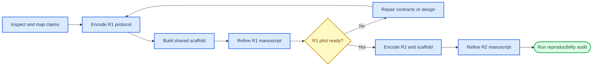

# Agent-paper priority and readiness guide

_Execution audit for Papers R1 and R2 · 2026-08-01_

---

This guide answers three operational questions: what should be done first, which
instructions already exist, and where another implementation agent would still
have to guess. It covers experimental refinement, manuscript refinement, and the
software/research scaffold for both papers.

## 🎯 Recommended priority order

The work should be dependency-driven rather than split into three independent
streams. Experimental claims determine the runtime contracts; those contracts
determine the scaffold; only then can the manuscript describe an implementation
that actually exists.

| Priority | Work package | Why it comes here | Completion gate |
| ---: | --- | --- | --- |
| **P0** | Preflight and claim–artifact crosswalk | Prevents two agents from using different paper boundaries or editing over existing work | Both repositories inspected; claims, owners, outputs, and protected user changes recorded |
| **P1** | Make R1 experiment executable | R1 supplies the shared trace, fault, split, and evidence contract | Machine-readable pilot/confirmatory protocols validate and regenerate deterministic schedules |
| **P2** | Build the shared reliability scaffold | The experiment cannot be tested against prose-only interfaces | Minimal schemas, validators, adapters, configs, and golden tests pass without running paid experiments |
| **P3** | Refine the R1 DMLR manuscript | R1 is first and its Methods can be written before results | Introduction, related work, benchmark, and methods are full prose; claims map to protocol IDs; PDF builds |
| **P4** | Complete R1 pilot-readiness gate | Prevents scaling a broken observer, injector, or adjudication scheme | Dry run and synthetic fixtures validate manifests, fault secrecy, traces, outcomes, and analysis exports |
| **P5** | Make R2 experiment executable and extend the scaffold | R2 must consume, not redefine, the frozen R1 contract | Controller and training protocols validate; unsupported counterfactuals remain explicitly unknown |
| **P6** | Refine the R2 TMLR manuscript | The method story becomes concrete only after controller/data contracts exist | Full prospective Methods and positioning; anonymous review build and identity audit pass |
| **P7** | End-to-end reproducibility and handoff | Converts a collection of files into an agent-followable project | One documented command validates protocols, tests both scaffolds, builds both papers, and emits a readiness report |



## 📋 Material readiness audit

### Summary verdict

The existing material is **followable for planning and scaffold construction**, but
not yet followable for autonomous experiment execution or submission-ready writing.
An agent can begin immediately if it treats P0–P2 as contract-building work and does
not infer missing task lists, models, budgets, results, or citations.

| Surface | Existing guidance | Readiness | What is still missing |
| --- | --- | ---: | --- |
| Paper boundary and claims | [Research program](10_reliable_scientific_agents_research_program.md) and [workspace map](README.md) | **High** | Claim IDs must be bound to generated artifacts |
| Portfolio and venues | [Publication evaluation](PUBLICATION_PLAN_EVALUATION.md) and venue scan | **High** | Recheck venue rules only at submission time |
| System architecture | [Implementation plan](IMPLEMENTATION_PLAN.md) | **High for design** | Actual `reliability/` package, precise compatibility adapters, and executable interface tests |
| R1 experiment | [Experiment plan](EXPERIMENT_PLAN.md) | **Medium–high** | Machine-readable factor levels, concrete task/model manifests, seeded schedules, power simulation, and preregistration snapshot |
| R2 experiment | [Experiment plan](EXPERIMENT_PLAN.md) | **Medium** | Exact action/cost ontology, logging propensities, controller eligibility rules, training hyperparameters, and compute/data matching ledger |
| Writing strategy | [Writing plan](WRITING_AND_SUBMISSION_PLAN.md) | **High for structure** | Verified literature matrix, claim cards, section word budgets, and actual prose |
| R1 LaTeX | [DMLR project](latex/r1_dmlr/README.md) | **Buildable shell** | Most sections are bracketed prompts; bibliography and generated result inputs are minimal |
| R2 LaTeX | [TMLR project](latex/r2_tmlr/README.md) | **Buildable shell** | Most sections are bracketed prompts; bibliography, anonymous artifact, and generated result inputs are minimal |
| Runtime substrate | Adjacent `../autoresearch_harness` | **Usable base** | No `src/autoresearch/reliability/`, `configs/reliability/`, or `tests/reliability/` tree yet |
| Reproducibility automation | Makefiles and template locks | **Partial** | No project-level protocol validator, scaffold test target, manuscript-data contract, or unified readiness command |

### What an agent can follow without clarification

- The two paper points, dependency direction, venue targets, and fallback claims
- The experimental-unit hierarchy and prohibition on event-level pseudoreplication
- R1 pilot and confirmatory factor families, starting trajectory counts, controls,
  endpoints, transfer splits, and evidence thresholds
- R2 controller baselines, randomized comparison, verified-intervention record,
  six-arm post-training comparison, non-inferiority gate, and ablations
- The intended runtime layers, event/manifest fields, fault-secrecy boundary,
  adjudication independence, phased implementation, and test categories
- DMLR and TMLR templates, build commands, section boundaries, and review anonymity

### Decisions the agent must not invent

- Final task instances, repositories, scientific datasets, or model/provider versions
- Paid API, GPU, human-review, or storage budgets
- Fault mechanisms retained after the instrumentation pilot
- Confirmatory sample size before the pilot variance/power simulation
- Outcome numbers, effect directions, acceptance claims, or result prose
- Author identities/order, conflicts, funding, editor, paper ID, or OpenReview URL
- Redistribution rights for tasks, traces, datasets, or model outputs
- A change to R1's frozen contract made solely to simplify R2

When one of these decisions blocks progress, the agent should complete all reversible
scaffold work, document the smallest required choice, and ask the user rather than
silently choosing.

## 🔍 Followability gaps to close

### Experiment artifacts

Create versioned protocol files rather than adding more prose. At minimum, the
project needs:

```text
agent_sys_paper1_2/protocols/
├── common/
│   ├── terminology.yaml
│   ├── endpoint_registry.yaml
│   └── claim_artifact_matrix.yaml
├── r1/
│   ├── pilot_protocol.yaml
│   ├── confirmatory_protocol.yaml
│   ├── split_manifest.example.yaml
│   ├── analysis_plan.md
│   └── deviations.md
└── r2/
    ├── controller_protocol.yaml
    ├── intervention_dataset_protocol.yaml
    ├── training_protocol.yaml
    ├── analysis_plan.md
    └── deviations.md
```

The protocol validator must reject missing units, outcomes, blocks, seeds, split
groups, thresholds, invalid-run rules, or analysis IDs. Design-generation scripts
must archive their seed, input hash, output hash, balance table, and estimability
diagnostics. Power simulation should use explicit assumed distributions until pilot
estimates are available, label those assumptions, and never convert them into
observed evidence.

### Implementation artifacts

The adjacent harness already has control-plane events, append-only storage, worker
interfaces, nodes, evaluation, and reporting. Extend those surfaces rather than
creating a parallel platform. The missing initial scaffold is:

```text
../autoresearch_harness/
├── src/autoresearch/reliability/
│   ├── schema/
│   ├── observability/
│   ├── faults/
│   ├── adjudication/
│   ├── benchmark/
│   ├── warning/
│   ├── control/
│   └── training/
├── configs/reliability/
├── experiments/reliability/
└── tests/reliability/
```

The first implementation should contain typed interfaces, validators, deterministic
fixtures, and tests—not empty directories and not premature neural models. The
minimum vertical slice is: validated manifest → sealed fault assignment → typed
action/result/state difference → independent adjudication → derived endpoint →
paper-facing export with provenance.

### Manuscript artifacts

Both LaTeX projects compile against pinned official styles, so template setup is not
the bottleneck. Refinement should replace bracketed prompts with full prospective
prose in Introduction, Related Work, Methods, Limitations, Artifact Use, and Broader
Impact. Results must remain generated placeholders until evidence exists.

Each manuscript still needs:

- a verified closest-work matrix and substantially expanded BibTeX database
- claim cards connected to protocol/analysis/figure identifiers
- generated-table and scalar-macro conventions with manifest hashes
- accessible architecture and study-design figure sources
- a graphical-abstract source and at least one methods schematic before finalization
- submission checklists for artifact access, licensing, anonymity, conflicts, and
  prohibited unsupported claims

## ✅ Definition of agent-ready

The project becomes fully followable when a new agent can perform these actions from
a clean checkout without unstated knowledge:

1. Validate all R1 and R2 protocol files.
2. Regenerate the same seeded pilot schedule and design diagnostics.
3. Run a synthetic end-to-end trace through the reliability scaffold.
4. Recompute one example endpoint and paper table from that trace.
5. Build both venue-formatted PDFs without fabricating results.
6. Run R2's anonymity audit.
7. Produce a readiness report mapping every enabled claim to code, protocol,
   evidence status, manuscript location, and remaining blocker.

Until those seven actions work, the documents should be described as a strong
research specification with buildable manuscript shells, not a turnkey experimental
package.

