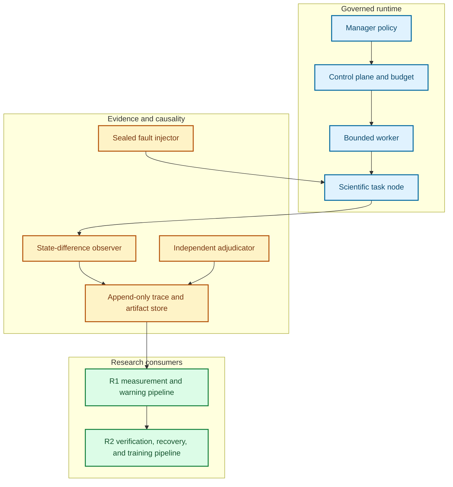
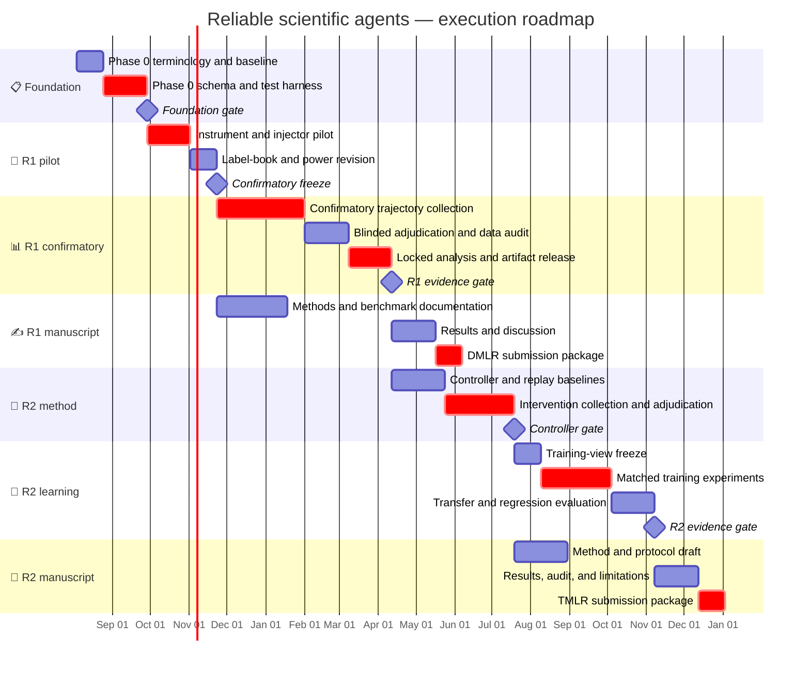

# Reliable scientific agents: implementation plan

_Engineering and execution specification for Papers R1 and R2 · 2026-08-01_

## 🎯 Objective and completion definition

The implementation must support two independently publishable claims without
building two agent platforms. The existing governed
[autoresearch harness](../../autoresearch_harness/) is the runtime substrate. The
new work adds a reliability layer that makes faults, state differences,
verification, recovery, and training provenance experimentally controllable.

The program is complete only when all of the following are true:

| Completion condition | R1 | R2 |
| --- | :---: | :---: |
| A versioned trace can be replayed and validated independently | Required | Consumed |
| Fault injection has clean counterfactuals and causal metadata | Required | Consumed |
| Task, fault, model, and analysis manifests are immutable | Required | Required |
| Primary outcomes can be regenerated from raw ledgers | Required | Required |
| Training reward is independent from final adjudication | Not applicable | Required |
| Held-out tasks, fault families, and compositions remain sealed | Required | Required |
| Clean-task and safety regression gates are enforced | Supporting | Required |
| The manuscript builds with the official target-venue template | DMLR | TMLR |

Implementation success is not defined by a working dashboard or a large trace
collection. It is defined by an auditable chain from a preregistered hypothesis
through intervention assignment, immutable evidence, analysis, figure/table
generation, and a claim that remains valid under the declared negative controls.

## 🧱 Architectural invariants

The following constraints are non-negotiable because they protect the scientific
interpretation:

1. **Intent and effect are distinct.** A proposed action, tool invocation, exit
   status, observed state difference, and verified postcondition are separate
   events.
2. **Absence is typed.** A timeout, missing observation, failed verifier, negative
   result, and unexecuted action cannot share one null value.
3. **Fault truth is write-once.** Injector metadata is sealed before the agent run
   and is unavailable to the evaluated policy.
4. **Evaluation is out of band.** Final adjudicators do not reuse the policy's
   prompts, hidden state, reward model, or self-reported confidence.
5. **Every derived artifact is content-addressed.** Tables and figures identify
   the raw trace manifest, analysis code version, and configuration hash.
6. **Splits are group-based.** Near-duplicate tasks, templates, repositories, and
   fault implementations cannot cross training, calibration, and test boundaries.
7. **Events within a trajectory are repeated measures.** They do not inflate the
   independent sample count.
8. **Pilot and confirmatory namespaces never merge.** Pilot traces may inform the
   design but cannot appear in confirmatory estimates.

## 🔄 Target system architecture



### Responsibility boundary

| Layer | Owns | Must not own |
| --- | --- | --- |
| Manager policy | Proposal and action selection | Budgets, fault truth, final outcome |
| Control plane | Lifecycle, permissions, budget, run identity | Scientific validity judgment |
| Worker | Bounded code/tool execution | Keep/discard or benchmark labels |
| Task node | Environment and task-specific oracle hooks | Global benchmark split logic |
| Fault injector | Predeclared perturbation and causal record | Detection or recovery decisions |
| Observer | Typed state differences and evidence references | Root-cause truth |
| Adjudicator | Execution and scientific postconditions | Training reward optimization |
| R1 pipeline | Measurement, labels, hazard and attribution models | Recovery-policy training |
| R2 pipeline | Verification/recovery policy and training views | Changing R1 test labels or splits |

## 🗂️ Repository and package layout

Runtime code should extend the adjacent harness rather than this detector-paper
repository. The proposed layout is:

```text
autoresearch_harness/
├── src/autoresearch/
│   ├── reliability/
│   │   ├── schema/              # versioned event and manifest models
│   │   ├── observability/       # state snapshots and semantic diffs
│   │   ├── faults/              # injectors, causal metadata, counterfactuals
│   │   ├── adjudication/        # execution and scientific outcome adapters
│   │   ├── benchmark/           # task/fault manifests and split resolver
│   │   ├── warning/             # hazard, calibration, attribution baselines
│   │   ├── control/             # verification and recovery policies
│   │   └── training/            # immutable training-view construction
│   ├── control_plane/           # existing lifecycle, budget, permissions
│   ├── memory/                  # existing append-only records and provenance
│   ├── evaluation/              # extend with paper-facing metrics
│   └── reporting/               # extend with manifest-bound exports
├── configs/
│   ├── reliability/schemas/
│   ├── reliability/faults/
│   ├── reliability/tasks/
│   ├── reliability/splits/
│   └── reliability/experiments/
├── experiments/reliability/
│   ├── pilot/
│   ├── confirmatory/
│   ├── intervention/
│   └── training/
└── tests/reliability/
```

This folder owns only paper-facing specifications and manuscript sources:

```text
agent_sys_paper1_2/
├── README.md
├── IMPLEMENTATION_PLAN.md
├── EXPERIMENT_PLAN.md
├── WRITING_AND_SUBMISSION_PLAN.md
├── 10_reliable_scientific_agents_research_program.md
├── PUBLICATION_PLAN_EVALUATION.md
└── latex/
    ├── r1_dmlr/
    └── r2_tmlr/
```

## 🧾 Core data contracts

### Run manifest

Every trajectory begins with an immutable manifest. At minimum it contains:

| Group | Required fields |
| --- | --- |
| Identity | `run_id`, `campaign_id`, `task_id`, `task_family`, `replicate_id` |
| Versions | Git commit, dirty-tree digest, environment lock hash, schema version |
| Agent | Provider, model ID, model revision, decoding configuration, scaffold version |
| Resources | Wall-clock budget, token budget, tool-call budget, compute class |
| Assignment | Experimental arm, block, randomization seed, split name |
| Fault | Sealed fault-manifest hash; no plaintext fault truth in policy-visible state |
| Evaluation | Adjudicator versions, primary endpoint version, analysis-plan hash |
| Governance | Editable paths, network policy, secret policy, approval requirements |

The manifest is signed or hashed before execution. A run with a post-hoc edited
manifest is invalid rather than silently repaired.

### Event envelope

All events share a stable envelope:

```text
event_id
schema_version
run_id
parent_event_ids[]
event_type
actor_type
actor_id
monotonic_step
wall_time_utc
payload_ref
artifact_refs[]
visibility_class
integrity_hash
```

Event payloads are discriminated unions rather than free-form dictionaries.
Initial event types should include `proposal`, `action_request`, `action_result`,
`state_snapshot`, `state_diff`, `evidence`, `verifier_request`,
`verifier_result`, `fault_injection`, `belief`, `recovery_action`,
`human_escalation`, `terminal_outcome`, and `adjudication`.

### State-difference contract

A state difference records what changed, not merely what a tool printed:

| Field | Meaning |
| --- | --- |
| `target` | File, process, dataset, metric, environment, or external resource |
| `before_ref` / `after_ref` | Content-addressed snapshots or explicit missing states |
| `diff_type` | Text, binary hash, filesystem, process, metric, semantic, or composite |
| `expected_change` | Postcondition declared before execution |
| `observed_change` | Normalized change after execution |
| `reconciled` | Whether timeout/partial completion was independently reconciled |
| `confidence` | Observer confidence, never used as causal ground truth |

### Fault manifest

Each controlled fault is created before the run and includes:

- fault family and mechanism;
- causal parent and affected component;
- injection trigger and deterministic seed;
- severity and persistence;
- observability class;
- expected immediate and downstream effects;
- reversibility and valid recovery classes;
- clean-counterfactual run identifier;
- policy-visible and hidden fields;
- checksum of the injector implementation.

### Adjudication record

Execution success and scientific validity are separate outcomes. The record must
contain the deterministic checks, scientific checks, evidence references,
verifier versions, disagreements, human review if any, missing evidence, and a
final status from a closed vocabulary. Ambiguous cases remain ambiguous; they are
not coerced into the majority class merely to simplify training.

## 🧩 Component implementation

### Schema and validation package

Implement typed models with Pydantic or dataclasses plus JSON Schema export. The
package must support:

- forward-compatible readers for old minor versions;
- explicit migration functions for major changes;
- round-trip serialization tests;
- rejection of unknown critical fields;
- content hashing with canonical key ordering;
- CLI validation for a manifest, an event stream, or a complete trajectory;
- referential-integrity checks for parents and artifact hashes.

Exit criterion: a corrupted, reordered, duplicated, or partially missing event
stream produces a deterministic validation result and never passes as complete.

### Observability package

Implement adapters for filesystem state, Git state, process state, environment
state, metrics, structured datasets, and task-specific scientific evidence. Each
adapter exposes `snapshot()`, `diff(before, after)`, `reconcile()`, and
`summarize_for_policy()`.

Policy summaries must be derived from the same raw snapshots used by independent
analysis, but they may redact hidden fault truth and sensitive content. This
prevents two untraceable observation channels.

Exit criterion: at least one timeout-after-side-effect scenario, partial write,
stale process, and metric-without-artifact scenario is correctly distinguished in
integration tests.

### Fault-injection package

Use a registry of deterministic injectors with capability declarations. Initial
injectors should cover:

1. malformed or redirected tool arguments;
2. timeout after a completed or partial side effect;
3. stale or corrupted memory retrieval;
4. evidence leakage or metric misuse;
5. incomplete or flaky verifier behavior;
6. conflicting worker ownership or duplicated action.

Every injector requires a no-fault control and a replay test. Injection assignment
is block-randomized and recorded in a sealed manifest. The agent cannot read the
fault label, severity, intended symptom, or recovery key.

Exit criterion: injection fidelity exceeds the preregistered target, contamination
of no-fault controls is below its target, and adjudicators can distinguish the
intended mechanism from injector implementation errors.

### Benchmark and split package

The benchmark resolver maps immutable task, model, scaffold, fault, and split
manifests into executable runs. It must enforce group isolation at task-template,
repository, dataset, and injector-implementation level.

Required commands:

```text
reliability manifest validate <path>
reliability design materialize <experiment.yaml>
reliability run --manifest <run.json>
reliability replay --run-id <id>
reliability adjudicate --run-id <id> --adjudicator <version>
reliability export --manifest <analysis.yaml>
```

Exit criterion: materializing the same experiment design with the same seed yields
identical run assignments and hashes on a clean checkout.

### R1 measurement and warning package

The measurement layer should produce trajectory-indexed survival data, typed
propagation graphs, warning lead-time records, attribution targets, calibration
tables, and recoverability outcomes. The predictive API returns a failure hazard,
root-cause distribution, warning/abstention state, and calibration-version ID at
each eligible step.

Implement baselines before complex models:

- terminal verifier;
- runtime rules;
- agent self-confidence;
- text-only trace critic;
- typed-event model without state differences;
- typed-event model with state differences and evidence provenance;
- oracle features for an upper bound only.

The first trainable baseline should be small and inspectable: discrete-time hazard
regression or a compact temporal encoder with post-hoc calibration. Model
complexity is expanded only if the simple baseline fails for a diagnosed capacity
reason.

Exit criterion: all primary metrics can be computed from a prediction file with a
fixed schema, allowing blind re-analysis without loading the training code.

### R2 control package

Represent the online decision state using R1's calibrated belief, cause
distribution, evidence freshness, reversibility, resource budget, and estimated
damage. Implement fixed policies before learned policies:

- never verify;
- verify every eligible step;
- fixed-period or terminal verification;
- random verification at matched budget;
- threshold on R1 failure probability;
- myopic value of information;
- learned budget-aware policy;
- oracle policy for simulator analysis only.

Each action declares cost, preconditions, expected observation, rollback boundary,
and allowed postconditions. The controller never directly writes a success label.

Exit criterion: an offline replay and a live shadow run produce the same decision
given the same observable history and budget state.

### R2 training-view package

Training views are immutable projections of accepted intervention transitions, not
mutable copies of raw traces. Build separate views for successful-only SFT,
recovery SFT, outcome-only optimization, process supervision, and calibrated
abstention. Each example records source run IDs, selection rule, verifier channel,
split, deduplication cluster, and view-builder hash.

Exit criterion: no task, template, fault implementation, near-duplicate trace, or
adjudicator-derived label crosses the declared training/evaluation boundary.

## 🗓️ Phased execution plan

The schedule uses stage gates rather than calendar pressure. Durations are planning
ranges for one primary researcher with engineering support; the experiment plan
may revise them after the pilot.



### Phase 0 — Foundation and baseline freeze

**Purpose:** remove uncertainty about the runtime before treating it as an
experimental instrument.

Work:

- repair deterministic harness test failures and classify environment-dependent
  failures;
- record a clean baseline test and artifact build;
- freeze terminology for task success, scientific validity, failure onset,
  root cause, propagation, recoverability, and verifier failure;
- implement schema version 1, canonical hashing, validators, and migration tests;
- create a small deterministic task node used only for integration tests;
- define the data-access, licensing, retention, and secret-redaction policy;
- freeze pilot model/provider versions or record immutable API snapshots where a
  provider cannot guarantee a revision.

Gate G0:

- all reliability unit and integration tests pass on a clean environment;
- replay reproduces the same terminal state and trace hash for deterministic cases;
- no undocumented free-form fields remain in primary event types;
- pilot task, fault, and adjudicator manifests validate.

### Phase 1 — R1 instrumentation pilot

**Purpose:** determine whether the proposed faults are observable and labels are
reliable before paying for confirmatory scale.

Work:

- implement six initial fault injectors and no-fault controls;
- run two model families across two workload levels;
- double-adjudicate a stratified sample enriched for ambiguous and partial cases;
- measure injector fidelity, contamination, missingness, inter-adjudicator
  agreement, event latency, storage volume, and cost;
- fit only design-diagnostic models; do not publish pilot effect estimates as
  confirmatory;
- simulate power and operating characteristics using pilot variance and cluster
  structure;
- revise the label book, instrumentation, and confirmatory budget once.

Gate G1:

- each retained fault mechanism has acceptable fidelity and a working clean
  counterfactual;
- primary endpoints have deterministic computation code;
- adjudicator agreement and ambiguity rates meet the thresholds in the experiment
  plan or the label is narrowed;
- the confirmatory manifests, randomization seed, exclusions, and analysis plan are
  frozen and hashed.

### Phase 2 — R1 confirmatory study

**Purpose:** test H1 and H2 without instrument or outcome drift.

Work:

- materialize all assigned trajectories before execution;
- randomize run order within task/model/resource blocks;
- monitor only operational validity, not treatment effects, during collection;
- retain timeouts, failed runs, and partial observations under predeclared censoring
  rules;
- blind human adjudicators to policy prediction and experimental hypothesis where
  practical;
- lock raw traces before unblinding the primary analysis;
- generate every result table and figure from manifest-bound scripts.

Gate G2:

- the trace and benchmark artifact passes completeness, leakage, licensing,
  documentation, and replay audits;
- at least one preregistered failure-dynamics law replicates across two workload
  families;
- the calibrated warning baseline satisfies the held-out transfer criterion;
- all null and negative results are included in the results inventory;
- R1's artifact is frozen before R2 confirmatory intervention collection.

### Phase 3 — R1 writing and DMLR submission

**Purpose:** produce an evidence-led benchmark paper, not a platform description.

Work:

- draft Methods and artifact documentation immediately after G1;
- prepare dataset/benchmark access, license, hosting, and maintenance statements;
- write Results from the locked figure/table inventory;
- write Discussion only after robustness and sensitivity analyses finish;
- complete broader-impact, limitations, data availability, funding, competing
  interests, and reproducibility materials required by DMLR.[^dmlr]

Gate:

- all claims map to a registered hypothesis or clearly labeled exploratory result;
- every number in the manuscript maps to an exported artifact;
- an independent reader can execute the minimal benchmark example;
- the official DMLR LaTeX template builds without warnings that affect layout.

### Phase 4 — R2 controller and intervention data

**Purpose:** establish that adaptive verification adds value before expensive
post-training.

Work:

- implement deterministic and oracle controller baselines;
- create forkable environment snapshots at eligible intervention points;
- estimate action costs and value-of-information features without using test labels;
- randomize policies within task/fault blocks for online confirmation;
- collect counterfactual recovery alternatives where replay validity permits;
- independently adjudicate execution recovery and scientific validity;
- freeze the verified-intervention dataset only after controller evaluation.

Gate G3:

- a non-oracle adaptive controller improves verified outcome at matched cost over
  the strongest fixed baseline;
- controller decisions are replayable from observable state;
- verifier disagreement and reward-channel dependence are quantified;
- the intervention dataset contains adequate coverage of action and fault classes.

If G3 fails, stop the full training program. Publish the intervention benchmark or
negative controller result only if it is independently informative.

### Phase 5 — R2 process-supervised training

**Purpose:** test whether independently verified process information adds value
beyond successful-only imitation and terminal reward.

Work:

- freeze deduplicated training, calibration, and evaluation views;
- train one open model family with parameter-efficient adaptation;
- run the six primary arms with matched data and compute;
- calibrate warning and abstention on a dedicated split;
- evaluate unseen tasks, fault families, compositions, and environment shifts;
- run reward-leakage, verifier-substitution, false-intervention, and clean-task
  regression audits;
- preserve all checkpoints needed to reproduce the declared selection rule.

Gate G4:

- the process-supervised arm meets the recovery and selective-risk superiority
  thresholds;
- clean-task performance satisfies the non-inferiority margin;
- improvement survives an independent evaluation verifier and grouped uncertainty
  analysis;
- no result depends on a single task template, fault implementation, or seed.

### Phase 6 — R2 writing and TMLR submission

R2 uses TMLR's official double-blind format and must remain anonymous during
review. TMLR permits flexible length but warns that unusually long manuscripts and
main bodies over approximately 12 pages may take longer to review.[^tmlr] Keep the
main narrative near 12 pages and place exhaustive schemas, prompts, and secondary
results in the appendix or supplementary archive.

Gate:

- the paper separates controller value from training value;
- outcome-only and process-supervised arms use matched data and compute;
- the broader-impact and verifier-risk analysis is complete;
- supplementary material is anonymized and contains no identifying URLs or paths.

## 🧪 Verification and test strategy

### Unit tests

- schema validation and migrations;
- canonical hashing and content-addressed references;
- deterministic injector triggers;
- missing-state and timeout semantics;
- cost accounting and budget exhaustion;
- calibration metric correctness;
- split and deduplication isolation;
- training-view eligibility rules.

### Property and metamorphic tests

- event serialization round trips without semantic change;
- reordering independent events does not alter derived state;
- corrupting an artifact changes its integrity result;
- hiding a non-causal event does not change the fault label;
- increasing a verification cost cannot make an otherwise identical myopic action
  more attractive;
- relabeling an evaluation-only field cannot alter a training view.

### Integration tests

- timeout before effect versus timeout after effect;
- partial file write and subsequent reconciliation;
- stale memory causing a plan divergence;
- incorrect metric accepted by a weak verifier but rejected by the independent
  scientific adjudicator;
- rollback from a forkable snapshot;
- verifier failure followed by escalation rather than false acceptance.

### End-to-end golden tests

Maintain a small fixed suite with known traces and expected derived outputs. Golden
tests cover trace validation, survival-row generation, warning evaluation,
controller replay, training-view construction, and paper-table export. Golden
artifacts change only through a reviewed migration with an explanation.

## 📦 Artifact and reproducibility plan

Each release should contain:

- source code and environment lock;
- schema package and machine-readable schema files;
- task, fault, model, split, and analysis manifests;
- raw or access-controlled trace references;
- de-identified public trace sample;
- adjudication guide and agreement report;
- baseline predictions and evaluation code;
- generated tables and figure-data files;
- dataset card, intended-use statement, license, and maintenance plan;
- exact commands for a smoke run and a paper-result rebuild;
- known limitations and unresolved validation failures.

Use a release manifest whose root hash covers every included file. Large artifacts
should live in an archival store with a DOI; the Git repository contains hashes and
retrieval instructions rather than mutable cloud links.

## 💻 Compute and storage planning

Track cost at the trajectory, verifier, and training-example level. Before G1,
measure median and tail token use, wall time, artifact size, and verifier cost.
Resource estimates should include retries and invalid runs rather than only accepted
trajectories.

Use three execution tiers:

| Tier | Purpose | Typical resource |
| --- | --- | --- |
| **Local deterministic** | Unit, replay, schema, and small-node tests | CPU and local storage |
| **Pilot** | Injector fidelity, label reliability, and design estimation | Local GPU or bounded API budget |
| **Confirmatory/training** | Frozen R1 runs and R2 matched training arms | Scheduled GPUs/API budget with immutable job manifests |

No confirmatory campaign begins until projected cost, storage, and adjudication time
fit within a declared budget plus contingency. If API model revisions cannot be
frozen, record provider model IDs, dates, request parameters, and repeated anchor
tasks to estimate temporal drift.

## ⚠️ Risk register

| Risk | Early indicator | Mitigation | Stop or fallback |
| --- | --- | --- | --- |
| Fault injector measures its own artifact | Easy detection limited to one implementation | Multiple injectors per mechanism; unseen injector tests | Drop mechanism-level generalization claim |
| Labels are non-identifiable | Low adjudicator agreement; frequent multi-cause cases | Hierarchical/partial labels; ambiguous set | Predict failure only; narrow attribution claim |
| Warning is terminal leakage | Performance collapses when last events are removed | Lead-time censoring; terminal-feature audit | Report detection boundary; no early-warning claim |
| Model/API drift | Anchor-task distribution changes over collection | Block by date; model snapshots; drift covariate | Restrict claim to frozen models |
| Task leakage | Near-duplicate solutions across splits | Grouped hashing and manual audit | Rebuild splits before analysis |
| Verifier is exploitable | Reward improves while independent outcome declines | Independent verifier; adversarial tests | Stop R2 training and publish audit |
| Rare faults lack power | Wide hierarchical intervals | Enriched design with prevalence weighting | Treat rare family as exploratory |
| Controller intervention changes observability | Labels only appear under certain policies | Policy-aware analysis and randomized logging | Limit to policy-specific performance |
| Clean-task over-intervention | Higher cost or failure on no-fault tasks | Non-inferiority gate and abstention calibration | Reject trained policy |
| Scope expansion | New models/algorithms added before primary gates | Locked minimal matrix | Move extras to future work |

## ✅ Operational definition of done

### R1

- G0, G1, and G2 are passed and documented.
- Benchmark version 1 is immutable, accessible, licensed, and replay-tested.
- Confirmatory H1/H2 outputs are generated without manual table editing.
- A non-obvious law and early-warning transfer result meet the evidence gates, or
  the negative-result fallback is used honestly.
- DMLR manuscript, appendix, dataset documentation, and artifact archive build from
  a clean checkout.

### R2

- R1 version 1 remains unchanged throughout R2 evaluation.
- G3 and G4 are passed, or the declared controller/data fallback is used.
- Every training example has trace, view-builder, verifier, and split provenance.
- Process-supervision improvement and clean-task non-inferiority are separately
  supported.
- TMLR manuscript and anonymized supplement build from a clean checkout using the
  pinned official template.

## 🔗 Venue requirements

[^dmlr]: Data-centric Machine Learning Research requires the official DMLR LaTeX template and, for benchmark submissions, documentation, reviewer access, licensing responsibility, hosting and maintenance plans, reproducible code and evaluation procedures, and a broader-impact statement. <https://data.mlr.press/submissions.html>

[^tmlr]: Transactions on Machine Learning Research requires its official LaTeX style and double-blind submission, encourages reproducibility materials, permits flexible length with slower handling for long manuscripts, and requires a broader-impact statement when meaningful harm is possible. <https://www.jmlr.org/tmlr/author-guide.html>
