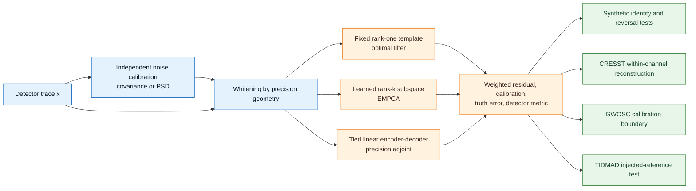
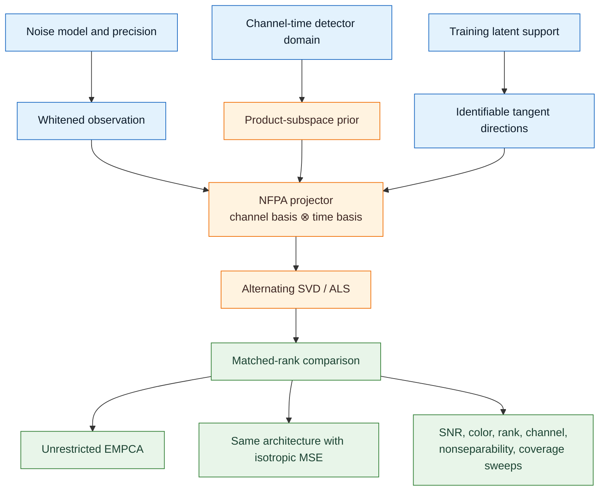
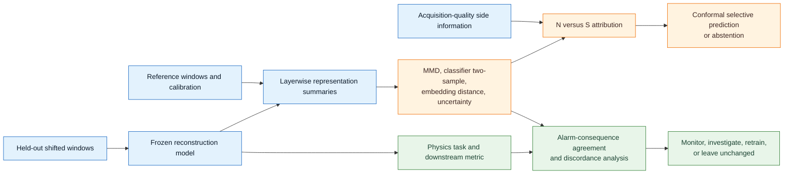
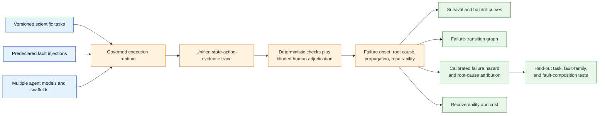
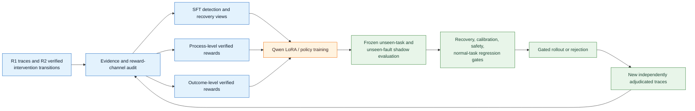
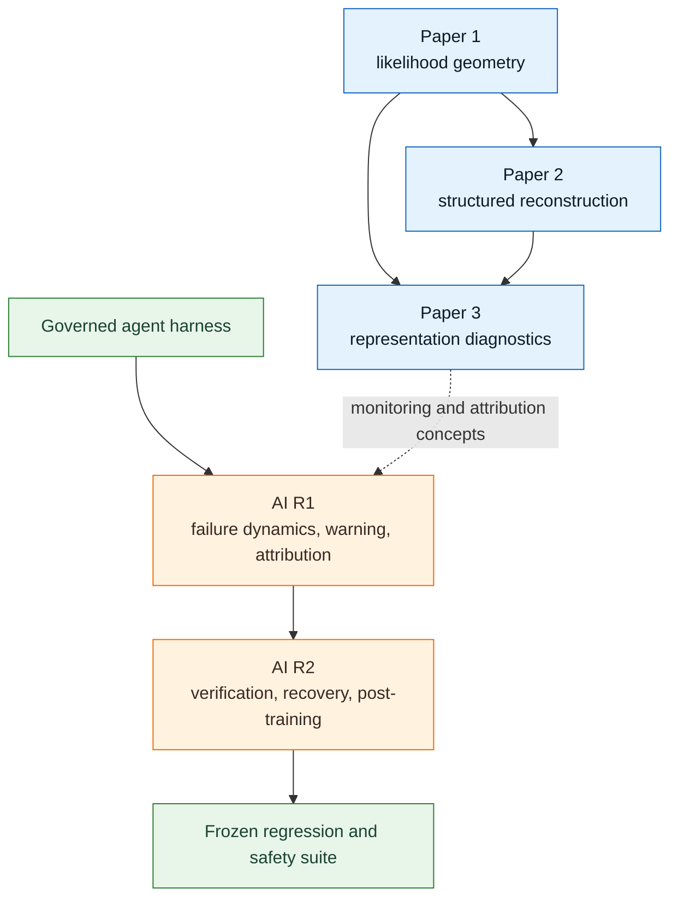

# Publication portfolio evaluation and revision plan

Companion specifications for the agent papers: [workspace map](README.md),
[implementation plan](IMPLEMENTATION_PLAN.md),
[experiment plan](EXPERIMENT_PLAN.md), and
[writing/submission plan](WRITING_AND_SUBMISSION_PLAN.md).

## 🧭 Executive decision

This portfolio contains one near-submission manuscript, two detector-reconstruction projects at different maturity levels, and a revised two-paper scientific-agent program. The merge improves the agent program's coherence, but both projects remain exposed to fast-moving prior art and substantial evidence-generation risk.

The best immediate publication order is:

1. **Finish and submit Paper 1** after repairing two theory statements, eliminating the TIDMAD placeholder, and shortening the story.
2. **Execute Paper 3's confirmatory protocol** while external checkpoint-reproduction questions are being resolved; preserve its mechanism arm as an independent path.
3. **Recast Paper 2 as a focused NFPA/product-subspace paper**, not a 60-page architecture manifesto. Run the missing sweeps and either prove a nontrivial approximation result or make the empirical detector result the center.
4. **Build AI Paper R1 next:** combine the benchmark with calibrated early warning and attribution, and differentiate it around failure dynamics, recoverability, and transfer rather than another taxonomy.
5. **Start AI Paper R2 only after R1 freezes its trace contract and held-out splits:** combine active verification, recovery control, and process-supervised post-training around one unit of evidence—the independently verified intervention transition.

The strongest current artifact is Paper 1. The highest-upside new detector paper is Paper 3. The highest-upside agent paper is R1; R2 has the larger long-term method upside but also the lower realization probability.

## 📊 Evaluation method

### Evidence boundary

The assessment uses four primary source artifacts:

- [Paper 1](../papers/paper1_preprint_arxiv.pdf)
- [Paper 2](../papers/paper2_nonlinear_reconstruction.pdf)
- [Paper 3 proposal](../papers/paper3_proposal.pdf)
- [Two-paper scientific-agent program](10_reliable_scientific_agents_research_program.md)

It also inspects the implementation and evidence directories in this repository and the adjacent `autoresearch_harness` repository referenced by the agent program. External novelty and venue claims are grounded in the dated scan at [publication_plan_literature_and_venue_scan_2026-08-01.md](../sources/publication_plan_literature_and_venue_scan_2026-08-01.md).

### Score dimensions

Each dimension is scored from 1 to 10 in the artifact's **current state**, then combined into a 100-point weighted score.

| Dimension | Weight | What earns a high score |
| --- | ---: | --- |
| Significance | 10% | A consequential scientific or engineering problem |
| Novelty and differentiation | 15% | A literature-visible gap closed on a defensible collision axis |
| Problem–method fit | 10% | The method directly addresses the stated bottleneck |
| Theory or conceptual rigor | 10% | Correct definitions, claims, proofs, and assumptions |
| Experimental solidness | 15% | Adequate controls, power, baselines, and representative data |
| Robustness and falsifiability | 10% | Stress tests, negative results, held-out shifts, and kill criteria |
| Implementation maturity | 10% | Working code and completed evidence, not only scaffolding |
| Reproducibility and auditability | 8% | Frozen configs, provenance, tests, artifacts, and leakage controls |
| Literature positioning | 7% | Direct comparison with the closest work and calibrated novelty claims |
| Writing and scope control | 5% | One clear paper point with proportionate length and structure |

### Probability definitions

- **Idea realization probability** is the probability of producing a defensible submission within roughly 12–18 months with the existing code base, one primary researcher, normal collaborator access, and no major new hardware program.
- **Archival acceptance probability** is a judgmental range conditional on implementing the priority revisions and submitting to the recommended primary venue. It is not a historical venue acceptance rate.
- **Workshop acceptance probability** is conditional on a suitable workshop recurring in the target year and on submitting a complete empirical paper rather than a proposal.

## 🏆 Portfolio scorecard

### Dimension scores

| Project | Sig. | Novelty | Fit | Theory | Experiments | Robustness | Impl. | Reprod. | Positioning | Scope | Overall |
| --- | ---: | ---: | ---: | ---: | ---: | ---: | ---: | ---: | ---: | ---: | ---: |
| Paper 1 — noise covariance geometry | 8.5 | 7.0 | 9.0 | 7.5 | 7.2 | 8.5 | 9.2 | 8.5 | 6.5 | 7.0 | **79/100** |
| Paper 2 — architecture-constrained geometry / NFPA | 8.0 | 6.5 | 7.5 | 6.5 | 3.8 | 4.5 | 6.8 | 6.5 | 5.8 | 5.5 | **61/100** |
| Paper 3 — consequence-aware diagnostics | 8.5 | 7.2 | 8.5 | 6.2 | 3.5 | 8.0 | 5.5 | 6.5 | 6.2 | 7.5 | **66/100** |
| AI R1 — failure dynamics and early warning | 9.0 | 7.2 | 8.7 | 7.0 | 3.2 | 8.5 | 6.5 | 7.5 | 7.0 | 8.5 | **70/100** |
| AI R2 — process-supervised verified recovery | 9.0 | 7.3 | 8.0 | 6.8 | 2.2 | 8.5 | 4.5 | 6.5 | 6.8 | 7.5 | **65/100** |

### Publication decisions

| Project | Realization | Revised archival acceptance | Workshop acceptance | Best primary fit | Paper size | Verdict |
| --- | ---: | ---: | ---: | --- | --- | --- |
| Paper 1 | **95%** | **50–65%** | **70–85%** | JINST; MLST alternative | Full paper, tightly edited | **Advance now** |
| Paper 2 | **75%** if narrowed | **25–40%** | **50–70%** | MLST; JINST or IEEE TSP depending emphasis | Small-to-medium focused methods paper | **Revise scope** |
| Paper 3 | **70%** | **30–45%** | **55–75%** | MLST or JINST | Medium-to-big if both testbeds work | **Advance with gates** |
| AI R1 | **70%** | **30–45%** | **55–75%** | DMLR; KDD Datasets & Benchmarks Cycle 2 alternative | Big benchmark and evaluation paper | **Advance after substrate freeze** |
| AI R2 | **45%** | **25–40%** | **45–65%** | TMLR; COLM/main ML alternative if evidence is strong | Big but algorithmically narrow method paper | **Stage behind R1** |

MLST's scope explicitly includes physics-motivated ML methods, robustness, architectures, benchmark studies, and particle physics.[^mlst] JINST explicitly includes detector algorithms, software, and data-reduction methods.[^jinst] DMLR is the current primary fit for R1 because its submission requirements explicitly cover reusable datasets and benchmarks, documentation, reviewer access, licensing, maintenance, reproducibility, and broader impact.[^dmlr] TMLR is the rolling primary fit for R2 and an R1 alternative when the empirical/methodological result dominates the artifact.[^tmlr]

## 🔬 Paper 1 — Noise covariance defines reconstruction geometry

### Core idea and paper point

The paper's real contribution is not a new estimator in isolation. It is the detector-facing synthesis:

> Under a linear Gaussian measurement model, inverse noise covariance fixes the likelihood geometry; optimal filtering, weighted low-rank reconstruction, and a correctly tied linear autoencoder are constrained or parameterized versions of projection in that geometry.

That paper point is coherent, useful, and well matched to the implementation. The white-noise control, metric-reversal experiment, CRESST study, GWOSC boundary failure, and TIDMAD ground-truth attempt form an unusually honest evidence ladder.

The novelty is **conceptual integration plus detector validation**, not the individual ingredients. Matched filtering, generalized/weighted PCA, linear-autoencoder/PCA equivalence, whitening, and Grassmann optimization are established. The paper should claim that it makes their common likelihood geometry explicit for detector reconstruction and demonstrates where the conditional theory does and does not survive public data.

### Structure and technical stack

### What is already strong

- The repository is real and tested: **277 tests pass** in the project environment. The implementation covers covariance/PSD handling, whitening, OF, PCA/EMPCA, linear autoencoders, CRESST, GWOSC, TIDMAD, negative controls, and validation harnesses.
- The paper distinguishes implementation identity, likelihood calibration, reconstruction quality, and detector sensitivity rather than letting one proxy stand for all four.
- The CRESST analysis has a clean calibration/evaluation split, public data, 19,335 held-out events, negative controls, a same-rank PCA comparison, and a post-freeze channel-aware sensitivity analysis.
- The GWOSC result is reported as a failed calibration hypothesis, not massaged into a success. This materially increases credibility.
- The TIDMAD section reports non-confirmation of the rank prediction and a detector-facing denoising score worse than no denoising. Again, this is scientifically healthy.
- The code-and-data section is unusually specific about commits, seeds, schemas, checksums, and unresolved provenance.

### Revision-critical theory issues

1. **Correct the stationary-point claim.** Appendix C says that, absent degeneracy, all stationary points correspond to the same top-κ eigenspace. That is not true for the PCA/Stiefel objective: invariant subspaces built from non-leading eigenvectors are stationary too, usually as saddles or non-optimal extrema. The valid statement is about global minimizers, while convergence from generic initialization requires a separate argument and conditions.
2. **Repair the ALS re-orthonormalization argument.** Re-orthonormalizing the basis cannot be asserted to preserve or reduce the objective with fixed coefficients unless the corresponding inverse basis transform is applied to the coefficients. State the gauge-preserving update explicitly or formulate the algorithm entirely in whitened projector coordinates.
3. **Downgrade or prove the rate claim.** The stated local rate bound by `λ_(k+1)/λ_k` is plausible for subspace iteration under specific updates but is not established merely by citing generic block-coordinate descent. Either supply a precise theorem with assumptions or label it a heuristic interpretation.
4. **Audit real/complex Gaussian normalization.** The CRB discussion acknowledges factor-of-two convention differences, but the main theorem should use one convention consistently and avoid deriving a model-dependent constant that appears to change between real and proper-complex formulations.

These repairs should be reviewed by a numerical linear algebra or statistical signal-processing collaborator before submission.

### Experimental weaknesses

- The largest CRESST contrast, OF versus rank-6 EMPCA, changes both model capacity and weighting. It demonstrates the signal-model hierarchy more than covariance weighting. The same-rank PCA–EMPCA effect is the direct geometry evidence and should be promoted.
- Seven channels from two runs are not enough for a broad detector-generalization claim. The paper handles this honestly, but the abstract should not make the pooled event count sound like 19,335 independent detector replications.
- The trigger-efficiency result is inconclusive; it should stay out of the contribution list.
- GWOSC covers one interval. It is a valuable boundary example, not a general conclusion about interferometer noise.
- The primary TIDMAD Phase 2 result is still a placeholder, and the two reported files have confidence intervals spanning zero. The manuscript is not submission-ready until the placeholder is removed or the entire primary claim is rewritten around the completed evidence.
- The paper is 52 pages and carries several parallel narratives. The evidence ladder is valuable, but the main text should not read like four papers welded together.

### Recommended new structure

1. Introduction: one page, one claim, one explicit novelty boundary.
2. Likelihood geometry and the projection hierarchy.
3. Bridge theorem with only the proofs needed for the main result.
4. Controlled validation: identities, white-noise control, metric reversal.
5. Public detector evidence: lead with same-rank CRESST; use OF comparison as capacity context.
6. Model adequacy and truth boundary: compact GWOSC/TIDMAD section.
7. Limitations and decision rule: geometry is conditional on a calibrated covariance model.
8. Appendices: algorithms, conventions, full controls, provenance, withdrawn legacy evidence.

Move detailed OF derivations, the long symbol table, most symmetry exposition, and full data-contract prose to appendices or a companion repository document.

### Priority revisions

**Must do before submission**

- Remove the TIDMAD placeholder; synchronize the run artifact or narrow the claim.
- Correct the stationary-point, ALS, and convergence-rate statements.
- Rewrite the abstract so the same-rank CRESST result is the evidence for weighting and OF–EMPCA is the evidence for model capacity.
- Add a closest-work table covering generalized PCA, noisy/heteroskedastic PCA, linear autoencoders, and detector optimal filtering.
- Reduce the main narrative by roughly one third.
- Run a clean artifact audit from a fresh environment and provide a single reproducibility entry point.

**High value**

- Add one untouched CRESST-like acquisition or an additional detector release if this can be done without post hoc tuning.
- Report covariance-estimation sensitivity and shrinkage choice more prominently.
- Ask a statistical-signal-processing expert to review the bridge theorem's novelty language.

### Venue and size decision

**Best fit:** JINST regular article, with MLST as the cross-disciplinary alternative. IEEE Transactions on Signal Processing is possible only after much tighter theory/novelty positioning and a more signal-processing-centered empirical design; its scope emphasizes original and significant signal-processing theory, algorithms, and performance analysis.[^tsp]

**Size:** one full paper, not a collection of small papers. However, it should be a **tight full paper**, not a maximal compendium. The negative and boundary results strengthen the central claim when compactly organized.

**Verdict:** advance now.

## 🧩 Paper 2 — Architecture-constrained likelihood geometry and NFPA

### Core idea and paper point

The draft tries to make three contributions at once:

1. a framework tuple `(precision geometry, architecture class, training coverage)`;
2. NFPA, a Kronecker-constrained channel–time projection model;
3. a roadmap for VAEs, ResNets, U-Nets, Transformers, coverage correction, and detector design.

Only the NFPA case study is currently a completed research object. The framework is useful language, but the paper becomes diffuse because most nonlinear sections are proposals or external illustrations. The strongest publishable point is narrower:

> A covariance-aware product-subspace model trades unrestricted likelihood-optimal rank-k reconstruction for interpretable channel–time factorization; quantify exactly when that prior helps, what approximation error it creates, and how the result changes under noise and coverage mismatch.

### Structure and technical stack

### What is already strong

- The draft clearly separates likelihood geometry, admissible model class, and training coverage. This is a useful corrective to vague claims that architecture alone “learns the physics.”
- NFPA's gauge-safe projector interpretation is clear.
- The paper does not claim unrestricted equivalence to EMPCA and explicitly reports large non-leading principal angles.
- The repository includes an NFPA demo, metric and coverage ablation notebooks, explicit configs, tables, and a broader Paper 2 scaffold.
- The draft admits that its current synthetic setting is single-seed, two-channel, and extremely high SNR, and it lists the missing sweeps.

### Novelty collision

Kronecker/product subspaces, multilinear PCA, Tucker models, and two-dimensional PCA are established. NFPA is best positioned as a **whitened or likelihood-aware Tucker-2 model for detector reconstruction**, not as a fundamentally new tensor factorization. The restricted bridge theorem, as currently stated, is essentially the observation that ordinary PCA restricted to Kronecker projectors solves ordinary PCA over that restricted set. It is correct but too close to a definitional equivalence to carry a large theory paper by itself.

The paper needs at least one stronger differentiator:

- a nontrivial approximation or statistical guarantee;
- a detector-specific method for nonseparable covariance that preserves interpretable factors;
- a convincing real-data advantage under parameter-matched baselines; or
- a coverage-identifiability theorem and experiment that changes detector simulation practice.

### Revision-critical technical issue

The draft says the separability prior on `U_c, U_t` is independent of whether the covariance is separable, while NFPA acts on the fully whitened vector reshaped into channel–time form. Under an arbitrary dense covariance, whitening can mix channel and time coordinates. A Kronecker subspace in the whitened coordinates need not correspond to a physically separable channel–time signal subspace in native detector coordinates.

The paper must choose and state one of these models:

1. **Separable or block-temporal covariance:** whitening preserves the product domain; the current channel–time interpretation is valid.
2. **Whitened-coordinate product prior:** the model is separable only after a declared whitening map; interpretability is noise-model-dependent.
3. **Native-coordinate product decoder with Mahalanobis loss:** impose separability before whitening and optimize the full weighted objective directly. This is harder but preserves the physical prior under general covariance.

At present, the text shifts between these interpretations.

### Experimental weaknesses

- The manuscript's principal result uses one seed, one split, two channels, and SNR near 914. This is a software demonstration, not scientific validation.
- The likelihood-aligned differences are sub-percent and not statistically resolved.
- Raw MSE values are printed below display precision and need exact export.
- NFPA's mean principal angle to EMPCA is about 61.7 degrees in the manuscript's experiment, so the product prior is strongly active. Capturing one dominant direction is not equivalent to recovering the full likelihood subspace.
- The repository contains newer synthetic tables, but the paper does not integrate their provenance, uncertainty, or relation to the frozen manuscript. These should not be silently substituted for the stated experiment.
- The VAE and Transformer sections consume substantial space without empirical results. They make the paper look larger while weakening the completed claim.

### Recommended new structure

1. Problem: covariance-aware channel–time reconstruction under a product-subspace prior.
2. Model: native versus whitened separability; choose one generality level.
3. Theory: restricted optimum, rank-one limit, identifiability, and a real approximation/statistical result if obtainable.
4. Optimization: ALS with initialization, convergence diagnostics, and complexity.
5. Controlled experiments: matched rank, matched parameter count, matched metric.
6. Real detector experiment or realistic public simulator.
7. Limitations: nonseparability, covariance mismatch, coverage, and local optima.

Move the VAE, Transformer, U-Net, geometric-deep-learning taxonomy, and external Xenon case study to a short “extensions” section or a separate perspective document.

### Required implementation program

- At least 20 independent seeds for the core synthetic matrix.
- SNR sweep spanning a regime where amplitude recovery is nontrivial.
- White, pink, Brownian, and measured/realistic PSD conditions.
- Channel counts 2, 4, 8, and 16 with compute and memory scaling.
- Matched total rank and matched parameter-count comparisons against EMPCA, Tucker/MPCA, and a native-coordinate weighted Tucker baseline.
- Controlled nonseparability severity with a known oracle approximation error.
- Covariance mismatch and covariance-estimation sample-size sweeps.
- Coverage ablations with held-out latent axes and a predeclared generalization gap.
- One public detector or high-fidelity public simulation where channel–time factorization is scientifically motivated.

### Priority revisions

**Must do**

- Resolve native versus whitened separability.
- Remove untested nonlinear architectures from the contribution list.
- Run the declared NFPA sweeps with uncertainty.
- Add classical Tucker/MPCA and weighted native-coordinate baselines.
- Either prove a meaningful approximation/stability result or recenter the paper on a strong real-data finding.
- Reduce the paper from 60 pages to a focused methods manuscript.

**Kill criterion**

If NFPA does not improve a predeclared likelihood, sample-efficiency, interpretability, or compute metric against matched classical tensor baselines on a realistic detector task, do not publish it as a standalone “new architecture.” Fold it into Paper 1's extensions or release it as a technical note.

### Venue and size decision

**Best fit:** MLST for a physics-motivated methods paper; JINST if the contribution is primarily detector reconstruction; IEEE TSP only if the approximation/statistical theory becomes the main result.

**Size:** **small-to-medium focused paper**. The current big-paper form is not justified by completed evidence. A big paper becomes defensible only after a real detector result plus a nontrivial theorem and coverage experiments.

**Verdict:** revise scope before investing in prose.

## 📡 Paper 3 — Consequence-aware failure diagnostics

### Core idea and paper point

Paper 3 asks a strong operational question:

> Can a frozen learned reconstruction representation distinguish acquisition/noise failures from physically valid but under-supported signal variation, abstain on ambiguous cases, and predict when a representation alarm has downstream scientific consequence?

This is better than generic OOD detection because it distinguishes the **source of shift** and separately tests **scientific consequence**. Recent work explicitly warns that feature distance and classifier uncertainty may answer the wrong question for OOD detection, which strengthens the need for Paper 3's declared failure contracts.[^wrongquestion2025]

### Structure and technical stack

### What is already strong

- Failure families are frozen before evaluation: acquisition/noise shift `N`, training-support shift `S`, and deterministic evaluation-contract failures `E` handled by gates rather than a learned classifier.
- Claims are operationalized with explicit false-positive rates, power margins, selective coverage, attribution effects, latency, storage, and downstream consequence metrics.
- The waveform mechanism arm has assumed and realized covariance, making covariance mismatch a controlled intervention rather than a guessed explanation.
- The realistic NuBench arm uses a frozen public representation and a physically meaningful perturbation.
- The proposal explicitly allows informative negative outcomes, especially disagreement between representation alarms and scientific consequence.
- Preliminary feasibility work is real: the released 2,989,339 predictions were rescored; a 256-event module-dropout pilot shows monotonic degradation in angular error, embedding displacement, and neighbor retention.

### Current blockers

- The released prediction metrics differ from the paper by up to 0.055 degrees or 0.051 percentage point and fail the deliberately strict identity gate.
- Checkpoint re-inference differs from released predictions by a median 0.944 degrees, with a 95th percentile of 7.708 degrees. The current pipeline therefore cannot support confirmatory claims about the frozen representation.
- The pilot sample is enriched for high module multiplicity and is not representative of the released test population.
- The implementation currently demonstrates sensitivity, not N-versus-S attribution, abstention calibration, monitoring cost, or consequence validity.

These are correctly documented as feasibility results.

### Novelty and collision risk

Internal-representation anomaly detection, layerwise OOD aggregation, classifier two-sample testing, MMD, conformal abstention, and uncertainty are existing tools.[^raghuram2021] [^splitting2025] The novelty cannot be “we monitor hidden layers.”

The defensible paper point is the composition:

- declared scientific failure contracts;
- causal or intervention-backed separation of acquisition failure from valid physics variation;
- selective attribution with held-out failure families;
- resource-bounded monitoring; and
- direct comparison of representation alarms with downstream scientific loss.

The paper should add an explicit identifiability statement: without acquisition side information, paired interventions, or restrictions on the shift families, `N` and `S` may be observationally indistinguishable in representation space. This is not a nuisance; it is the conceptual reason the method uses side information and abstention.

### Experimental design revisions

- Replace one universal “80% power at 1% FPR” target with power-versus-severity curves and a small number of predeclared operating points.
- Hold out entire **shift mechanisms**, not only magnitudes, to test attribution generalization.
- Separate event-level sample size from independent shift episodes; bootstrap and confidence intervals must resample at the acquisition or episode level where appropriate.
- Add strong generic baselines: output-only monitoring, input-only monitoring, all-layer pooled features, energy/score baselines, and a domain-classifier oracle.
- Include a “no attribution possible” mixture where N and S are deliberately matched in observed representation distance. A well-calibrated abstention increase is the desired result.
- Guard against label leakage from perturbation severity, event multiplicity, file identity, and preprocessing metadata.
- Predeclare how multiple layers, metrics, windows, severities, and failure families are corrected for multiplicity.
- Make C4 primary only if the downstream task has enough statistical power. Otherwise make it a paper-defining secondary analysis, not an overloaded confirmatory claim.

### Recommended paper structure

1. Scientific monitoring problem and declared failure contracts.
2. Identifiability boundary and why side information/abstention are necessary.
3. Frozen-model monitoring method and resource budget.
4. Mechanism testbed with controlled covariance interventions.
5. Realistic point-cloud testbed with held-out physical failures.
6. Consequence agreement and discordance.
7. Limits, deployment decision policy, and negative results.

### Priority revisions

**Must do**

- Resolve NuBench inference provenance or define a predeclared backend-tolerance policy with author confirmation.
- Implement the complete N/S attribution and selective-abstention baseline matrix.
- Freeze independent failure-family and severity splits before confirmatory runs.
- Write the identifiability boundary as a proposition or formal design assumption.
- Choose one primary scientific endpoint for C4.

**Fallback path**

If exact NuBench checkpoint reproduction remains blocked, the waveform arm can still support a smaller mechanism paper, while the real-data arm becomes a preregistered follow-up. Do not weaken the gate post hoc merely to preserve the two-testbed story.

### Venue and size decision

**Best fit:** MLST if the methodological and cross-domain monitoring contribution is central; JINST if the point-cloud detector case and operational monitoring dominate. A NeurIPS or ICML AI4Science workshop is a good de-risking venue, subject to the actual future call.

**Size:** **medium-to-big paper** if both testbeds and the consequence claim work. If only the waveform mechanism is complete, publish a smaller methods paper or workshop paper.

**Verdict:** advance, but keep the gates.

## 📉 AI Paper R1 — Failure dynamics and calibrated early warning

### Core idea and paper point

The revised paper merges the original benchmark with the strongest defensible part of the original diagnosis proposal. Its question is:

> How do failures emerge, propagate, remain detectable, and become recoverable across long-horizon scientific-agent trajectories—and can a calibrated model warn early and attribute the causal fault on held-out tasks and fault structures?

This is stronger than the old A1 because the benchmark now has a predictive thesis, not only a descriptive one. Detection and attribution remain deliberately modest baselines; learned recovery belongs to R2.

### Structure and technical stack

### Existing substrate

The adjacent `autoresearch_harness` is substantial: it has a governed control plane, bounded workers, typed lifecycle events, append-only ledgers, memory modes, six reported ML nodes, and 1,355 governed trials in its current KDD-facing paper. This makes R1 more feasible than the proposal checklist alone suggests.

The revised program removes the stale `hybrid_agent/`, `evals/`, `memory_lab/`, and `post_training/` links and maps planned capabilities to the real adjacent harness. A prior test run there completed 197 tests with **five failures and one import error**: some are environment or sandbox related, but there are also a deterministic worker failure and four missing paper figures. This is a viable research substrate, not yet the frozen benchmark artifact R1 requires.

### Direct prior-art collisions

MAST-Data already contains more than 1,600 annotated multi-agent traces and a failure taxonomy; AgentRx already provides critical-step localization and root-cause categories; Aegis already combines an agent-environment taxonomy with targeted interventions.[^mast2025] [^agentrx2026] [^aegis2025] Scientific-agent benchmarks such as MLR-Bench and SciAgentArena further reduce the novelty of “scientific tasks plus traces.”[^mlrbench2025] [^sciagentarena2026]

Therefore R1 must not claim novelty from:

- introducing a taxonomy;
- collecting agent trajectories;
- using scientific tasks;
- adding fault injection; or
- reporting final success rate.

Its differentiated contribution must be **failure dynamics under governed interventions plus calibrated pre-terminal warning, causal attribution, and transfer to unseen fault structures**.

### Required empirical contribution

At least one non-obvious, replicated law should survive model, task, and scaffold changes. Examples of valid targets include:

- a hazard phase transition as unresolved state divergence accumulates;
- a small set of transition motifs that explain most catastrophic failures;
- an early-warning signal whose calibration transfers across task families;
- a recoverability window that closes predictably after evidence corruption; or
- an interaction showing that additional autonomy improves short-horizon success but worsens long-horizon failure propagation.

The law must be predeclared after an exploratory phase and confirmed on frozen held-out task and fault families.

### Design revisions

- Collapse the broad taxonomy into a small causal fault model plus descriptive labels. Root cause, manifestation, and downstream consequence should be separate fields.
- Use a factorial design crossing task family, model, scaffold, horizon, and fault family. Do not let each model see a different workload mix.
- Freeze fault-family and task-family splits before collecting the confirmatory test set.
- Report inter-annotator agreement for onset, root cause, and recoverability separately.
- Treat repeated trajectories within one task as clustered observations.
- Predefine censoring for runs that time out or are stopped by policy.
- Include no-fault negative controls and benign perturbations that should not trigger failures.
- Audit benchmark leakage and model exposure to public task solutions.
- Release the executable environment, trace schema, adjudicators, dataset metadata, and a minimal inspectable sample. For DMLR, provide reviewer access, documentation, licensing authority, a maintenance plan, reproducible code and evaluation procedures, and a broader-impact statement.[^dmlr]

The merged warning baseline should predict both time-varying terminal-failure hazard and a distribution over causal fault families. Compare terminal checks, runtime rules, agent self-confidence, a text-only critic, typed histories without state differences, and the full execution-grounded history. The primary result should report lead time at a fixed false-alert budget, calibration, selective risk, and transfer to held-out task families, fault families, and fault compositions. Do not let a large neural architecture become a second paper point.

### Recommended paper structure

1. Measurement gap: final success hides failure onset, propagation, and recoverability.
2. Benchmark contract: tasks, faults, trace schema, adjudication, leakage controls.
3. Measurement model: survival, hazard, transition, calibration, and cost.
4. Confirmatory failure-dynamics results across models and task families.
5. Calibrated warning and attribution baselines on frozen transfer splits.
6. Non-obvious failure law, recoverability model, and falsification tests.
7. Benchmark limitations and intended use.

### Venue and size decision

**Best fit:** DMLR. KDD Datasets & Benchmarks Cycle 2 is the deadline-based alternative; TMLR becomes preferable if the transferable failure law and warning method dominate the reusable artifact. A reliable-agents, AI4Science, or agent-evaluation workshop can serve as a non-archival pilot, but the benchmark needs an archival destination.[^dmlr][^tmlr]

**Size:** **big benchmark and evaluations paper**. The predictive baseline makes the package materially stronger, but a small paper containing only a taxonomy, traces, and in-domain detection will still be crowded out.

**Verdict:** advance after freezing the substrate. The merge raises the current proposal score from the old A1's 64/100 to **70/100**, mainly through better problem–method fit, falsifiability, positioning, and scope.

## 🔍 AI Paper R2 — Process-supervised verified recovery

### Core idea and paper point

R2 merges the original A2 recovery proposal with the original A3 post-training proposal around one shared scientific unit: an independently verified intervention transition. R1 supplies calibrated risk and cause beliefs; R2 decides whether to buy evidence or intervene, adjudicates the result, and tests whether process-level training learns that behavior.

The focused paper point is:

> Given a calibrated belief over agent failure causes, learn which verification or recovery action to take and whether process supervision from independently adjudicated transitions improves unseen-fault recovery at matched cost without degrading clean-task behavior.

Detection and attribution are frozen R1 inputs, not co-equal R2 contributions. R2's two linked claims are cost-sensitive intervention and the incremental value of process-supervised learning over recovery SFT and outcome-only training.

### Structure and technical stack

```mermaid
flowchart LR
    accTitle: AI Paper R2 verified-recovery learning loop
    accDescr: Frozen R1 beliefs feed a cost-sensitive intervention policy whose independently adjudicated transitions provide process supervision under frozen transfer and regression gates.

    trace["Frozen R1 trace contract"] --> belief["Calibrated failure hazard<br/>and root-cause belief"]
    belief --> voi["Value-of-information policy"]
    tests["Available verification actions<br/>with cost and latency"] --> voi
    voi --> verify["Selected active verification"]
    verify --> control["Posterior update, retry, repair,<br/>rollback, escalate, or abstain"]
    control --> outcome["Independent execution and<br/>scientific adjudication"]
    outcome --> transitions["Verified intervention transitions"]
    transitions --> training["Recovery SFT and one<br/>process-supervised objective"]
    training --> metrics["Unseen-fault recovery, risk,<br/>cost, and clean-task regression"]

    classDef evidence fill:#e3f2fd,stroke:#1565c0,color:#0d1b2a
    classDef decision fill:#fff3e0,stroke:#ef6c00,color:#3e2723
    classDef outcome_style fill:#e8f5e9,stroke:#2e7d32,color:#1b4332
    class trace,belief,tests,transitions evidence
    class voi,verify,control,training decision
    class outcome,metrics outcome_style
```

### What is promising

- The proposal uses explicit observables rather than relying on hidden chain-of-thought.
- It treats verification as an action with cost, not as an unlimited oracle.
- It includes uncertainty, calibration, abstention, unseen faults, and scientific shift.
- It separates the runtime from the research claim.
- The POMDP/value-of-information framing matches the sequential decision problem.
- It can compare recovery SFT, outcome-only learning, and process supervision on the same adjudicated transitions.
- The revised program declares clean-task regression and independent evaluation gates before training.

### Main risks

- AgentRx already targets critical-step localization and failure attribution from trajectories, so R2 cannot lead with “we diagnose agent failures.”[^agentrx2026]
- Aegis already uses failure analysis to design interventions, so “taxonomy-guided recovery” is also insufficient.[^aegis2025]
- A verifier selector, recovery controller, adjudication system, and training objective still create scope risk; the merge works only if one verified-intervention contract connects them.
- Ordinary calibration metrics may fail under adaptive verification because the policy changes which examples receive labels and which trajectories continue.
- Root-cause labels may be non-identifiable when several failures co-occur or one upstream fault causes many downstream manifestations.
- A learned controller can exploit verifier weaknesses unless evaluation uses an independent, versioned adjudication channel.
- Process labels can encode the initial controller's biases, and reward optimization can teach verifier exploitation rather than scientific recovery.
- The second paper remains compute- and data-intensive because rare, high-impact faults need credible alternatives and independent outcomes.

### Scope control

Make **verified intervention under calibrated beliefs** the method centerpiece and **process supervision versus outcome-only training** the principal learning comparison. Use R1's detector and attributor as frozen inputs. For online control, compare:

- always verify;
- never verify;
- fixed terminal verification;
- threshold on failure probability;
- random verification at matched cost;
- myopic expected-value verification;
- learned policy;
- oracle with true fault labels.

The outcome should be a Pareto frontier over verified success, scientific risk, latency, compute, human intervention, and false recovery. Report regret to the oracle and performance on unseen fault compositions. For learning, begin with one open model, recovery SFT, and one process-supervised optimization method; treat DPO, multiple RL algorithms, and distributed training as optional extensions.

### Required theory and statistics

- Define the belief state, action space, observation model, and utility in a way that can be audited from traces.
- State when the active verifier is allowed to observe ground truth and prevent label leakage into the policy.
- Use calibration under policy shift or off-policy evaluation; do not assume exchangeable held-out examples after adaptive sampling.
- Include selective-risk and risk–coverage curves rather than one abstention threshold.
- Distinguish epistemic uncertainty about root cause from aleatoric ambiguity caused by observationally equivalent faults.
- Predeclare a safe baseline that the learned controller must dominate before any shadow deployment.

### Recommended paper structure

1. Decision problem and failure of fixed verification.
2. Frozen R1 belief and trace contract.
3. Cost-sensitive verification and recovery policy.
4. Independent adjudication and verified-intervention dataset.
5. Recovery SFT and one process-supervised objective.
6. Matched-cost unseen-fault and clean-task evaluation.
7. Calibration, reward audit, safety, and failure analysis.

### Controller component and progression gate

The controller can be developed before training, but it should not become a separate archival paper unless the post-training hypothesis fails and the controller plus intervention dataset are independently substantial. A workshop submission is appropriate for validating the action space, cost model, and adjudication protocol.

Progress to full post-training only if a simple learned or value-of-information controller beats fixed, random, and confidence-threshold policies at matched cost on held-out faults.

**Dependency verdict:** begin only after R1 freezes the data contract, labels, and transfer splits.

### Process-supervised post-training component

#### Core idea and paper point

The learning component converts R1 traces and R2's independently adjudicated intervention transitions into recovery-SFT, process-supervision, and outcome-only views, then trains a small open model to verify, recover, and abstain under execution and scientific uncertainty.

The strongest claim would be:

> Process-level training on independently verified recovery transitions improves unseen-fault recovery and calibrated abstention beyond outcome-only post-training, without degrading normal-task performance.

That is a real research question. It is also expensive and dependent on R1 plus a successful R2 controller pilot.

#### Structure and technical stack

#### What is promising

- The proposal insists on independent reward channels and final adjudication.
- It includes normal-task regression gates, abstention, and unseen fault composition.
- It compares process and outcome supervision rather than assuming process rewards are better.
- A small Qwen LoRA implementation makes compute more feasible than full-model training.
- The versioned training views create an auditable bridge from benchmark evidence to learning.

#### Collision and differentiation

Execution-feedback post-training, self-verification, trajectory-level objectives, and verifier-guided repair are already active. CAPF is close because it converts zero-reward failures into verifier-guided repair trajectories; Afterburner already compares SFT, DPO, and GRPO under execution feedback.[^capf2026] [^afterburner2025]

R2's novelty therefore must come from the **scientific-agent reliability target, calibrated intervention policy, and independent evidence contract**, not from using SFT/RLVR or collecting repair trajectories.

The crucial differentiators are:

- root-cause-aware recovery rather than generic answer revision;
- selective verification and calibrated abstention;
- process rewards sourced from independent state differences and scientific adjudicators;
- transfer to unseen fault composition and new scientific task families; and
- explicit normal-task and safety regression gates.

#### Dependency and feasibility risks

- R2 needs enough high-quality failures, recoveries, and counterfactual alternatives from R1 and its controller pilot. Rare but important faults will be underrepresented.
- Process labels can encode the current controller's biases and prevent learning better recovery strategies.
- The policy may learn to satisfy the verifier rather than repair the scientific task.
- Off-policy/stale trajectories and changing runtimes can invalidate reward semantics.
- Multi-objective reward weighting can hide regressions behind an aggregate score.
- Multiple training views do not create independent experiments; the core causal comparison must be predeclared.

#### Minimal publishable experiment

Start with one open model, one governed runtime, two task families, and three fault families. Compare:

1. base model;
2. SFT on successful trajectories;
3. SFT on detection and recovery transitions;
4. outcome-only RLVR;
5. process-level verified reward;
6. process-level reward plus calibrated abstention.

Freeze an unseen task family and an unseen fault-composition split. Primary endpoints should be verified recovery success, false intervention on clean tasks, selective risk, and normal-task regression. Only expand to DPO and broader curricula after this matrix is stable.

#### Required safeguards

- Independent verifier versions for training and final evaluation.
- Reward-channel ablations and adversarial reward-hacking tests.
- Duplicate and near-duplicate trajectory controls.
- Task/fault/model split isolation.
- Fixed clean-task regression suite.
- Human-review sampling for apparent high-reward recoveries.
- Rollback criteria and shadow-only deployment until all gates pass.
- A cost report covering rollout generation, verification, and training.

#### Venue and size decision

**Best fit:** TMLR is the primary rolling fit; COLM, ICLR, ICML, or NeurIPS become plausible deadline-based alternatives if the process-versus-outcome result generalizes across models, tasks, and unseen fault structures.[^tmlr] COLM's scope explicitly includes post-training and training data for language models.[^colm] A future workshop in the Lifelong Agents/agent-learning family is a good early target; the 2026 workshop explicitly welcomed agent post-training, agentic RL, and agents for science, but recurrence is not guaranteed.[^lifelong]

**Size:** **big but algorithmically narrow method paper**, not a small incremental training note and not a catalogue of post-training algorithms. Its acceptance depends on a frozen R1 artifact, matched-cost control baselines, process-level transfer, and regression safety.

**Verdict:** stage behind R1. The merge raises the proposal to **65/100** through a clearer evidence contract and stronger robustness plan, but realization remains approximately **45%** because the controlled interventions, adjudication, and training evidence do not yet exist.

## 🔗 Portfolio-level architecture and dependency plan

The detector papers and agent papers form two separate research arcs. Each arc should share infrastructure without allowing shared infrastructure to become the paper claim.

### Shared rules

- Every paper needs one primary claim, one primary endpoint, and one frozen confirmatory split.
- Infrastructure, dashboards, and broad taxonomies are supporting artifacts unless they enable a new measured scientific result.
- Negative results should be retained when the test was predeclared and informative.
- A result on a proxy metric must not be upgraded into a detector-sensitivity, scientific-validity, or agent-safety claim without a direct endpoint.
- Multiple events from one channel, file, task, or fault episode are not independent replications.
- All future proposals should include a collision table with problem framing, mechanism, key insight, and application axes.

## 🗓️ Recommended 18-month sequence

### Months 0–3

- Repair Paper 1 theory and remove the TIDMAD placeholder.
- Run a clean Paper 1 artifact build and submit to JINST or MLST.
- Contact NuBench/GraphNeT authors and freeze Paper 3's inference-provenance decision.
- Reframe Paper 2 around native versus whitened separability and design the full sweep matrix.
- Replace stale agent-program module links with the actual governed-harness layout.

### Months 3–6

- Execute Paper 3 mechanism confirmatory runs and finish N/S attribution baselines.
- Run Paper 2 SNR, covariance, rank, nonseparability, and seed sweeps.
- Freeze R1's trace schema, fault causal model, workload ladder, warning endpoints, and held-out splits.
- Pilot R1 on two models and two task families; use only for power calculations, label-book revision, and instrument repair.

### Months 6–9

- Decide Paper 2 using its kill criterion; write only if the matched-baseline result is positive or theoretically informative.
- Execute Paper 3 real testbed if the reproduction gate is resolved; otherwise publish the mechanism-scale version or continue as a registered follow-up.
- Collect R1 confirmatory traces and run blinded adjudication.

### Months 9–12

- Submit Paper 2 or Paper 3, whichever reaches its evidence gate first.
- Analyze R1 failure dynamics and test the preregistered failure law plus calibrated warning on held-out tasks and faults.
- Build R2's fixed, random, threshold, and oracle intervention baselines on frozen R1 training/development traces.

### Months 12–18

- Submit R1 to DMLR; use KDD Datasets & Benchmarks Cycle 2 if its cycle aligns with artifact readiness, or TMLR if the transferable empirical law dominates.
- Run R2's cost-sensitive verification and recovery study, then freeze independently adjudicated intervention transitions.
- Run R2's six-arm training matrix only after the controller beats matched-cost baselines and the clean-task regression suite is frozen.

## ✅ Final recommendations by paper

| Paper | One-sentence recommendation |
| --- | --- |
| Paper 1 | Submit first after theory correction, placeholder removal, and substantial compression. |
| Paper 2 | Turn it into a focused covariance-aware product-subspace paper; remove the untested architecture survey. |
| Paper 3 | Preserve the strong preregistered design, formalize identifiability, and do not relax the NuBench gate post hoc. |
| AI R1 | Publish a large benchmark around failure dynamics, calibrated early warning, causal attribution, and recoverability—not taxonomy or “scientific tasks” alone. |
| AI R2 | Use one verified-intervention contract to connect cost-sensitive verification, recovery, and process supervision; prove unseen-fault value without clean-task regression. |

[^mlst]: IOP Publishing, “About Machine Learning: Science and Technology,” current scope and article types. https://publishingsupport.iopscience.iop.org/journals/machine-learning-science-and-technology/about-machine-learning-science-technology/
[^jinst]: Journal of Instrumentation, “About JINST,” current scope and editorial policy. https://jinst.sissa.it/jinst/help/JINST/JINST_about.jsp
[^tsp]: IEEE Signal Processing Society, “IEEE Transactions on Signal Processing,” current scope. https://signalprocessingsociety.org/publications-resources/ieee-transactions-signal-processing
[^neuripsed]: NeurIPS 2026, “Call for Evaluations & Datasets.” https://neurips.cc/Conferences/2026/CallForEvaluationsDatasets
[^dmlr]: Data-centric Machine Learning Research, “Submission.” https://data.mlr.press/submissions.html
[^tmlr]: Transactions on Machine Learning Research, “TMLR guidelines for authors.” https://www.jmlr.org/tmlr/author-guide.html
[^wrongquestion2025]: Y. L. Li et al., “Position: Supervised Classifiers Answer the Wrong Questions for OOD Detection,” ICML 2025. https://proceedings.mlr.press/v267/li25ec.html
[^raghuram2021]: J. Raghuram et al., “A General Framework for Detecting Anomalous Inputs to DNN Classifiers,” ICML 2021. https://proceedings.mlr.press/v139/raghuram21a.html
[^splitting2025]: J. Zhang et al., “Splitting & Integrating: Out-of-Distribution Detection via Adversarial Gradient Attribution,” ICML 2025. https://proceedings.mlr.press/v267/zhang25by.html
[^mast2025]: M. Cemri et al., “Why Do Multi-Agent LLM Systems Fail?” NeurIPS 2025 Evaluations and Datasets. https://proceedings.neurips.cc/paper_files/paper/2025/hash/b1041e52d3be19f0a9bc491657488e4a-Abstract-Datasets_and_Benchmarks_Track.html
[^agentrx2026]: S. Barke et al., “AgentRx: Diagnosing AI Agent Failures from Execution Trajectories,” arXiv:2602.02475. https://arxiv.org/abs/2602.02475
[^aegis2025]: K. Song et al., “Aegis: Taxonomy and Optimizations for Overcoming Agent-Environment Failures in LLM Agents,” arXiv:2508.19504. https://arxiv.org/abs/2508.19504
[^mlrbench2025]: “MLR-Bench: Evaluating AI Agents on Open-Ended Machine Learning Research,” NeurIPS 2025 Evaluations and Datasets. https://proceedings.neurips.cc/paper_files/paper/2025/hash/ab8dd000d6f87f40061a73f8bca7fae4-Abstract-Datasets_and_Benchmarks_Track.html
[^sciagentarena2026]: T. Liu et al., “Benchmarking AI Agents for Addressing Scientific Challenges Across Scales,” arXiv:2606.12736. https://arxiv.org/abs/2606.12736
[^capf2026]: B. Chen et al., “CAPF: Guiding Search-Agent Rollouts with Credit-Attenuated Privileged Feedback,” arXiv:2606.01830. https://arxiv.org/abs/2606.01830
[^afterburner2025]: M. Du et al., “Afterburner: Reinforcement Learning Facilitates Self-Improving Code Efficiency Optimization,” NeurIPS 2025. https://proceedings.neurips.cc/paper_files/paper/2025/hash/0d1d415fb1a14ba3bb56b831d1eecbe7-Abstract-Conference.html
[^colm]: COLM 2026, “Call for Papers.” https://colmweb.org/cfp.html
[^lifelong]: COLM 2026 Workshop on Lifelong Agents, “Call for Papers.” https://lifelongagent.github.io/
