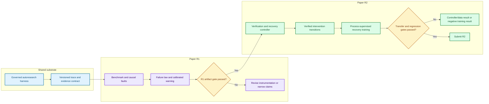

# Reliable scientific agents: Paper R1 and R2 workspace

_Program workspace · initialized 2026-08-01_

This folder converts the reliable-scientific-agents research direction into an
executable two-paper program. Paper R1 establishes the measurement artifact and
calibrated early-warning evidence. Paper R2 consumes the frozen R1 contract to
study cost-sensitive verification, verified recovery, and process-supervised
learning.

## 🧭 Document map

| Artifact | Purpose |
| --- | --- |
| [Research program](10_reliable_scientific_agents_research_program.md) | Scientific thesis, paper boundary, hypotheses, novelty boundary, and high-level gates |
| [Publication evaluation](PUBLICATION_PLAN_EVALUATION.md) | Portfolio scores, feasibility, acceptance estimates, venue choices, and sequencing |
| [Implementation plan](IMPLEMENTATION_PLAN.md) | System architecture, interfaces, phases, ownership, test strategy, resources, risks, and exit criteria |
| [Experiment plan](EXPERIMENT_PLAN.md) | Experimental units, designs, baselines, endpoints, analysis models, evidence matrix, and success thresholds |
| [Writing and submission plan](WRITING_AND_SUBMISSION_PLAN.md) | Manuscript narratives, section contracts, figure/table plans, venue compliance, and submission checklists |
| [R1 DMLR LaTeX project](latex/r1_dmlr/README.md) | Journal-formatted manuscript scaffold for the benchmark and evaluation paper |
| [R2 TMLR LaTeX project](latex/r2_tmlr/README.md) | Journal-formatted manuscript scaffold for the verified-recovery method paper |
| [Protocols](protocols/) | Machine-readable R1/R2 protocols, terminology, endpoint registry, claim–artifact matrix |
| [Scripts](scripts/) | Protocol validator, design generator, and project readiness command |
| [Archive](archive/) | Superseded planning and prompt documents retained for provenance |
| [Venue alternatives](../sources/research_r1_venue_alternatives_2026-08-01.md) | Dated official-source check for DMLR, TMLR, KDD, ICLR, and non-archival workshops |

## 🎯 Locked publication strategy

| Paper | Primary target | Alternative | Minimum paper point |
| --- | --- | --- | --- |
| **R1** | DMLR | KDD Datasets & Benchmarks Cycle 2; TMLR if the predictive law dominates | A reusable failure-dynamics benchmark plus a replicated empirical law and calibrated pre-terminal warning on frozen transfer splits |
| **R2** | TMLR | COLM or another main ML venue after stronger multi-model evidence | Cost-sensitive verified intervention plus evidence that process supervision improves unseen-fault recovery without clean-task regression |

R1 and R2 are not run in parallel from day one. R2 may prototype interfaces
against pilot data, but confirmatory R2 experiments cannot start until the R1
schema, outcome definitions, and held-out splits are frozen.

## 🔄 Program dependency

## ⚙️ Working rules

1. The adjacent `../../autoresearch_harness/` remains the implementation home
   for runtime code. This folder owns research specifications, manifests,
   manuscript sources, and paper-facing artifact contracts.
2. Pilot data may change instruments. Confirmatory data may change conclusions,
   but not hypotheses, labels, thresholds, or held-out membership.
3. A trajectory is the experimental unit for intervention assignment. Events and
   steps within a trajectory are repeated observations, not independent samples.
4. Training reward, agent self-report, and final evaluation evidence must remain
   separate channels.
5. Every reported number must be reproducible from an immutable manifest and an
   append-only trace or derived table with provenance.
6. Negative confirmatory results are retained and reported. They trigger the
   predeclared fallback rather than post-hoc outcome substitution.

## ✅ Immediate next actions

- Authorize the R1-P pilot budget and concrete task/model manifest, then run
  the frozen pilot protocol under `protocols/r1/pilot_protocol.yaml`.
- Validate the current implementation state with the readiness command:
  `python3 scripts/readiness.py --json readiness_report.json`.
- Build both manuscripts against their pinned official templates:
  `make pdf` in `latex/r1_dmlr` and `latex/r2_tmlr`.
- Draft Methods and artifact documentation first; do not write result claims or
  the abstract before confirmatory outputs exist.

## 🔗 External standards

R1 follows the official DMLR submission scope, template, benchmark-access,
documentation, licensing, maintenance, broader-impact, and reproducibility
requirements.[^dmlr] R2 follows the official TMLR double-blind template,
originality, evidence, ethics, and supplementary-material requirements.[^tmlr]

[^dmlr]: Data-centric Machine Learning Research. “Submission.” <https://data.mlr.press/submissions.html>

[^tmlr]: Transactions on Machine Learning Research. “TMLR guidelines for authors.” <https://www.jmlr.org/tmlr/author-guide.html>
