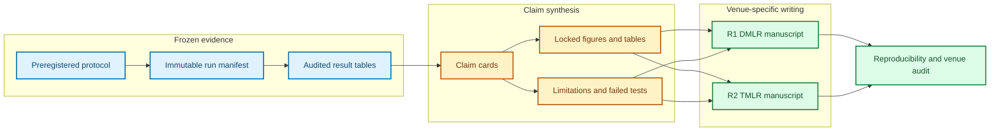

# Writing and submission plan for reliable scientific agents R1 and R2

_Venue-specific manuscript specification · 2026-08-01_

This document converts the research and experiment plans into two defensible
manuscripts. The manuscripts share an infrastructure lineage but make different
claims: R1 is an artifact-and-measurement paper for DMLR; R2 is a method paper
for TMLR. R2 must cite the frozen R1 artifact and must not repeat R1's benchmark
claim as a second contribution.

## 🧭 Evidence-to-writing workflow

Every headline claim gets a claim card containing: exact wording; estimand;
confirmatory analysis identifier; figure/table cell; robustness checks; known
counterevidence; and the maximum defensible scope. A result may enter the
abstract only after its card passes the analysis audit.

## ✍️ Shared writing protocol

### Draft order

1. Write the task, trace, intervention, endpoint, and analysis contracts while
   the protocol is being implemented.
2. Freeze Methods, artifact documentation, and planned figure shells before the
   confirmatory test set is unsealed.
3. Generate tables and figures directly from versioned analysis outputs. Never
   copy a number manually into the manuscript.
4. Write Results as claim–evidence–qualification paragraphs after analysis lock.
5. Write the Introduction and Discussion against the surviving claim cards.
6. Write the title and abstract last. The abstract reports the population,
   intervention or predictor, main numerical result, transfer regime, and
   principal limitation.

### Paragraph and terminology rules

Final manuscript sections use continuous scientific prose, not outline-style
bullet lists. The first sentence of each Results subsection states the question;
the next sentences identify the design and effect; the final sentence states
the limitation or boundary. Root cause, manifestation, downstream consequence,
terminal failure, intervention, verification, and recovery retain exactly the
definitions in the frozen label book.

Use causal language only for randomized injected faults or randomized
interventions with the relevant assumptions. Use predictive language for
warning models and associational language for naturally occurring failures.
Report effect sizes and uncertainty intervals before significance tests.

### Reproducible manuscript contract

- Each figure and table has a stable artifact ID, generating script, input
  manifest hash, and analysis-environment lock.
- `main.tex` contains no hand-entered experimental values; generated macros or
  tables are used for all quantitative claims.
- The supplement includes protocol deviations, exclusions, missingness,
  additional robustness checks, and the complete model/task/fault manifests.
- A clean-checkout build must reproduce the PDF and all referenced tables.
- Public artifact releases receive immutable archival identifiers; mutable
  documentation points to, but does not replace, the archived release.

## 📘 R1 manuscript — DMLR

### Paper point and title

Working title: **Failure Dynamics in Scientific Agents: A Causal Benchmark for
Calibrated Early Warning and Recoverability**.

The single paper point is that governed state-difference traces and controlled
fault interventions make failure onset, propagation, warning, attribution, and
recoverability measurable across scientific-agent workloads. The warning model
is deliberately a strong benchmark baseline, not a second architectural story.

### Section contract

| Section | Required content | Evidence admitted |
| --- | --- | --- |
| Abstract | Artifact, population, causal design, replicated law, warning transfer, and limitation | Only locked headline claim cards |
| 1. Introduction | Measurement gap; why final success is insufficient; three contributions | No untested benefit claims |
| 2. Related work | Agent benchmarks, failure taxonomies, execution monitoring, calibration, survival analysis | Structured collision matrix |
| 3. Benchmark and governance | Workloads, task/fault splits, event schema, evidence channels, adjudication, access, license, maintenance | Validation and agreement results |
| 4. Measurement and baselines | Estimands, censoring, survival model, warning/attribution baselines, calibration | Frozen protocol |
| 5. Failure dynamics | Injected-fault effects, propagation motifs, recoverability window, replication | R1-E1 and standardized R1-E4 |
| 6. Warning and attribution | Lead time, false-alert budget, calibration, selective risk, transfer | R1-E2 and R1-E3 |
| 7. Robustness and limits | Model/task/fault heterogeneity, negative controls, sensitivity, exposure limits | Predeclared robustness set |
| 8. Artifact use and impact | Intended use, prohibited interpretations, hosting, maintenance, broader impact | Governance record |

### Planned main-display budget

| ID | Display | Claim supported |
| --- | --- | --- |
| Figure 1 | Governed harness, evidence channels, and causal fault intervention diagram | The artifact isolates observable process state and intervention provenance |
| Figure 2 | Task/fault/model coverage and split geometry | The evaluation tests declared transfer regimes rather than random trajectory leakage |
| Figure 3 | Failure-state transition or hazard result with interval estimates | The preregistered failure law replicates across workload families |
| Figure 4 | Warning lead-time versus false-alert-budget curves with calibration | Warning is useful before terminal failure and remains calibrated on held-out structure |
| Figure 5 | Attribution confusion/cost matrix and recoverability curve | Attribution and the closing recovery window are separately measurable |
| Table 1 | Dataset and artifact statistics | Coverage, censoring, annotation, and provenance are transparent |
| Table 2 | Confirmatory effects and transfer results | Headline quantitative evidence with uncertainty |
| Table 3 | Ablations, negative controls, and sensitivity analyses | The result is not explained by runtime, terminal checks, or leakage |

Move exhaustive per-task results, prompt/configuration manifests, annotator
instructions, schema tables, and secondary motifs to the supplement. Keep
artifact documentation in the release as well as the paper.

### DMLR compliance

Use the official DMLR style in `latex/r1_dmlr`, pinned to the commit recorded in
`TEMPLATE.lock`. DMLR is single blind. The submission therefore includes real
author identities, complete artifact access instructions for reviewers,
licensing authority, documentation, hosting and maintenance plans,
reproducibility materials, and the required broader-impact statement.[^dmlr]

The benchmark should be independently usable. A paper-only collection of traces
without an executable generator, validator, data card, and stable access path is
not submission-ready. If licensing prevents redistribution of some workloads,
publish generators and derived metadata and state the access boundary precisely.

### R1 writing gates

- **Methods-complete gate:** schemas, estimands, exclusions, censoring, and
  analysis IDs are frozen and reflected identically in code and prose.
- **Results gate:** the failure law passes its cross-workload replication
  criterion and the warning baseline passes the held-out calibration/utility
  criterion in `EXPERIMENT_PLAN.md`.
- **Artifact gate:** a new user can validate a sample and reproduce one table
  from the documented release.
- **Submission gate:** the DMLR template builds cleanly; access, licensing,
  maintenance, impact, and conflict disclosures are complete.

If the predictive law fails but the artifact remains valuable, narrow the claim
to a benchmark and negative evaluation result. If the reusable artifact is not
ready, do not submit R1 as a full DMLR paper.

## 📗 R2 manuscript — TMLR

### Paper point and title

Working title: **Learning When to Verify and How to Recover: Cost-Sensitive
Process Supervision for Scientific Agents**.

The paper point is a factorized, budget-aware policy that selects verification
and recovery actions from independently adjudicated evidence, followed by a
controlled test of whether learning from verified processes improves unseen-
fault recovery without clean-task regression.

### Section contract

| Section | Required content | Evidence admitted |
| --- | --- | --- |
| Abstract | Decision problem, randomized evaluation, budget-matched effect, unseen-fault transfer, regression result | Locked R2 claim cards only |
| 1. Introduction | Why detection alone is insufficient; decision and learning claims; contributions | No benchmark novelty recycled from R1 |
| 2. Related work | Tool verification, test-time control, selective prediction, recovery, process supervision | Explicit distinction from R1 |
| 3. Problem formulation | Belief state, action set, costs, utility, evidence independence, assumptions | Formal contract and counterexamples |
| 4. Controller and adjudication | Gating, verification selection, recovery proposal, postcondition checks | Algorithms and computational complexity |
| 5. Verified-intervention dataset | Collection policy, randomization, labels, leakage controls, splits | R2-C1 and R2-C2 |
| 6. Experimental design | Controller arms, post-training arms, matched budgets, estimands, power, regression gates | Frozen R2 protocol |
| 7. Results | Controller value, transfer, training comparison, interactions, abstention | R2-C1 and R2-T |
| 8. Analysis and limitations | Cost sensitivity, failure cases, reward-channel audit, external validity | Robustness and negative results |

### Planned main-display budget

| ID | Display | Claim supported |
| --- | --- | --- |
| Figure 1 | Belief–verify–recover–adjudicate architecture | Decisions and evidence channels are factorized and auditable |
| Figure 2 | Utility or failure reduction versus verification budget | The learned controller improves over matched-cost fixed/random/threshold policies |
| Figure 3 | Effects across unseen tasks, faults, and compositions | Controller value transfers beyond training combinations |
| Figure 4 | Six-arm post-training comparison with clean-task regression panel | Process supervision contributes beyond outcome-only training without unacceptable regression |
| Figure 5 | Factorial ablation and failure-case decomposition | Attribution to selection, verification evidence, recovery labels, and abstention is identifiable |
| Table 1 | Decision problem, costs, datasets, and split counts | Evaluation units and budgets are explicit |
| Table 2 | Primary controller and training estimands | Main effects with hierarchical uncertainty |
| Table 3 | Robustness, policy-cost sensitivity, and negative results | Conclusions remain bounded under plausible cost choices |

### TMLR compliance

Use the official double-blind TMLR style in `latex/r2_tmlr`, pinned to the commit
recorded in `TEMPLATE.lock`. Remove author identities, affiliations,
acknowledgments, deanonymizing repository links, and revealing self-citations
from the review build. TMLR permits flexible length, but its author guidance
warns that unnecessarily long submissions can slow review; target roughly 12
main-text pages plus references, with extensive audit material in the
supplement.[^tmlr]

The submission includes a broader-impact statement and links reviewers to an
anonymous artifact snapshot. The camera-ready build restores author metadata and
the final artifact identifier only after acceptance.

### R2 writing gates

- **Controller gate:** randomized, matched-budget comparison beats fixed,
  random, and threshold baselines on the primary utility estimand.
- **Data gate:** intervention transitions have independent postcondition
  adjudication, provenance, agreement, and a frozen unseen-composition split.
- **Training gate:** the process-supervised contrast beats the matched outcome-
  only arm and stays inside the clean-task non-inferiority margin.
- **Submission gate:** all six arms have matched data/compute accounting,
  negative results are retained, the anonymous artifact works, and the TMLR
  source builds without identity leakage.

If the controller succeeds but process supervision does not, submit a narrower
controller-and-dataset paper only if that contribution remains complete. Report
the negative training result; do not redefine the primary contrast.

## 🗂️ Authorship, review, and change control

Maintain a contribution ledger from the first implementation phase. Before each
paper's full draft, agree on author order, accountable artifact maintainer, and
the person responsible for statistical sign-off. Record venue-required
conflicts and funding disclosures separately from the anonymous R2 manuscript.

Use one branch per claim-bearing figure. A figure is merged only when its
generating script, frozen inputs, caption, claim card, and reviewer-readable
interpretation are present. After the confirmatory test is unsealed, protocol
changes require a dated deviation record and cannot silently replace the
preregistered analysis.

## ✅ Final submission audits

### R1 audit

- DMLR style, author metadata, keywords, editor placeholder, impact statement,
  acknowledgments, and references compile.
- Artifact access, license, provenance, documentation, maintenance, and ethical
  use are explicit.
- Every headline result maps to a frozen test; all exclusions and censored runs
  reconcile with the manifest.
- Benchmark examples are inspectable without exposing secrets or restricted
  scientific data.

### R2 audit

- TMLR review build is double blind, including PDF metadata, supplement, code,
  URLs, filenames, and acknowledgments.
- Baseline budgets, model versions, data volumes, and compute are matched and
  auditable.
- The clean-task non-inferiority test and all prespecified negative outcomes are
  reported.
- The paper distinguishes randomized causal effects, predictive transfer, and
  exploratory associations.

[^dmlr]: Data-centric Machine Learning Research. “Submission.” <https://data.mlr.press/submissions.html>

[^tmlr]: Transactions on Machine Learning Research. “TMLR guidelines for authors.” <https://www.jmlr.org/tmlr/author-guide.html>
