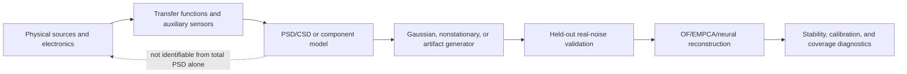

# Evaluation of the Experiments and Noise Modules

Consolidated: 2026-07-26. This is the **single authoritative evaluation
document**. It merges two audits that previously coexisted with the same date
and roughly 60% overlapping content:

- `docs/archive/2026-07-26_pre_paper23/ACADEMIC_EXPERIMENT_AND_NOISE_MODULE_EVALUATION.md`
  — the broad first-pass audit (structure and most wording retained here);
- `docs/archive/2026-07-26_pre_paper23/INDEPENDENT_EVALUATION_2026-07-26.md`
  — a second, independent verification pass whose new findings are folded into
  §4 below.

Sections that grew into their own documents are pointed at rather than
duplicated: the experiment registry now lives in
[`EXPERIMENTS_OVERVIEW.md`](EXPERIMENTS_OVERVIEW.md), and the collaboration
analysis in [`../paper3/PAPER3_PLAN.md`](../paper3/PAPER3_PLAN.md).

Primary sources: Paper 1 (`paper1.pdf`), Paper 2
(`paper2_nonlinear_reconstruction.pdf`), source code, checked-in
configurations, machine-readable results, notebooks, and tests.

## 1. Executive verdict

Paper 1 has a strong theoretical core and a substantially better experimental
foundation than a typical methods manuscript. The OF–EMPCA–tied-linear-AE
equivalence is implemented coherently, the synthetic gates test the right
mathematical invariants, CRESST supplies a positive public-data result, and the
failed GWOSC calibration is reported honestly. The stop-ship items from the
first-pass audit (Study A contradicted by its source data, the obsolete
random-phase sampler equation, the overstated metric-reversal sentence) were
corrected in the 2026-07-26 manuscript pass. **One stop-ship item remains**,
found on the second pass: the S5 confirmatory numbers printed in the manuscript
come from a run whose seed range violates its own predeclaration (§4.1).

Paper 2 is a good research program and a useful theoretical framework, but not
a validated nonlinear-reconstruction paper. Its completed NFPA case study is
explicitly a single-seed proof of concept. The newer neural experiments have
uncontrolled random initialization, repeated test-set evaluation during
training, a broken timing metric, a weak coverage intervention, and a
Transformer with neither positional encoding nor cross-channel attention.
Existing neural result artifacts should not be used as paper evidence.

The upgraded noise package is scientifically sound at the level of **controlled
stochastic simulation and second-order validation**. Its stationary Gaussian
Fourier synthesis, PSD-density normalization, CSD sampling, explicit
circulant-versus-Toeplitz distinction, and distributional tests are strong, and
were re-verified numerically on the second pass (§5). It is not, by itself, a
physical noise-decomposition method.

| Artifact | Internal assessment | Publication status |
| --- | --- | --- |
| Paper 1 theory | Strong | Defensible |
| Paper 1 synthetic experiments | Strong implementation validation | Cite only held-out (v2/sweep/confirmatory) artifacts |
| Paper 1 CRESST | Positive and useful | Hierarchical sensitivity added; retain detection-sensitivity limitation |
| Paper 1 GWOSC | Valid negative stress test | Keep as a boundary result; demote to appendix if a second real-data anchor lands |
| Paper 1 Study A noise budget | Rebuilt from source files (2026-07-26) | Resolved |
| Paper 1 Study B | Implemented, unreported pending metadata | Resolve or formally descope |
| Paper 2 NFPA | Coherent proof of concept | Run the manuscript-prescribed sweeps and ≥20 seeds/splits |
| Paper 2 neural/coverage runs | Exploratory and currently invalid for inference | Repair implementation and rerun from a frozen protocol |
| Upgraded trace generator | Strong simulator; conventions verified numerically | Suitable for controlled validation |
| Upgraded PSD/CSD/calibration stack | Strong second-order toolkit | Requires acquisition-response assumptions and held-out empirical validation for detector claims |

An internal five-point triage gives Paper 1 about **3.7/5 (major revision)** and
Paper 2 about **2.5/5 (promising framework, evidence incomplete)**. These are
readiness judgments, not bibliometric scores.

## 2. What each paper requires

### Paper 1

Paper 1 claims that, under a linear Gaussian model, inverse noise covariance defines reconstruction geometry; OF is the fixed rank-one solution, EMPCA is the learned rank-k solution, and a tied linear autoencoder with the correct noise-weighted adjoint learns the same subspace. The minimum sufficient evidence is therefore:

1. analytic and numerical OF normalization/CRB agreement;
2. recovery of the OF direction by rank-one EMPCA;
3. independent optimization of the tied AE reaching the EMPCA optimum;
4. PCA/EMPCA agreement under white noise;
5. divergence or metric reversal under colored noise;
6. a rank requirement when timing or pulse shape varies;
7. convergence with covariance-estimation sample size;
8. calibrated whitened residuals under a correct model;
9. benefit from full rather than diagonal multichannel covariance;
10. public-data evidence with independent noise calibration and evaluation samples, strong baselines, negative controls, and detector-facing metrics.

The repository covers items 1–9 with S1–S9. CRESST covers most of item 10 for reconstruction, but its trigger-efficiency result is inconclusive. GWOSC demonstrates model inadequacy rather than positive calibration, which is scientifically useful provided it remains a negative result.

### Paper 2

Paper 2 broadens the object of study to the tuple `(noise metric, model class, training coverage)`. Only the NFPA component is currently claimed as experimentally completed. The paper itself correctly asks for:

- at least about 20 seeds and multiple train/test splits;
- low/medium/high SNR;
- white, pink, Brownian, and measured noise;
- channel counts 2, 4, 8, and 16;
- matched total ranks and alternative `(k_c, k_t)` factorizations;
- a controlled nonseparability sweep;
- explicit sample counts, rank, whitening, seeds, and confidence intervals.

The nonlinear architecture and coverage claims additionally require a factorial design in which metric, architecture, coverage, and noise mismatch are changed independently. Current real-data neural runs do not yet satisfy this design.

## 3. Experiment registry

The per-experiment description, method, target, and status table now lives in
its own document so that it can be maintained independently of this audit:
[`EXPERIMENTS_OVERVIEW.md`](EXPERIMENTS_OVERVIEW.md). It covers S0–S9, CRESST-A
and its controls and post-freeze sensitivity, the four GWOSC checks, Study A/B,
and the Paper 2 exploratory set. Commands and acceptance gates are in
[`EXPERIMENT_PROTOCOLS.md`](EXPERIMENT_PROTOCOLS.md).

## 4. Scientific-rigor assessment

### 4.1 Second-pass findings (new, verified against code and archived artifacts)

These were produced by an independent verification pass that re-derived the
load-bearing claims rather than accepting the first-pass audit.

1. **(Stop-ship) The S5 confirmatory numbers in the manuscript come from a
   non-predeclared run.** §7.2 of the manuscript reports PCA 48.418 / EMPCA
   47.878, paired difference 0.540, CI [0.523, 0.560], raw MSE 2367.99 /
   5388.75, angle 86.07°. Those trace to a 30-seed run using **seeds 0–29**,
   archived only in the manuscript repository. The experiment repository's
   predeclaration (`scripts/run_s5_confirmatory_sweep.py`) requires seeds
   *disjoint from the frozen 0–9 block*, and its archived run uses seeds
   1000–1029: PCA 48.419 / EMPCA 47.869, difference 0.5503, CI [0.530, 0.571],
   raw 2330.27 / **7412.67**, angle 86.25°. The frozen 10- and 20-seed sweeps
   agree with neither (0.5455 / 0.5446). No conclusion changes — all variants
   agree in sign and in the ≈1.1% weighted-residual effect — but the raw-MSE
   EMPCA value differs by 38% and the provenance claim is not satisfied by the
   cited artifact. Resolution: WP-E1 (experiments) and WP-P1 (manuscript).
2. **Latent crash bug in `OptimumFilter.sliding_fit(chisq_mode='none')`.** The
   call to `_slide_block_hop1_amponly` passes 12 arguments to a 13-parameter
   numba kernel (`self._F_imag` omitted), so the first invocation raises a
   `TypingError`. No test covers the path and no paper result uses it.
   Resolution: WP-E2.
3. **S5 weight/noise scale convention.** The synthetic noise is scaled by 0.25
   while the weights derive from the unscaled PSD. Subspace fits and residual
   orderings are invariant to a global Σ scale, so no claim is affected, but S5
   weighted residuals must not be read as χ²-per-dof calibrated. Resolution:
   one clause in the manuscript (WP-P2).
4. **Appendix G's generator equations verified numerically.** An independent
   re-implementation of the documented convention reproduces the time-domain
   variance to 0.2%, interior rFFT-bin power to 0.03%, and a periodogram
   coefficient of variation of 0.993 against the 1.0 expected for
   complex-Gaussian bins. The generator half of `OPEN_ISSUES.md` #7 can be
   closed; the Appendix A Fisher-information endpoint factor remains open.
5. **Confirmed from the first pass:** the v1 standalone S4/S5/S6 configs are
   in-sample (`test_frac = 0`) while the v2 configs and sweeps are held-out.
   The remediation is sound; held-out claims must cite only v2/sweep artifacts.

### 4.2 Resolved first-pass findings

Retained for the record because the manuscript's correction history depends on
them:

- *Study A contradicted by its own data.* Table 8's "1/f phonon",
  "vibrational", and "TES Johnson" labels did not correspond to the supplied
  `SQUID`/`Johnson`/`TD`/`Er` files. **Resolved** 2026-07-26: Study A was
  rebuilt from the component files and reframed as a conditional audit.
- *Manuscript described the obsolete random-phase sampler (Eq. 81).* Fixed
  modulus with random phase gives the correct mean PSD but degenerate per-bin
  power, invalidating χ² and KS tests. **Resolved** 2026-07-26: replaced with
  the complex-Gaussian construction, with the covariance correctly described as
  periodic/circulant and the exact-Toeplitz sampler named as a separate path.
- *Overstated metric-reversal sentence.* **Resolved**: the manuscript now
  reports a residual value and a paired difference rather than a fold ratio.

### 4.3 What is done well

- The theoretical claims and synthetic gates are unusually well aligned. Each core equivalence has a direct numerical invariant rather than only a downstream task score.
- White-noise controls, wrong-PSD controls, random/noise-only bases, permuted bins, and mismatched templates are appropriate falsification tests.
- The project preserves failed GWOSC gates and does not convert them into a positive narrative.
- CRESST uses held-out pulses and independent noise calibration records, a strong multi-template baseline, paired comparisons, and predeclared negative controls.
- The upgraded noise tests go beyond mean PSD matching: they check Fourier Gaussianity, exponential periodograms, χ²-relevant behavior, covariance/CSD, endpoints, and reproducible random streams.

### 4.4 Major design limitations

- Ten synthetic seeds are acceptable for regression testing but thin for publication inference. Use at least 20–30 independent seeds, report raw seed rows, paired effect distributions, and a predeclared smallest relevant effect.
- S4–S6 sweep code uses held-out fractions, but the frozen standalone YAML defaults do not always encode the same held-out design. Archive the exact generated configs or command manifest used for every table and figure.
- CRESST’s pooled event bootstrap is conditional on seven observed channels and lets high-count channels dominate. Add equal-channel and channel-then-event hierarchical intervals to the main sensitivity analysis. Do not claim population-level detector generalization from seven clusters.
- CRESST pulse and noise streams are split chronologically but separately. There is no direct row/hash leakage, yet some evaluation pulses precede the last calibration-noise time. A future replication should use a shared acquisition cutoff or grouped acquisition blocks.
- Paper 1’s S5 effect is statistically clear but smaller than its prose suggests: the likelihood metric changes by about 1.1% (`0.546/48.49`), while the dramatic reversal is in raw MSE/subspace angle. Report both scales without calling a metric value a ratio.
- The real K-alpha “restricted coverage” experiment restricts a central observed box, not a designed physical latent. It changes support and sample size simultaneously. Use equal-n controls, explicit held-out tails, and a simulator or labeled dataset with independent energy, time, position, sharing, and shape coordinates.
- Random event splits should be replaced or supplemented by acquisition-time, run, detector, or source-group splits wherever neighboring/duplicate records could leak.
- Paper 2 result folders need immutable checkpoint, predictions, git revision, environment lock, data checksums, split indices, seed state, and separate validation/test metrics. Some promised artifacts are absent from current result folders.

## 5. Implementation assessment

### 5.1 Paper 1 implementation

The linear algebra is internally coherent. OF, weighted subspace fitting, whitening, principal angles, and the tied-AE projection are implemented in conventions that agree with the positive gates. The full test suite passed during this audit (`224 passed`; warnings only), and the upgraded noise-module suite passed (`99 passed`; warnings only). Passing tests verify the coded contracts; they do not resolve experimental-design limitations, and they did not catch the untested `sliding_fit` path in §4.1.

Verified line by line on the second pass: `src/canonical/OptimumFilter.py` implements the covariance-form estimator of Eq. (12)–(13) with correct two-sided PSD unfolding, DC exclusion via an infinite PSD bin, and the standard χ² decomposition; each S-runner in `src/noise_geometry/experiments/synthetic.py` implements what the manuscript describes, with S5 using the likelihood-preserving Re/Im-stacked rFFT representation and S1 routing OF through the same whitened-real primitive as EMPCA (so the S2 equivalence is not circular at the code-path level while still sharing one convention module).

The main implementation correction is provenance. A paper table should be traceable to one immutable configuration, source rows, code revision, and rendering script. At present, some paper evidence comes from sweeps, some from standalone configs, and some from stateful notebooks. Consolidate these into one results manifest.

### 5.2 Paper 2 implementation

The current four-way neural experiment matrix should be considered contaminated by uncontrolled initialization and metric bugs. The following repairs are minimum requirements before rerunning:

1. initialize and record Python, NumPy, CPU Torch, and CUDA seeds before model construction;
2. use deterministic split and loader generators, and record split indices;
3. restore the best validation checkpoint and touch the test set once;
4. retain separate `best_validation` and `final_test` dictionaries;
5. correct timing coordinates and add injection-based unit tests;
6. define a physical Mahalanobis normalization if values are to be called χ² or NLL;
7. add position/channel encodings and cross-channel attention to the Transformer;
8. match parameter count, optimization budget, early stopping, rank/bottleneck, and training samples across architecture comparisons;
9. run divergence checks and report failed seeds rather than silently selecting stable runs.

The whitening code preserves relative precision geometry but normalizes positive weights to mean one and clips their dynamic range in [`whitening.py`](../paper2/data/whitening.py), lines 41–60. This is acceptable for optimization geometry. It is not an absolute Gaussian likelihood, calibrated χ², or cross-dataset NLL unless the missing constants, endpoint conventions, effective degrees of freedom, and clipping are explicitly restored.

## 6. Upgraded noise-module review

### 6.1 Part I: noise-trace generation

The stationary Gaussian core is scientifically correct under its declared discrete convention:

- inputs are one-sided PSD densities with explicit units;
- interior rFFT bins use independent circular complex Gaussians with expected power `S(f) f_s N / 2`;
- DC and Nyquist are real Gaussians with endpoint scaling;
- `irfft` normalization and expected time variance are consistent;
- the default FFT-grid process is correctly labeled periodic/circulant;
- an exact finite Toeplitz sampler is supplied separately;
- random streams can be seeded and split reproducibly.

This is a material improvement over the sampler printed in Paper 1 and makes S8-style residual calibration meaningful.

The multichannel CSD path is also sound at the second-order level. It checks Hermitian positive-semidefinite matrices, preserves the PSD cone under linear interpolation, treats real endpoints correctly, supports explicit repair policies, and can sample directly from low-rank factors without materializing a dense CSD. The `shared_private` and low-rank generators are useful controlled models, but their latent factors are simulated causes, not fitted physical source identities.

The temporal, artifact, and non-Gaussian extensions are appropriate **stress-test generators**. Piecewise scaling, evolutionary overlap-add, slow envelopes, drift, lines, glitches, bursts, and heavy tails let the reconstruction pipeline be challenged under declared violations. They should not be called a calibrated detector-noise model unless their parameters and joint distributions pass held-out real-data checks.

Important cautions:

- per-realization channel variance normalization, if enabled, constrains the sample norm and therefore changes the Gaussian distribution; keep it off for likelihood-calibration experiments;
- crossfades and multiplicative envelopes introduce spectral convolution and boundary correlations, so local target PSDs are approximate;
- additive artifacts plus Gaussian background do not reproduce detector causality unless morphology, rate, amplitude, state dependence, and dead time are empirically fitted;
- one small documentation bug says custom mode `multiply`, while the configuration uses `scale`.

### 6.2 Part II: PSD simulation, fitting, resampling, and calibration

The PSD code has strong engineering contracts: density versus rFFT power is separated, component ASDs are squared before addition, custom out-of-band behavior is explicit, composite contributions are recorded, and deterministic interpolation, alias folding, and time-domain polyphase resampling are separate operations.

The Al₂O₃/Al athermal component fit is mathematically consistent with the supplied files. The nearly exact quadrature validation, however, is not independent empirical validation: the provided total is effectively the quadrature construction of the same component curves. It proves correct parsing and arithmetic, not that the four components uniquely or physically explain a detector measurement.

The default alias-folded artifact is a hypothesis about acquisition. Aliasing depends on the analogue transfer function and anti-alias filter. With no measured electronics response, “fold everything above target Nyquist” and “remove everything out of band” are two bounding assumptions, neither a validated detector truth. Study B sensitivity should be reported under both, plus the actual transfer function when available.

The empirical calibration layer is useful but its current gates are engineering heuristics. It randomly splits records, bootstraps records as independent, and applies thresholds such as 50% interval coverage and 0.75 CSD relative error. For publication calibration:

- split chronologically or by acquisition/run groups;
- use block/hierarchical bootstrap when records or channels are dependent;
- report frequency-resolved uncertainty and simultaneous bands, not only aggregate coverage;
- predeclare gates from the downstream scientific tolerance;
- validate generated and real distributions on independent records using PSD/CSD/coherence/phase, whitened autocorrelation, tails, line occupancy, drift, and downstream OF residuals.

`CalibrationPreset.sample_parameters()` samples each marginal log-PSD bin independently and uniformly between bootstrap bounds. That produces jagged spectra and is not a posterior draw. Replace it with bootstrap spectrum draws, a smooth log-spectral Gaussian process, or a low-dimensional component-parameter posterior that preserves frequency correlation and, for multichannel data, PSD-constrained CSD structure.

### 6.3 Scientific boundary of the module

The module covers nodes C–G well as a controlled framework. It cannot infer node A uniquely without node B or equivalent interventions.

## 7. Noise decomposition and decorrelation: what linear methods can do

Linear methods can do the following rigorously:

- whiten noise using a fitted covariance or CSD;
- eigendecompose covariance or perform frequency-dependent CSD factorization;
- identify low-rank correlated statistical modes;
- construct null channels or generalized eigenmodes relative to a signal covariance;
- measure coherence, phase, shared/private variance, and the sensitivity of OF/EMPCA to removing a fitted component;
- regress against auxiliary/environmental channels and quantify the held-out residual reduction.

They generally **cannot** identify physical sources from the observed total covariance alone. If `Σ = Σ₁ + Σ₂`, many alternative positive-semidefinite pairs produce the same total. Rotations of latent factors leave a low-rank covariance unchanged. Decorrelation gives statistically orthogonal modes, not labels such as SQUID, vibration, Johnson, microphonics, or unknown physics.

Physical categorization becomes defensible only with additional structure: known spectral/transfer-function families, auxiliary sensors, spatial/channel topology, multiple operating conditions, injected calibration lines, hardware interventions, or non-Gaussian/temporal signatures. Even then, fit competing models on calibration data and compare predictive performance on held-out runs. Report identifiability intervals and correlations among fitted components rather than one deterministic decomposition.

For detector design, the easier and more useful target is often **actionable sensitivity attribution**, not unique source recovery. Compute how each well-defined nuisance model changes Fisher information, OF variance, trigger threshold, and reconstruction stability under a declared intervention. This can guide shielding, bandwidth, sensor layout, or readout changes without pretending that covariance eigenvectors are physical causes.

## 8. Fit to the proposed collaboration topics

The topic-by-topic analysis, the joint-paper thesis, and the four-application
experimental program moved into their own planning document when the
collaboration became a concrete third paper:
[`../paper3/PAPER3_PLAN.md`](../paper3/PAPER3_PLAN.md). The short version: the
upgraded noise module is directly relevant, and its best role is a **controlled
perturbation and calibration engine** rather than a source-decomposition
method. Perturbation stability and calibration verification are where it is
uniquely strong; physical noise decomposition is identifiability-limited, not
effort-limited (§7).

The Paper 2 side of the same question — wiring the module into the NFPA and
coverage suites — is in
[`../paper2/PAPER2_NOISE_INTEGRATION_AND_PAPER3_OUTLINE.md`](../paper2/PAPER2_NOISE_INTEGRATION_AND_PAPER3_OUTLINE.md).

## 9. Prioritized action list

Work-package identifiers refer to
[`plans/CORRECTION_PLAN_EXPERIMENTS_2026-07-26.md`](plans/CORRECTION_PLAN_EXPERIMENTS_2026-07-26.md)
(experiments, WP-E*) and the manuscript repository's
`plan/CORRECTION_PLAN_2026-07-26_AUDIT.md` (WP-P*).

### 9.1 Stop-ship before Paper 1 submission

1. **WP-E1 / WP-P1** — resolve the two competing S5 30-seed runs; make the
   manuscript cite the predeclared one and label the other a replicate.
2. **WP-P3** — resolve Study B (accepted run with branch labels) or formally
   descope it, clearing `OPEN_ISSUES.md` #6 and #15.
3. **WP-P2** — one clause stating the S5 global-scale convention.
4. Confirm detector naming and permission to publish the component spectra
   (`OPEN_ISSUES.md` #4).

### 9.2 Correctness and hygiene

1. **WP-E2** — fix and test `sliding_fit(chisq_mode='none')`.
2. **WP-E3** — evidence manifest; guard table/figure scripts against in-sample
   S4/S5/S6 records.
3. **WP-E6** — noise-module refinements (calibration sampler, chronological
   split option, documentation mismatch).

### 9.3 Before using Paper 2 neural results

1. Fix seeding, test-set handling, timing coordinates, metric naming, and
   artifact provenance (**WP-E7** 1–5).
2. Replace the coverage restriction with a designed latent intervention and an
   equal-n control.
3. Add Transformer positional/channel geometry and cross-channel interaction;
   predeclare the ablations.
4. Rerun the NFPA required sweeps and the architecture × metric × coverage ×
   noise experiment across ≥20 seeds/splits, using the noise module as the
   instrument (**WP-E7** 6–9).
5. Keep current result folders labeled exploratory and exclude their numbers
   from claims.

### 9.4 Before claiming detector noise decomposition

1. Obtain acquisition transfer functions and anti-alias response.
2. Add independent auxiliary channels or controlled operating-condition /
   hardware interventions.
3. Fit constrained component/CSD models on calibration runs and compare
   predictive likelihood on held-out runs.
4. Report statistical modes and actionable sensitivity attribution separately
   from physical source labels.

### 9.5 Strengthening the real-data evidence

Paper 1's real-data evidence has two structural gaps — no ground-truth test of
metric reversal, and no detector-facing metric. Both are addressed by a second
real-data anchor; the candidate analysis and decision are in
[`plans/PAPER1_SECOND_REALDATA_ANCHOR.md`](plans/PAPER1_SECOND_REALDATA_ANCHOR.md)
and the execution plan in
[`plans/TIDMAD_IMPLEMENTATION_ROADMAP.md`](plans/TIDMAD_IMPLEMENTATION_ROADMAP.md).

## 10. Evidence and reproducibility map

- Current claim status: [`CURRENT_STATUS.md`](CURRENT_STATUS.md)
- Experiment registry: [`EXPERIMENTS_OVERVIEW.md`](EXPERIMENTS_OVERVIEW.md)
- Protocols and gates: [`EXPERIMENT_PROTOCOLS.md`](EXPERIMENT_PROTOCOLS.md)
- CRESST predeclaration: [`results/CRESST_PREDECLARED_GATES.md`](results/CRESST_PREDECLARED_GATES.md)
- CRESST outcome: [`results/CRESST_RESULT.md`](results/CRESST_RESULT.md)
- GWOSC outcome: [`results/GWOSC_RESULT.md`](results/GWOSC_RESULT.md)
- Synthetic implementation: [`../src/noise_geometry/experiments/synthetic.py`](../src/noise_geometry/experiments/synthetic.py)
- Noise core: [`../noise_module/noise_module/NoiseGenerator.py`](../noise_module/noise_module/NoiseGenerator.py)
- Generator convention: [`../noise_module/noise_module/PAPER_CONVENTION.md`](../noise_module/noise_module/PAPER_CONVENTION.md)
- PSD resampling: [`../noise_module/noise_module/psd_resampling.py`](../noise_module/noise_module/psd_resampling.py)
- Multichannel CSD: [`../noise_module/noise_module/multichannel_noise.py`](../noise_module/noise_module/multichannel_noise.py)
- Empirical calibration: [`../noise_module/noise_module/calibration.py`](../noise_module/noise_module/calibration.py)
- Noise validation: [`../noise_module/noise_module/validation.py`](../noise_module/noise_module/validation.py)
- Al₂O₃ component fit: [`../noise_module/noise_module/fit_al2o3_athermal.py`](../noise_module/noise_module/fit_al2o3_athermal.py)
- Paper 2 trainer: [`../paper2/trainers/train_reconstruction.py`](../paper2/trainers/train_reconstruction.py)
- Paper 2 whitening: [`../paper2/data/whitening.py`](../paper2/data/whitening.py)
- Paper 2 Transformer: [`../paper2/models/transformer_encoder.py`](../paper2/models/transformer_encoder.py)
- Paper 2 experiment artifacts: [`../paper2/results/`](../paper2/results/)

This audit distinguishes mathematical implementation tests, controlled
synthetic evidence, public-data validation, negative stress tests, and proposed
experiments. Only the first four categories have current evidence; the
collaboration program is a recommended design, not a completed result.
