# Experiment Repository Revision Plan

_Agent-executable evidence and implementation plan for revising Paper 1, dated 2026-07-26_

---

## 📋 Purpose and authority

This repository is the authority for simulation code, experiment configurations, raw and derived metrics, statistical analyses, and the exportable paper-evidence bundle. The companion manuscript plan is expected at `/Users/wongdowling/Documents/arXiv-v1-polished-extended-preprint/plan/REVISION_PLAN_2026-07-26.md`. The two plans must be executed as a dependency chain: evidence is corrected and frozen here before numerical prose, tables, or figures are changed in the paper repository.

The revision has four stop-ship objectives. It must replace the incorrect Study A interpretation with results computed from the checked-in `SQUID`, `Johnson`, `TD`, and `Er` spectra; rebuild Study B with the same physical component identities and explicit acquisition assumptions; establish which archived experiments used Gaussian versus fixed-modulus Fourier sampling; and export an immutable, checksum-backed bundle from which the manuscript can be revised without consulting notebooks or guessing values.

The existing academic audit is [EVALUATION.md](../EVALUATION.md). It defines the scientific concerns; this document defines the implementation sequence and acceptance gates.

> ⚠️ **Evidence rule:** Existing frozen results must never be overwritten. A corrected or extended run receives a new run identifier, configuration snapshot, code revision, and output directory. Failed or changed results remain archived.

## 🎯 Final deliverables

| Deliverable | Required location | Acceptance condition |
| --- | --- | --- |
| Generator provenance audit | `results/audits/noise_generator_provenance.json` and `.md` | Every paper-facing synthetic/noise artifact maps to code path, commit, sampler distribution, and rerun decision |
| Corrected Study A evidence | `results/noise_budget/<run_id>/study_a/` | Tables, figures, JSON, config, checksums, and tests agree with native component files |
| Corrected Study B evidence | `results/noise_budget/<run_id>/study_b/` | Physical component labels, explicit acquisition branch, information and sensitivity ratios, uncertainty/assumption record |
| Revised S5 evidence | `results/sweeps_v2/<run_id>/S5/` | Held-out paired comparison with unambiguous metric names and interval-backed effect sizes |
| Synthetic configuration audit | `results/audits/synthetic_config_provenance.csv` | Paper figures and tables resolve to exact held-out configs and seed rows |
| Paper-facing evidence bundle | `transfer_paper/` plus `BUNDLE_MANIFEST.json` | Complete checksums, source paths, git revision, schema version, and no stale contradictory Study A/B files |
| Repository documentation | `docs/` and top-level status documents | Current status, commands, claims, and negative results agree with exported evidence |
| Verification record | `results/audits/revision_verification.json` | Unit, statistical, integration, link, manifest, and reproducibility checks recorded |

## 🔗 Cross-repository evidence flow

```mermaid
flowchart LR
    accTitle: Evidence to manuscript revision flow
    accDescr: The experiment repository generates and freezes evidence, exports a checksum-backed bundle, and the paper repository imports that bundle before revising prose, tables, and figures.

    source_data["Source spectra and public data"] --> frozen_config["Frozen configs and seeds"]
    frozen_config --> run_code["Versioned experiment runs"]
    run_code --> validate["Scientific acceptance gates"]
    validate --> bundle["Checksum evidence bundle"]
    bundle --> import_step["Staged paper import"]
    import_step --> manuscript["TeX tables and prose"]
    manuscript --> qa_gate{"Claims match evidence?"}
    qa_gate -->|Yes| release["Revision candidate"]
    qa_gate -->|No| source_data

    classDef evidence fill:#dbeafe,stroke:#2563eb,stroke-width:2px,color:#1e3a5f
    classDef decision fill:#fef9c3,stroke:#ca8a04,stroke-width:2px,color:#713f12
    classDef success fill:#dcfce7,stroke:#16a34a,stroke-width:2px,color:#14532d

    class source_data,frozen_config,run_code,validate,bundle,import_step,manuscript evidence
    class qa_gate decision
    class release success
```



The dependency direction is one-way. The paper repository may format evidence but must not recompute scientific results. If a manuscript edit reveals a missing statistic, add the statistic here, test it, regenerate the bundle, and then resume the manuscript revision.

## 📌 Guardrails for the implementing agent

Before changing code, record `git status --short`, `git rev-parse HEAD`, Python version, dependency lock hash, and the current test counts. The worktree contains user-owned untracked PDFs and the audit Markdown; preserve them. Do not delete or rewrite existing `results/`, `evidence/`, or CRESST/GWOSC run directories.

Use deterministic command-line scripts for final evidence. Notebooks may explore or visualize, but no paper number may exist only in notebook state. Every final command must be runnable from a clean checkout with declared external-data paths. Use `apply_patch` for edits and add tests before changing an accepted numerical convention.

The following evidence hierarchy is mandatory:

| Level | Meaning | Permitted manuscript use |
| --- | --- | --- |
| Implementation identity | Two code paths or analytic/numeric objects agree | Implementation claim only |
| Controlled synthetic validation | Data-generating model is known and matched | Conditional theorem/consequence claim |
| Public held-out reconstruction | Signal and noise calibration are separated | Domain-specific reconstruction claim |
| Calibration validation | Residual/score distribution matches its null | Calibrated uncertainty or score claim |
| Detector sensitivity | Frozen background threshold and injection curve | Detection or sensitivity claim |

Do not promote an implementation check to calibration evidence or a reconstruction gain to detector sensitivity.

## ✍️ Work package EXP-00: freeze and map the current state

### Objective

Create a non-mutating inventory that lets a later agent determine exactly which artifacts predate the upgraded noise module and which source generated every paper-facing value.

### Required implementation

Add a read-only audit script, preferably `scripts/audit_paper_evidence.py`, that inventories:

- `results/sweeps/`, `results/metrics/`, `evidence/`, `data/noise_sample/Study_A/`, and `transfer_paper/`
- source configuration, seed, split fraction, git commit, file checksum, and generation timestamp when available
- generator import path and sampler class for each synthetic/noise artifact
- whether evaluation is in-sample or held-out
- whether the metric is a raw value, difference, ratio, normalized ratio, uncertainty, or test statistic
- whether an artifact is frozen primary, post-freeze sensitivity, diagnostic, superseded, or unknown

The audit must distinguish the core Gaussian generator in `src/noise_geometry/noise/synthetic.py` from the upgraded modular generator in `noise_module/noise_module/NoiseGenerator.py`. Do not infer that S8 is contaminated merely because Appendix G documents a fixed-modulus sampler. The current core S8 path already uses Gaussian real and imaginary Fourier coefficients; its lineage must be demonstrated rather than assumed.

### Outputs and gate

Write `results/audits/noise_generator_provenance.json`, a human-readable companion Markdown file, and `results/audits/synthetic_config_provenance.csv`. The gate passes only if every numerical sentence, table, and figure named in `transfer_paper/MANUSCRIPT_EVIDENCE_MAP.md` resolves to an artifact and source path. Unknown lineage is a mandatory rerun, not permission to guess.

## ✍️ Work package EXP-01: make the noise-synthesis contract paper-ready

### Objective

Turn the upgraded noise module’s discrete convention into a versioned contract that can be copied directly into Appendix G without ambiguity.

### Technical contract

For a one-sided PSD density `P_k` on an `N`-sample rFFT grid at sampling frequency `f_s`, define expected unnormalized rFFT power as

```text
E|X_k|² = f_s N P_k / 2    for interior positive-frequency bins
E|X_k|² = f_s N P_k        for DC and Nyquist endpoints
```

Interior coefficients must be circular complex Gaussian. DC and even-length Nyquist coefficients must be real Gaussian. A variance-process configuration sets stochastic DC power to zero; a deterministic mean is represented separately. The implied finite-grid covariance is periodic/circulant. Exact finite Toeplitz covariance is a separately named sampling operation and must not be conflated with the FFT-grid process.

### Required changes

Create `noise_module/noise_module/PAPER_CONVENTION.md` and a machine-readable `noise_module/noise_module/paper_convention.json` containing symbols, units, endpoint rules, FFT normalization, covariance class, and equation-ready formulas. Correct the `multiply` versus `scale` wording in `NoiseGenerator.build_psd_density()` documentation. Add or retain tests for:

- expected variance from the one-sided PSD integral
- exponential normalized interior periodograms
- standard-normal real and imaginary standardized coefficients
- real DC/Nyquist constraints
- ensemble PSD recovery with confidence-aware tolerances
- circulant covariance recovery on the FFT grid
- exact Toeplitz recovery through the separate covariance sampler

The acceptance report must record statistical test seeds and tolerances. A single favorable random p-value is not a stable gate; use moment/effect tolerances and repeat across several fixed seeds.

## ✍️ Work package EXP-02: rebuild Study A from authoritative spectra

### Objective

Replace notebook-state and manuscript-invented noise categories with deterministic evidence computed from the four authoritative component files:

```text
noise_module/Al2O3_Al_athermal/SQUID_noise.dat
noise_module/Al2O3_Al_athermal/Johnson_noise.dat
noise_module/Al2O3_Al_athermal/TD_noise.dat
noise_module/Al2O3_Al_athermal/Er_noise.dat
```

Use `total_noise.dat` only as the supplied total against which the quadrature reconstruction is checked. Preserve the source labels exactly. Do not relabel `Er` as “1/f phonon,” `TD` as “vibrational,” or `Johnson` as “TES Johnson” unless an external detector document explicitly establishes that mapping and is recorded in provenance.

### Required script and configuration

Implement a pure command-line analysis, preferably `scripts/run_noise_budget.py`, with a versioned YAML configuration declaring:

- input directory and SHA-256 checksum for every source file
- ASD-to-PSD conversion
- frequency support and band-edge rule
- component labels and optional externally justified display names
- crossover interpolation method
- output run identifier and schema version

The band rule should default to the native support with internal decade edges `[10², 10³, 10⁴, 10⁵, 10⁶]` Hz, reproducing the checked-in Study A export. For every band, compute the median fractional PSD contribution of every component, not only the winner. Detect crossovers by sign changes of `log P_i - log P_j` on the native grid and interpolate in log frequency. Explicitly report “none in analyzed support” when no crossing exists.

### Required outputs

The Study A directory must contain:

- `config.yaml`
- `source_checksums.json`
- `study_a_summary.json`
- `study_a_band_fractions.csv`
- `study_a_crossovers.csv`
- `study_a_quadrature_diagnostics.json`
- vector PDF and PNG versions of overview, fractional-contribution, and quadrature figures
- a run log and environment record

### Acceptance gates

The following are correctness gates, not tunable targets:

- component frequency grids are identical, finite, positive, and strictly increasing
- each component PSD equals the squared input ASD under the declared units
- fractional contributions sum to one within floating-point tolerance at every supported bin
- the reconstructed total ASD agrees with the supplied total within the source-file precision
- reported winners and runners-up are computed directly from the exported fractions
- every reported crossover is independently bracketed by a sign change
- no unsupported physical label appears in JSON, CSV, figure, or caption

For the currently checked-in files, a regression snapshot should show SQUID dominance in every band, median fractions approximately `0.867–0.967`, no SQUID crossing with Johnson, TD, or Er, a Johnson–Er crossing near `319.67` Hz, and a Johnson–TD crossing near `688.58` Hz. If regenerated values differ, stop and explain the input or convention change before updating the snapshot.

## ✍️ Work package EXP-03: rebuild Study B as sensitivity attribution

### Objective

Recompute the optimal-filter information budget from the corrected physical components. Study B must be described as conditional sensitivity attribution under declared PSD and acquisition assumptions, not unique source decomposition and not a measured detector improvement.

### Method

On a common rFFT grid, compute

```text
I = sum_k q_k |S_k|² / P_total,k
sigma_A = I^(-1/2)
relative sensitivity = sqrt(I_scenario / I_baseline)
```

where `q_k` encodes the declared one-sided endpoint convention. Verify the formula against the repository OF amplitude-variance implementation. Use the fitted reference pulse only within its identifiable magnitude-response limits; record that magnitude-only `signal.dat` does not identify absolute time origin and the intermediate `tau_n` parameter.

Run, at minimum, leave-one-component-out and `0.5×`/`0.2×` scale scenarios for each of SQUID, Johnson, TD, and Er. Record the changed total PSD, information, amplitude uncertainty, relative sensitivity, and the frequency interval containing 10–90% of cumulative information. Never substitute generic pink/Brownian/white labels for these physical files.

### Acquisition branches

The resampling and aliasing assumption must be explicit. Until the analogue electronics response is known, produce two sensitivity branches:

1. `inband_no_alias`: source PSD restricted to target Nyquist, representing ideal anti-alias rejection
2. `unfiltered_alias_fold`: available out-of-band PSD folded into the target band, representing no ideal anti-alias filter

Neither branch may be called the detector truth. If a measured anti-alias transfer function becomes available, add a third `measured_transfer` branch and designate it primary in a new frozen config. Include a transfer-function uncertainty or sensitivity analysis if its calibration is not exact.

### Acceptance gates

- baseline `P_total` equals the sum of the same four Study A components after the declared resampling operation
- removing or reducing a nonnegative component cannot decrease information except for numerical tolerance
- the reported sensitivity ratio agrees with a direct OF variance calculation
- labels, units, endpoint factors, sampling frequency, trace length, template normalization, and acquisition branch appear in every table caption or metadata record
- Study B’s numerical table is exported as CSV/JSON and generated by the same script as the figure

## ✍️ Work package EXP-04: correct and strengthen S5

### Objective

Remove the unsupported “48.49 times the observed reference scale” interpretation and create a result whose metric, comparator, and effect size cannot be misunderstood.

### Required analysis

Preserve the frozen ten-seed result as historical evidence. Add a predeclared confirmatory held-out sweep with at least 30 independent seeds, `test_frac=0.5`, fixed split construction, and matched rank. Export for PCA and EMPCA:

- held-out raw residual to the observed trace
- held-out clean-signal MSE as a diagnostic
- held-out weighted residual and Gaussian NLL under the declared normalized metric
- PCA minus EMPCA paired difference
- PCA/EMPCA ratio
- principal angles in the whitened metric

Use paired seed-level inference because both methods see the same generated train/test data. Report the mean or median paired effect, a 95% interval, all seed rows, and the fraction of seeds with the expected sign. Define a smallest practically relevant weighted-residual improvement before running; statistical nonzero difference alone is insufficient.

Also audit S4–S6 standalone YAML files so their defaults encode held-out evaluation rather than relying on a sweep-time override. Do not alter the old configs in place if they are part of frozen evidence; create versioned `*_v2.yaml` configs and make figure/table provenance point to them.

### Acceptance gates

- white-noise S4 remains a negative control under the same held-out protocol
- S5’s raw-MSE and weighted-residual orderings are both reported with explicit direction
- no prose generator can format a scalar metric as a “times” ratio unless a ratio field exists in the JSON schema
- the summary table distinguishes raw value, absolute difference, fractional difference, and ratio

## ✍️ Work package EXP-05: decide which results require rerunning

### Objective

Use EXP-00 provenance rather than a blanket rerun.

### Decision rule

| Provenance result | Required action |
| --- | --- |
| Gaussian-bin source path and complete config/commit are proven | Retain; rerun only for the new seed/held-out protocol if required |
| Fixed-modulus random-phase source path is proven | Rerun every distributional or calibration claim; PSD-mean-only diagnostics may remain as historical implementation checks |
| Sampler lineage is unknown | Rerun from a frozen current config |
| Deterministic PSD arithmetic only | No sampler rerun; regenerate after label/convention correction |
| Public real-data result with no synthetic sampler in its scoring path | Retain unless another code defect affects it |

At minimum, regenerate the paper-facing PSD audit using the upgraded Gaussian generator and add distributional panels or companion metrics showing periodogram variability, not only mean PSD recovery. Re-evaluate any Appendix F χ²/KS/QQ figure whose generator lineage cannot be proven. Preserve CRESST and GWOSC as frozen public-data evidence unless this audit identifies an actual shared scoring defect.

### Appendix F quantitative audit

Treat every legacy supplementary number as unverified until it has a machine-readable source. This includes the principal-component alignment and bootstrap panels, CRB verification, resolution scaling, template mismatch, time-shift diagnostic, rank saturation, timing-bias reduction, KS/QQ residual calibration, rank sweep, and convergence figures/tables currently used by the paper repository. For each item, either:

1. map it to a deterministic script, exact config, seed rows, and archived metrics;
2. regenerate it under a versioned current protocol; or
3. mark it unsupported so the paper agent removes it.

Specifically reconcile the duplicate rank values `1029.2/1028.9/1028.6` used in two manuscript tables and verify claims such as the `0.500 ± 0.003` scaling slope, `<5%` CRB error, `>30%` timing-bias reduction, and KS transition at rank two. A plot image is not numerical provenance. Extend `synthetic_config_provenance.csv` or add `appendix_f_traceability.csv` with one row per displayed table, figure, and prose statistic.

## ✍️ Work package EXP-06: preserve and package CRESST/GWOSC correctly

### CRESST

No new primary CRESST run is required for this revision. Preserve the predeclared pooled event-bootstrap result as primary and the channel-balanced/channel-then-event analysis as post-freeze sensitivity. Export a stable table containing pooled effects, equal-channel effects, hierarchical intervals, all channel means, cluster count, run count, and the wrong-PSD exception on `35/58.0`. The figure and captions must state that trigger efficiency was inconclusive and that no detector-sensitivity claim is supported.

### GWOSC

Preserve the global and time-local PSD failures as negative boundary results. Do not retune radii, windows, cuts, or thresholds. Export implementation-identity metrics separately from calibration metrics so a paper-writing agent cannot combine them into a single “passed” status. Any new model is a new predeclared stage on untouched intervals and is outside this revision unless separately authorized.

## ✍️ Work package EXP-07: create a safe paper-bundle export

### Objective

Make the experiment repository the only place that refreshes scientific evidence. The copied `refresh_bundle.py` in the paper repository currently infers its source root from its own location and is therefore not a reliable cross-repository importer.

### Required design

Extend the canonical exporter in this repository or add `scripts/export_paper_bundle.py` with explicit arguments:

```bash
uv run python scripts/export_paper_bundle.py \
  --source-root /absolute/path/to/noise-weighted-subspace-reconstruction \
  --output /absolute/path/to/staging-directory \
  --study-a-run <run_id> \
  --study-b-run <run_id> \
  --synthetic-run <run_id>
```

The exporter must stage into a new directory, never delete an existing paper bundle, and fail on missing required evidence. It must include:

- authoritative JSON/CSV/config/checksum records for S1–S9, CRESST, GWOSC, Study A, and Study B
- paper-ready PDF/PNG figures generated from those records
- `claim_status.csv`, `method_traceability.csv`, `figure_index.csv`, and `paper_implications.csv`
- generator convention and provenance audit
- a top-level manifest with schema version, experiment-repository commit, run identifiers, file sizes, SHA-256 hashes, and source-relative paths

Add a verification command that recomputes every bundle checksum and fails if a derived table contradicts its authoritative JSON. The paper repository should import only after this gate passes.

## ✍️ Work package EXP-08: documentation and repository consistency

Update [CURRENT_STATUS.md](../CURRENT_STATUS.md), [EXPERIMENT_PROTOCOLS.md](../EXPERIMENT_PROTOCOLS.md), the main repository README, and the transfer-bundle writing controls. Required corrections include:

- mark CRESST complete everywhere and remove stale “next candidate” language
- distinguish the frozen ten-seed suite from any new confirmatory 30-seed S5/S4 run
- replace incorrect Study A and generic Study B labels
- document Gaussian-bin versus exact-Toeplitz generation
- state that PSD/CSD factorization yields statistical modes, not unique physical sources
- record aliasing/anti-alias assumptions and the non-identifiability boundary
- identify neural Paper 2 results as exploratory until their separate implementation defects are repaired

Do not edit Paper 2 code as part of this Paper 1 revision unless a shared library fix is required. If shared code changes, run both test suites and document the impact.

## ✅ Verification protocol

The implementing agent must run and archive the exact commands supported by the repository. At minimum:

```bash
uv run pytest -q
uv run pytest -q noise_module/noise_module/tests
uv run python scripts/audit_paper_evidence.py
uv run python scripts/run_noise_budget.py --config <frozen-config>
uv run python scripts/export_paper_bundle.py --source-root "$PWD" --output <staging-dir> ...
uv run python scripts/verify_paper_bundle.py <staging-dir>
```

If `uv` or an optional dependency is unavailable, record the failure and use the repository’s documented equivalent environment; do not silently change numerical libraries. Statistical tests must be deterministic under recorded seeds. The final verification JSON must include command, exit code, runtime, dependency versions, git status, and output hashes.

Run additional semantic checks:

- search the staged bundle for forbidden Study A phrases: `1/f phonon`, `Vibrational`, and unsupported `TES Johnson`
- search for the obsolete fixed-magnitude equation or `Uniform[0,2\pi)` sampler description outside historical notes
- assert that every paper-facing number exists in a machine-readable field
- assert that all local Markdown links resolve
- assert that the bundle manifest contains no untracked source without a checksum

## 🚀 Execution order and handoff

| Order | Work package | Depends on | Blocks paper work? |
| ---: | --- | --- | --- |
| 1 | EXP-00 current-state/provenance audit | None | Yes |
| 2 | EXP-01 generator contract | EXP-00 | Appendix G |
| 3 | EXP-02 Study A rebuild | EXP-00 | Study A tables/figures |
| 4 | EXP-03 Study B rebuild | EXP-01, EXP-02 | Study B table/figure |
| 5 | EXP-04 S5 confirmation | EXP-00 | Main Results wording |
| 6 | EXP-05 rerun decision | EXP-00, EXP-01 | Appendix distributional figures |
| 7 | EXP-06 public-data packaging | EXP-00 | CRESST/GWOSC provenance |
| 8 | EXP-07 evidence export | EXP-01–EXP-06 | All numerical manuscript edits |
| 9 | EXP-08 documentation | EXP-07 | Final consistency gate |

At handoff, provide the paper agent with one bundle path, one manifest checksum, one experiment-repository commit, and a short deviation report. The deviation report must list every planned run that was not completed, every failed gate, every output whose value changed from the previous manuscript, and every claim that must consequently be removed or weakened.

## ✅ Definition of done

The experiment revision is complete only when all of the following are true:

- [ ] Study A is reproducible from the four authoritative files and contains no unsupported categories or crossovers
- [ ] Study B uses the same physical components and declares its acquisition/aliasing branch
- [ ] Generator lineage is known for every distributional paper result
- [ ] The paper-facing Gaussian Fourier equation matches tested code, including endpoints and covariance class
- [ ] S5 reports explicit raw values, paired differences, ratios, intervals, and held-out provenance
- [ ] Frozen CRESST and GWOSC conclusions remain unchanged and correctly scoped
- [ ] Every evidence artifact has config, seed, commit, schema, and checksum provenance
- [ ] The staged transfer bundle verifies from a clean consumer directory
- [ ] Full and noise-module tests pass, or failures are documented as blockers
- [ ] Documentation and claim-control tables agree with the bundle

No manuscript number should be revised before the corresponding checkbox and bundle record are complete.
