# Round 10 desktop correction and submission-integration runbook

_Desktop implementation, remote rerun preparation, post-sync evidence audit, manuscript revision, and submission QA · 2026-08-19_

---

## 🎯 Mission and terminal states

Start from the synchronized Round 9 evidence commit
`c9686a0179bae0435d35bce1bbdaafb11839ef86`. Correct the two known
technical defects without rewriting archived evidence, freeze the corrected
implementation before any full rerun, and prepare an exact-commit remote
handoff for only the experiments that must be recomputed. After the remote
results return, audit them before revising the manuscript and rebuilding the
four-page submission.

This runbook has two legitimate stopping points:

1. `ROUND10_DESKTOP_REMOTE_HANDOFF_READY`: corrected code, tests, and the
   exact-SHA remote runbook/prompt are committed and pushed, but corrected
   remote evidence has not returned.
2. `ROUND10_DESKTOP_SUBMISSION_PACKAGE_READY`: corrected remote evidence has
   passed the desk audit, the manuscript and generated artifacts have been
   updated, and all submission QA gates pass.

A scientifically unfavorable result is not a failed run. A provenance,
configuration, archive-integrity, estimator-definition, or test failure is.

## 🧭 Workflow and ownership

```mermaid
flowchart LR
    accTitle: Round 10 Evidence Integration
    accDescr: Desktop code correction freezes an exact commit before two remote reruns; returned evidence is audited before manuscript integration and submission QA

    evidence([📥 Round 9 evidence]) --> correct_code[🔧 Correct diagnostics]
    correct_code --> freeze_code[🔒 Freeze implementation]
    freeze_code --> remote_handoff[📤 Publish remote handoff]
    remote_handoff --> rerun_server[🖥️ Run E10b and E11]
    rerun_server --> audit_evidence{🔍 Evidence audit passes?}
    audit_evidence -->|Yes| revise_paper[✏️ Revise manuscript]
    audit_evidence -->|No| record_failure[⚠️ Record scoped failure]
    revise_paper --> submission_qa([✅ Submission QA])

    classDef process fill:#dbeafe,stroke:#2563eb,stroke-width:2px,color:#1e3a5f
    classDef decision fill:#fef9c3,stroke:#ca8a04,stroke-width:2px,color:#713f12
    classDef success fill:#dcfce7,stroke:#16a34a,stroke-width:2px,color:#14532d
    classDef warning fill:#fee2e2,stroke:#dc2626,stroke-width:2px,color:#7f1d1d

    class correct_code,freeze_code,remote_handoff,rerun_server,revise_paper process
    class audit_evidence decision
    class evidence,submission_qa success
    class record_failure warning
```



The desktop implementation agent owns code corrections, tests, execution
specifications, scientific reconciliation, manuscript edits, figures, and QA.
The remote execution agent owns machine preflight and the frozen full reruns.
The remote agent must not edit the manuscript or change scientific choices.

## 🔒 Authority, immutable inputs, and prohibitions

The authority order is:

1. this runbook for Round 10 desktop work and evidence boundaries;
2. `ROUND9_REMOTE_REPORT.md` and Round 9 JSON/CSV artifacts for measured facts;
3. `ROUND9_OVERNIGHT_REMOTE_RUNBOOK.md` for shared-server safety patterns;
4. `AGENT_PROMPT_REMOTE_EXPERIMENTS.md` for machine-use rules;
5. the frozen synthetic configuration in
   `experiments/synthetic/nfpa_confirmatory/config.py`.

Never:

- edit, replace, normalize, or append to archived E1–E10 result files;
- rewrite raw terminal logs to make `git diff --check` historical ranges clean;
- change seeds, sample counts, ALS restarts, tolerances, covariance shrinkage,
  decoder definitions, or bootstrap units after inspecting a full result;
- treat checkpoints or evaluation steps as independent training replicates;
- call the pooled 30-seed E9 result confirmatory;
- call E8 at `alpha=0.1` predeclared;
- manufacture a binary H3 verdict;
- use the invalid legacy Iso-MPCA angle diagnostic in the paper;
- describe E10's unnormalized product as calibrated covariance estimation;
- modify `main`, force-push, or discard an unknown dirty worktree;
- place full remote outputs into the handoff commit before the implementation
  freeze.

All corrected outputs must be versioned into new paths. Preserve the exact
Round 9 evidence tip and record its digest before and after Round 10.

## 🔧 Desktop implementation phases

### Phase 0 — repository and evidence preflight

Require a clean checkout of `round9/remote-evidence` at the exact base commit.
If the checkout is dirty, report the paths and stop; do not stash, reset, clean,
or overwrite user work.

```bash
git fetch --all --prune
git status --short --branch
test -z "$(git status --porcelain)"
git cat-file -e c9686a0179bae0435d35bce1bbdaafb11839ef86^{commit}
test "$(git rev-parse origin/round9/remote-evidence)" = \
  "c9686a0179bae0435d35bce1bbdaafb11839ef86"
git fsck --no-dangling
```

Create the new desktop work branch directly from the pinned commit. If that
branch already exists on a resumed pass, require it to descend from the pinned
commit instead of recreating it:

```bash
if git show-ref --verify --quiet refs/heads/codex/rps-round10-desk-integration; then
  git switch codex/rps-round10-desk-integration
  git merge-base --is-ancestor \
    c9686a0179bae0435d35bce1bbdaafb11839ef86 HEAD
else
  git switch --detach c9686a0179bae0435d35bce1bbdaafb11839ef86
  git switch -c codex/rps-round10-desk-integration
fi
```

Record:

- base commit and branch;
- Python, NumPy, SciPy, LaTeX, and Git versions;
- SHA-256 digests of archived E1, E8, E9, and E10 raw and summary files;
- current paper page count and build warnings;
- the focused Round 9 test result before modification.

Write this preflight to
`results/rps2026/Round10_desktop/preflight.txt`. New Round 10 operational
records may be committed; no old evidence file may be touched.

### Phase 1 — synchronize the historical report

Do not rewrite the contemporaneous failure record in
`ROUND9_REMOTE_REPORT.md`. Append a dated synchronization addendum stating:

- the branch was subsequently pushed successfully;
- local `HEAD`, the local branch, and `origin/round9/remote-evidence` all
  resolve to `c9686a0179bae0435d35bce1bbdaafb11839ef86`;
- the report's older `386fd6...` value was an intermediate execution commit;
- the earlier `ROUND9_HANDOFF_FETCH_FAILED` remains a truthful description of
  the remote session, not the current synchronization state.

The addendum must distinguish historical execution facts from later desktop
reconciliation.

### Phase 2 — correct and version the angle diagnostic

The defect is in the raw-plus-factored branch of
`methods.basis_whitened`: a `(C*T, rank)` matrix stores basis vectors in its
columns, so the correct unstacking is
`B.T.reshape(rank, C, T, order="F")`. The legacy path used
`B.reshape(rank, C, T, order="F")`, which scrambles Iso-MPCA's basis before
whitening.

#### Implementation requirements

1. Add one canonical, directly tested helper that whitens each basis column
   under the repository's column-major `vec` convention.
2. Make new computations use the corrected helper by default.
3. Preserve a clearly named legacy helper only where required to reproduce
   archived angle columns; mark it as archival and do not use it in new
   scientific summaries.
4. Do not silently redefine an existing CSV column. New corrected outputs must
   use names such as `angle_to_cw_pca_mean_deg_v2` and
   `angle_to_cw_pca_max_deg_v2`.
5. Keep reconstruction, raw MSE, normalized chi-square, E8 semantic metrics,
   and all archived result files unchanged.

#### Required tests

- Compare the corrected helper against direct column-by-column whitening on a
  deterministic small matrix.
- Verify invariance to basis rotations within the same subspace.
- Verify NFPA and CW-PCA corrected angles agree with their existing valid
  calculations to numerical tolerance.
- Demonstrate that legacy and corrected Iso-MPCA angles differ on a fixture
  that exposes the original interleaving error.
- Verify no primary reconstruction metric calls the legacy helper.
- Verify archived E1 and E9 digests remain unchanged.

#### New E11 reconciliation runner

Implement an output-safe runner for a post-hoc diagnostic correction:

- experiment name: `E11_corrected_angles`;
- seeds: `0–29`, reported as frozen cohort `0–9`, replication cohort `10–29`,
  and a labeled post-hoc pooled cohort only after both subsets are shown;
- configuration: unchanged E9 colored-noise configuration;
- methods required for the contrast: `CW-PCA`, `NFPA`, and `Iso-MPCA`;
- output directory: `results/rps2026/E11_corrected_angles/`;
- primary integrity gate: reproduce archived raw MSE and normalized chi-square
  for every refitted seed/method to relative error at most `1e-9` before
  accepting an angle row;
- analysis label: `post_hoc_diagnostic_correction`;
- inferential unit: independent seed;
- bootstrap: 10,000 seed-level resamples with seed `20260819`;
- reporting: legacy and corrected values side by side, but all scientific
  interpretation must use only the corrected `v2` columns.

No predicted angle direction is introduced after observing the correction.
Report the corrected estimates regardless of whether they help NFPA.

### Phase 3 — correct and version E10 covariance scale

Round 9 estimated each marginal covariance separately. If

```text
v_c = trace(Sigma_c_raw) / C
v_t = trace(Sigma_t_raw) / T,
```

then both `v_c` and `v_t` estimate the same average measurement variance. Here
`Sigma_c_raw` and `Sigma_t_raw` mean the sample estimates after applying E10's
unchanged positive-definiteness regularization and before global-scale
normalization. The Kronecker product carries that scale twice. Define the
frozen symmetric correction before any full rerun:

```text
v_hat = sqrt(v_c * v_t)
Sigma_c_hat = Sigma_c_raw / sqrt(v_hat)
Sigma_t_hat = Sigma_t_raw / sqrt(v_hat).
```

The corrected Kronecker product is therefore the regularized, unnormalized
product divided by `v_hat`; its average diagonal equals `v_hat` by construction.
The remaining per-factor scale is reciprocal and does not alter the product.
The frozen order is sample estimation, E10's existing regularization, then the
normalization above. Do not change that order from full-run outcomes.

#### Implementation requirements

1. Introduce a named estimator result containing sample factors, regularized
   factors, corrected factors, `v_c`, `v_t`, `v_hat`, regularization
   information, and diagnostic values.
2. Use corrected factors for NFPA fitting and reconstruction.
3. Evaluate reconstruction with the unchanged oracle covariance and unchanged
   held-out test set.
4. Retain Round 9 E10 untouched; write only to a new experiment path.
5. Replace language that attributes the product's global-scale error to
   reciprocal factor non-identifiability. Reciprocal factor ambiguity and
   product-scale calibration are different issues.

#### Required tests

- Verify the normalization identity for a deterministic synthetic covariance.
- Verify the corrected dense Kronecker product matches the raw product divided
  by `v_hat` on a small fixture.
- Verify positive definiteness after regularization and normalization.
- Verify reconstruction invariance under a common global rescaling of both
  whitening factors.
- Verify calibration events, not flattened rows, remain the replication unit.
- Verify the Iso-MPCA covariance-independent control reproduces archived
  primary metrics to relative error at most `1e-9`.
- Verify archive digests remain unchanged.

#### New E10b corrected runner

Implement a versioned runner with:

- experiment name: `E10b_calibrated_estimated_covariance`;
- seeds: `0–9`;
- calibration events: `N_cal=2048`;
- calibration RNG: unchanged from E10;
- covariance regularization: unchanged from E10;
- output directory:
  `results/rps2026/E10b_calibrated_estimated_covariance/`;
- methods: corrected-covariance NFPA and covariance-independent Iso-MPCA;
- analysis label: `single_condition_covariance_estimation_sensitivity`;
- bootstrap unit: seed, 10,000 resamples, seed `20260819`;
- required diagnostics: channel and temporal shape error, `v_c`, `v_t`,
  `v_hat`, oracle product-scale ratio, Kronecker relative Frobenius error,
  corrected oracle-whitening residual, eigenvalue floors, and condition
  numbers;
- required comparisons: corrected estimated NFPA minus oracle NFPA, and
  corrected estimated NFPA minus Iso-MPCA under oracle evaluation.

Do not impose a scientific success threshold on degradation or reversal. An
unfavorable E10b outcome is recorded and propagated to the limitations.

### Phase 4 — tests and implementation freeze

Before any full E10b or E11 result is inspected:

1. run the focused angle, covariance, output-safety, and resume tests;
2. run the complete repository test suite;
3. run smoke executions using reserved non-scientific seeds below
   `results/rps2026/Round10_smoke/`;
4. run `git diff --check` on the current changes, not historical raw logs;
5. verify all archived E1–E10 digests against Phase 0;
6. commit the implementation, tests, smoke-only artifacts if normally tracked,
   and draft remote execution documents.

The implementation freeze commit must precede every full corrected result.
Full seeds `0–29` may not be run locally during development. Smoke seeds must
not overlap `0–29`.

### Phase 5 — generate the exact remote handoff

The implementation agent must create both files after the corrected code and
tests exist:

- `docs/plans/rps2026/ROUND10_REMOTE_RERUN_RUNBOOK.md`;
- `docs/plans/rps2026/ROUND10_REMOTE_RERUN_AGENT_PROMPT.md`.

Use the same two-commit pinning pattern as Round 9:

1. Commit corrected code, tests, and remote runbook/prompt with a placeholder.
   Call this exact SHA `ROUND10_CONTENT_COMMIT`.
2. Replace the prompt placeholder with `ROUND10_CONTENT_COMMIT` and commit the
   metadata-only pin.
3. Push the handoff branch. The remote agent executes from
   `ROUND10_CONTENT_COMMIT`, while the later prompt commit distributes the
   exact identifier.

The remote documents must specify:

- repository and exact handoff branch;
- exact `ROUND10_CONTENT_COMMIT` and ancestry checks;
- output branch `round10/remote-corrections`;
- clean-checkout, environment, CPU-load, memory, disk, and process preflight;
- E10b and E11 only; E6–E9 and legacy E10 must not be rerun;
- sequential CPU execution with explicit four-thread BLAS limits and `nice`;
- initial caps of three hours for E10b and four hours for E11, raised only
  before launch from measured smoke or archived per-seed timing and never
  reduced after an outcome;
- atomic seed shards, validated resume, manifests, digests, and exact commands;
- full continuation after an experiment-specific scientific failure, but
  global stop on shared configuration, test, provenance, or archive-integrity
  failure;
- before/after digests for archived E1, E8, E9, and E10;
- no manuscript, figure, table, bibliography, threshold, or archived-evidence
  edits;
- a final report and literal terminal fields.

Required remote terminal fields:

```text
scientific_thresholds_changed: false
archived_E1_to_E10_overwritten: false
manuscript_edited: false
angle_v2_used_for_new_outputs: true
e10b_scale_correction_frozen_before_full_results: true
```

If no authenticated push is available, the remote agent must still commit the
branch, report the exact SHA, and mark the push failure. It must never claim a
successful synchronization that did not occur.

After publishing this handoff, stop with
`ROUND10_DESKTOP_REMOTE_HANDOFF_READY` unless a synchronized, independently
auditable `round10/remote-corrections` branch already exists.

## 🔍 Post-sync integration phases

### Phase 6 — post-sync scientific audit

When the remote branch arrives, do not edit the manuscript first. Verify:

- local branch, remote branch, and reported tip agree;
- the remote branch descends from `ROUND10_CONTENT_COMMIT`;
- the implementation freeze predates every full result manifest;
- E10b and E11 contain exact seed sets, method sets, schemas, and config hashes;
- every summary regenerates deterministically from seed shards;
- every bootstrap uses independent seeds, not calibration rows or checkpoints;
- archived E1–E10 digests remain identical;
- primary metric reproduction gates pass;
- E11 interpretation uses only corrected `v2` angles;
- E10b reports product-scale calibration separately from reciprocal factor
  ambiguity;
- all failed gates and unfavorable outcomes are retained.

Write `docs/plans/rps2026/ROUND10_DESK_EVIDENCE_REPORT.md` with a
`DOES_SUPPORT` and `DOES_NOT_SUPPORT` section. If E10b fails, omit the estimated
covariance claim from the manuscript and retain the oracle limitation. If E11
fails, omit all corrected angle claims; neither failure blocks use of validated
E8/E9 evidence.

### Phase 7 — manuscript and figure integration

Only validated evidence may enter the paper.

#### Abstract and introduction

- Replace the ten-seed-only statement with a frozen ten-seed result followed
  by a twenty-seed post-hoc replication.
- Do not call the pooled 30 seeds confirmatory.
- Preserve the self-supervised framing: no class labels or clean targets are
  used for representation training; covariance is an instrument-informed
  measurement-model prior.

#### Evidence section

- Report E9's two cohorts separately before any labeled pooled estimate.
- Add E8 scientific utility with amplitude and pulse-shape decoding.
- State the E8 `alpha=0.1` analysis is post-hoc exploratory.
- Report the separable H3 execution as continuous projector errors without a
  binary verdict.
- State the channel/temporal asymmetry explicitly.
- Update rung 4 to two independent seeds with descriptive seed-level values;
  do not convert checkpoint bootstraps into across-seed intervals.
- Add E10b only if its integrity gates pass, and describe it as one fixed
  covariance-estimation sensitivity condition.

#### Limitations

Include all of:

- post-hoc E8 decoding;
- no predeclared numerical H3 threshold;
- weak absolute temporal recovery despite improvement over Iso-MPCA;
- only two rung-4 training seeds;
- one E10b calibration size and covariance condition;
- synthetic evidence does not establish a general robustness boundary.

#### Figure

Generate a new two-panel empirical figure directly from archived summaries:

- Panel A: frozen ten-seed and fresh twenty-seed NFPA-minus-Iso-MPCA contrasts
  for normalized chi-square and raw MSE, with seed-level intervals and cohort
  labels.
- Panel B: NFPA and Iso-MPCA scientific-utility/projector errors, separating
  channel and temporal recovery and marking analysis status in the caption.

Do not use the invalid legacy angle diagnostic. Corrected E11 angles belong in
the appendix or evidence report unless they materially improve understanding
without displacing stronger E8/E9 evidence. Summarize the two rung-4 seeds in
text or a compact inset only if the four-page budget permits.

Regenerate tables and figures from scripts; do not transcribe results into
binary assets by hand.

### Phase 8 — submission QA and handoff

Run and record:

- the complete test suite;
- deterministic regeneration of E8–E11 summaries used by the paper;
- figure and table regeneration from tracked scripts;
- LaTeX build from clean auxiliary files;
- exactly four main-content pages with references beginning on page 5;
- zero overfull boxes, undefined references/citations, and `PENDING` markers;
- anonymity sweep over TeX, PDF text, metadata, source notes, and generated
  artifacts;
- bibliography and citation-key validation;
- claim-to-evidence audit with file and field paths;
- OpenReview metadata reconciliation;
- `git diff --check` on the Round 10 change set;
- final archive-digest comparison against Phase 0.

Update:

- `paper_rps2026/notes/claim_audit.md`;
- `paper_rps2026/notes/openreview_metadata.md`;
- `docs/plans/rps2026/EXPERIMENT_RUN_LOG.md`;
- `docs/plans/rps2026/ROUND10_DESK_EVIDENCE_REPORT.md`.

Commit manuscript integration separately from the implementation freeze and
remote-evidence import. Push only the Round 10 desktop integration branch.
Finish with an exact inventory of commits, branches, output paths, tests,
paper page count, unresolved risks, and the terminal line
`ROUND10_DESKTOP_SUBMISSION_PACKAGE_READY`.

## ⚠️ Failure handling

| Failure | Required response |
| --- | --- |
| Dirty checkout | Stop without stashing or cleaning |
| Base SHA mismatch | Stop with exact observed SHA |
| Archive digest changed | Stop all Round 10 work |
| Corrected helper fails direct reference test | Stop E11 and fix before freeze |
| E10b normalization identity fails | Stop E10b and fix before freeze |
| Full result already inspected before freeze | Record protocol deviation; do not relabel confirmatory |
| E11 reproduction gate fails | Preserve audit, omit angle claims, continue E10b |
| E10b control gate fails | Preserve audit, omit estimated-covariance claim, continue E11 |
| Remote push fails | Commit locally and report exact unsynchronized SHA |
| Page budget fails | Compress prose; never delete caveats or alter evidence |

## 📦 Required deliverables

Before remote execution:

- corrected and versioned angle code plus tests;
- corrected and versioned E10b code plus tests;
- E10b and E11 smoke records;
- implementation freeze commit;
- exact-SHA remote runbook and prompt;
- pushed handoff branch.

After remote execution:

- synchronized `round10/remote-corrections` evidence branch;
- E10b and E11 manifests, seed shards, raw tables, summaries, and audit;
- Round 10 desk evidence report;
- revised manuscript, generated figure/table sources, and PDF;
- updated claim audit, metadata, and experiment log;
- final QA record and commit inventory.
