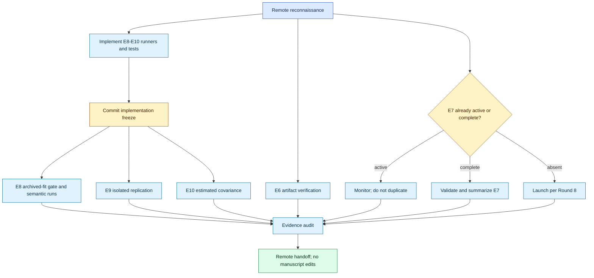

# Round 9 overnight remote runbook

*Fail-closed implementation and execution of the remaining submission evidence on the remote server. Scientific interpretation and manuscript edits remain desk work.*

---

## 🎯 Mission and terminal state

Start from the exact committed Round 9 revision, preserve every archived result,
finish or recover E7, implement and run E8–E10, and return a traceable evidence
bundle. Do not edit the manuscript and do not make the `priorThesis` publication
decision.

The handoff prompt supplies two immutable identifiers:

- `HANDOFF_BRANCH`: the branch used only to distribute this playbook; and
- `HANDOFF_CONTENT_COMMIT`: the exact scientific and execution specification
  from which `round9/remote-evidence` must descend.

The prompt itself is pinned in one later metadata-only commit because a Git
commit cannot contain its own hash. Execute from `HANDOFF_CONTENT_COMMIT`, not
from an unpinned `main` or whatever branch happens to be checked out.

The unattended run is successful when either:

1. every eligible experiment completes and its validation gates pass; or
2. a gate fails, downstream work that depends on it stops, independent work
   continues, and the failure is recorded without tuning or threshold changes.

The terminal report must state the status of E6–E10, every failed gate, the exact
commit used, output paths, wall times, and final machine state. A disappointing
scientific result is not a failed run. A data, configuration, reproduction, or
schema mismatch is.

## 🔒 Authority and prohibitions

Authority order:

1. this file for Round 9 execution mechanics;
2. `ROUND9_RUNBOOK.md` for scientific motivation and outcome-to-paper mapping;
3. `ROUND8_RUNBOOK.md` for E7;
4. `AGENT_PROMPT_REMOTE_EXPERIMENTS.md` for shared-server safety;
5. the frozen configuration in `experiments/synthetic/nfpa_confirmatory/config.py`.

Never:

- overwrite or append to `results/rps2026/E1_nfpa_blockA/block_A_colored_raw.csv`;
- edit data under `/ceph/dwong/datasets` or the resolved TIDMAD raw-data tree;
- loosen a tolerance, change a seed, choose a subset, tune shrinkage, or rerun
  because a result is unfavorable;
- pool the original and replication seeds before reporting each subset;
- launch a duplicate E7 if an E7 process, PID, checkpoint, or screen session exists;
- edit LaTeX, figures, tables, the claim audit, or bibliography;
- push directly to `main` or force-push;
- claim that E8 formally confirms H3. The original protocol supplied no
  quantitative recovery threshold, so E8 reports continuous errors and paired
  contrasts; the desk decides the wording.
- describe the archived-condition semantic decoder as predeclared. Block H was
  dropped by the frozen 2026-08-08 amendment; only the separable planted-factor
  analysis is the delayed execution of H3.

## 🧭 Ownership and dependency map



The CPU experiments are independent of E7 and may run at `nice -n 10` with
four BLAS threads while E7 occupies GPUs, provided the initial load and memory
checks show headroom.

## 📋 Phase 0 — repository and machine preflight

Use the actual checkout path; do not assume `~` if the repository lives
elsewhere. The user must synchronize a clean checkout of this repository before
the overnight run. Do not merge unrelated work into the experiment branch.

```bash
export CODE_ROOT=/ceph/dwong/noise-weighted-subspace-reconstruction
test -d "$CODE_ROOT/.git" || export CODE_ROOT="$HOME/noise-weighted-subspace-reconstruction"
cd "$CODE_ROOT"

git fetch --all --prune
git status --short --branch
git log -1 --format='%H %cI %s'
nvidia-smi
who
uptime
free -g
df -h /ceph "$CODE_ROOT"
screen -ls || true
ps -u "$USER" -o pid,etime,cmd
```

Set the exact values copied from `ROUND9_REMOTE_AGENT_PROMPT.md`, then verify
both identity and ancestry. If the commit is missing, stop with
`ROUND9_COMMIT_NOT_AVAILABLE`. If the checkout is dirty, preserve it untouched
and stop with `ROUND9_DIRTY_CHECKOUT`; do not stash, reset, clean, or switch
across unknown work. A fresh clone is preferable to trying to repair a shared
dirty checkout overnight.

```bash
export HANDOFF_BRANCH=codex/rps-round9-overnight-handoff
export HANDOFF_CONTENT_COMMIT=ff50d7184a2ab66275f01d076e9750ae8c367107

git fetch origin "$HANDOFF_BRANCH" || {
  echo ROUND9_HANDOFF_FETCH_FAILED
  exit 2
}
git cat-file -e "$HANDOFF_CONTENT_COMMIT^{commit}" || {
  echo ROUND9_COMMIT_NOT_AVAILABLE
  exit 2
}
git merge-base --is-ancestor "$HANDOFF_CONTENT_COMMIT" "origin/$HANDOFF_BRANCH" || {
  echo ROUND9_HANDOFF_ANCESTRY_MISMATCH
  exit 2
}
test -z "$(git status --porcelain)" || {
  echo ROUND9_DIRTY_CHECKOUT
  exit 2
}
```

Create the remote work branch from the pinned content commit on a fresh run. On
resume, require the existing branch to descend from that same commit:

```bash
if git show-ref --verify --quiet refs/heads/round9/remote-evidence; then
  git switch round9/remote-evidence
  git merge-base --is-ancestor "$HANDOFF_CONTENT_COMMIT" HEAD || {
    echo ROUND9_RESUME_BRANCH_WRONG_ANCESTRY
    exit 2
  }
else
  git switch --detach "$HANDOFF_CONTENT_COMMIT"
  git switch -c round9/remote-evidence
fi
export PYTHON="$CODE_ROOT/.venv/bin/python"
test -x "$PYTHON"
export PYTHONPATH="$CODE_ROOT/src:$CODE_ROOT"
export RPS_RESULTS="$CODE_ROOT/results/rps2026"
```

Run the NFPA correctness suite before implementation. A failure blocks E8–E10
but does not block monitoring an already-running E7.

```bash
OPENBLAS_NUM_THREADS=4 OMP_NUM_THREADS=4 MKL_NUM_THREADS=4 \
  timeout 30m nice -n 10 "$PYTHON" -m pytest \
  experiments/synthetic/nfpa_confirmatory/tests -q
```

Record the complete preflight, including the clean-tree check and the resolved
handoff identifiers, in `results/rps2026/Round9_remote/preflight.txt`. A
missing executable environment is a blocking provenance failure; do not fall
back silently to a system or Conda interpreter.

## 📦 Phase 1 — reconcile E6 and E7 without duplication

### E6: whitening-range evidence

Locate the existing remote `E6_whitening_range.json`. Copy it into
`results/rps2026/` only if the tracked destination is absent. Do not recompute
unless the artifact is genuinely missing and the exact Round 7 data root and
estimator are available.

Validate all of the following in code:

- `excluding_dc.cv_inverse_J`, not `all_bands.cv_inverse_J`, rounds to the
  manuscript's `0.69`;
- the stored verdict is `collinearity_supported: false`;
- the file records 328 bands before DC exclusion and the frozen PSD estimator;
- the source and destination SHA-256 digests are recorded.

Any mismatch is `E6_VARIANT_MISMATCH`; preserve the file, but do not silently
rename a statistic or update prose.

### E7: second rung-4 seed

Inspect screens, PIDs, checkpoints, logs, and output files before launching
anything. If E7 is active, monitor it. If complete, run the four Round 8 gates
and generate the registered summary. If absent, launch exactly the two
same-seed arms from `ROUND8_RUNBOOK.md` with its timeouts and GPU pinning.

Do not launch `chi2_of`. Do not compare incomplete or unequal step grids. A
failed or timed-out arm is reported as partial evidence, never restarted from
zero when a valid checkpoint exists.

## 🧱 Phase 2 — implement execution-safe E8–E10 drivers

Implementation must be committed before any new full result is inspected.
Use tests and reduced synthetic fixtures only during development.

### Shared output contract

Each runner must:

- accept an explicit output directory;
- refuse to overwrite a non-empty final output directory unless `--resume` is
  explicit and every existing manifest/shard passes validation;
- write one atomic shard per seed before aggregation;
- validate config hash, seed, regime, method set, and schema when resuming;
- use a temporary file plus atomic rename for each shard and summary;
- record the code commit, frozen config hash, Python/NumPy versions, hostname,
  thread limits, start/end timestamps, wall time, and command;
- produce deterministic CSV/JSON summaries from seed shards;
- support `--smoke` with synthetic seeds `900000` and `900001`, writing only
  below `results/rps2026/Round9_smoke/`; use `dataclasses.replace` for a reduced
  fixture and never edit the frozen `PRIMARY` object or use seeds 0–29;
- exit nonzero on a failed integrity gate.

Add focused tests for overwrite refusal, resume validation, deterministic
aggregation, exact seed sets, and malformed/missing shards.

### E8: semantic completion

Implement `experiments/synthetic/nfpa_confirmatory/run_semantics.py` with two
separate outputs:

1. `primary_alpha_0p1`, seeds 0–9, for semantics at the archived primary
   configuration; and
2. `separable_alpha_0`, seeds 0–9, for the separable condition named by H3.

At `alpha=0.1`, refit the same five registered methods: `CW-PCA`, `NFPA`,
`Iso-MPCA`, `IsoPCA`, and `OF`. The name `PCA` is invalid. Before writing any
semantic result, reproduce every archived `test_normalized_chi2` at the same
seed and method with relative error at most `1e-9`. Use
`abs(observed-expected) / max(abs(expected), 1e-15)` and compare unrounded
floats parsed from the archived CSV. If any row misses, stop E8 and write an
audit table of expected, observed, absolute error, and relative error. Do not
loosen the tolerance overnight.

Freeze one decoder rule before the run. For every eligible method, fit an
affine ordinary least-squares decoder on the training split only: standardize
each code column using training means and nonzero training standard deviations,
include an intercept, solve with `numpy.linalg.lstsq(rcond=None)`, and map
predictions back to the original target units. Persist the training means,
scales, coefficient matrix, intercept, numerical rank, and singular values. A
zero-variance code column receives scale one and must be flagged. With at most
six code dimensions and 800 training events, no test-tuned regularizer is
needed. Add tests for affine offsets, invariance to orthogonal code rotations,
zero-variance columns, rank deficiency, and strict train/test separation.

The semantic utilities must be method-aware:

- `NFPA` and `Iso-MPCA`: latent decoding from the `(k_c,k_t)` coefficients plus
  channel, temporal, and joint planted-product projector errors;
- `CW-PCA` and `IsoPCA`: latent decoding from the projection onto `fit.P` plus
  joint planted-product projector error; channel/temporal factor errors are
  null because an unrestricted subspace has no identified axis factors;
- `OF`: one-dimensional amplitude decoding only; pulse-shape and planted-factor
  fields are null.

Do not make null mean zero. Tests must cover every method and assert that no
metric is silently fabricated. All projector comparisons must be in the
method's declared coordinate system with the truth mapped into that same
system. Also export the joint projector error in the common oracle-whitened
coordinate system for every non-OF method; do not compare a raw-coordinate
projector directly with a whitened-coordinate target.

For `alpha=0`, use `dataclasses.replace(PRIMARY,
nonseparability_alpha=0.0)` and compute a fresh config hash embedded in every
row. This condition has no archived-fit reproduction gate. It is the delayed
execution of H3. Report the continuous recovery metrics and seed-level paired
contrasts; do not invent a post-hoc threshold or a binary H3 verdict.

The `alpha=0.1` decoder analysis is instead a post-hoc completion of the
superseded Block H. Label it `analysis_status: post_hoc_exploratory` in every
row and summary. Label the `alpha=0` planted-factor analysis
`analysis_status: delayed_predeclared_no_numeric_threshold`. The two statuses
must never be pooled.

Write:

```text
results/rps2026/E8_semantics/
  manifest.json
  primary_alpha_0p1/seed_00.csv ... seed_09.csv
  primary_alpha_0p1/raw.csv
  primary_alpha_0p1/summary.json
  separable_alpha_0/seed_00.csv ... seed_09.csv
  separable_alpha_0/raw.csv
  separable_alpha_0/summary.json
  archived_fit_reproduction.csv
```

Bootstrap paired seed differences only across seeds, 10,000 resamples, seed
`20260819`. Report NFPA minus Iso-MPCA contrasts for amplitude RMSE, rise-time
RMSE, decay-time RMSE, and channel, temporal, and joint projector errors where
identified. State the sign convention in every summary, keep every individual
seed value, and do not select whichever pulse-shape target looks favorable.

### E9: isolated 20-seed replication

Implement a dedicated runner or an explicit output-path option. It must execute
colored Block A for seeds exactly `10..29`, all five methods, with the unchanged
frozen `PRIMARY` configuration. It must never resolve to the E1 directory.

Write seed shards and final output under:

```text
results/rps2026/E9_blockA_replication/
  seed_10.csv ... seed_29.csv
  replication_raw.csv
  replication_summary.json
  pooled_summary.json  # only when the direction-agreement rule permits it
  manifest.json
```

The replication summary is generated first and contains exactly these paired
NFPA-minus-Iso-MPCA contrasts: held-out normalized chi-square, held-out raw
MSE, and mean principal angle to CW-PCA. Treat each seed-level method pair as
one independent replicate and bootstrap paired seed differences (10,000 resamples, seed
`20260819`). The first two are the primary metric-reversal contrasts; the angle
is a secondary geometric diagnostic.

Compare the signs of the two primary contrasts with seeds 0–9 before any
pooling. If either reverses sign, mark `pooling_permitted: false`, omit pooled
estimates, and report both subsets. If both directions agree, the pooled
summary may be generated but must display original, replication, and pooled
results side by side. Label seeds 0–9 `frozen_confirmatory`, seeds 10–29
`post_hoc_replication`, and the 30-seed aggregate `post_hoc_pooled`. Never call
the pooled set a 30-seed confirmatory experiment. A confidence interval that
includes zero is reported as inconclusive even when its mean sign agrees.

### E10: estimated covariance

Implement `run_estimated_covariance.py` using the following frozen choices;
the remote agent has no discretion to substitute another estimator:

- seeds 0–9 and `N_cal=2048` independent noise-only events per seed;
- calibration RNG initialized from
  `numpy.random.SeedSequence([20260819, seed, 10])`, separate from dataset RNG;
- generate calibration noise from the oracle colored model, with no signal
  events and no train/validation/test observations;
- estimate the channel covariance from rows shaped `(N_cal*T, C)` and the
  temporal covariance from rows shaped `(N_cal*C, T)` using
  `noise_geometry.noise.estimate_covariance(center=True)`;
- apply `regularize_covariance(shrinkage=0.0, floor=None)` to each axis: the
  existing data-scaled eigenvalue floor is the only regularization;
- generate train/validation/test data with the oracle covariance, fit NFPA
  using the estimated axis covariances, and reconstruct through those same
  estimated covariances;
- evaluate the resulting reconstruction only with the oracle covariance and
  the unchanged held-out test set;
- refit `Iso-MPCA` on the identical data as the covariance-independent control;
  it must reproduce its archived primary metrics within the E8 reproduction
  tolerance.

The required reshapes are
`noise.transpose(0, 2, 1).reshape(N_cal*T, C)` for channel samples and
`noise.reshape(N_cal*C, T)` for temporal samples. Add a fixture test that would
fail if channel and time axes were silently interchanged.

Rows within a calibration event are correlated; `N_cal=2048` events, not
`N_cal*T` or `N_cal*C` rows, is the independent calibration replication count.
Do not compute intervals by pretending the flattened rows are independent.

The two Kronecker factors are identifiable only up to reciprocal scale. Do not
report a naive raw per-axis relative error as though the factor scales were
identified. Freeze these diagnostics instead:

- channel- and temporal-*shape* errors after trace-normalizing each estimated
  and oracle factor;
- global scale ratio and relative Frobenius error of the full Kronecker
  covariance;
- each raw factor's minimum eigenvalue and condition number; and
- the oracle-whitening residual
  `||W_hat Sigma_oracle W_hat^T - I||_F / (C*T)`.

Compute the last two full-covariance diagnostics from Kronecker trace/Frobenius
identities rather than materializing or multiplying dense `(C*T)^2` matrices.
For example, with `A_c = W_c Sigma_c W_c^T` and
`A_t = W_t Sigma_t W_t^T`, use
`||A_t kron A_c - I||_F^2 = ||A_t||_F^2 ||A_c||_F^2 -
2 tr(A_t) tr(A_c) + C*T`. Add a direct small-matrix test of each identity.

Report the archived oracle-NFPA row beside the estimated-covariance NFPA row
for the same seed, including paired estimated-minus-oracle degradation. Also
report NFPA-minus-Iso-MPCA held-out raw MSE and normalized chi-square under
estimated whitening. The Iso-MPCA refit is an implementation gate, not a new
scientific condition. Bootstrap only the ten seed-level paired differences.
Write only to
`results/rps2026/E10_estimated_covariance/` using the shared shard/manifest
contract.

This is one fixed estimated-covariance condition, not the full originally
proposed covariance-robustness sweep. The paper may call it a measured
sensitivity check, not a general robustness boundary.

### Required command-line contract

The implementation may share internal utilities, but the unattended interface
must expose three explicit modules and never infer a destination from the old
Block A defaults:

```text
python -m experiments.synthetic.nfpa_confirmatory.run_semantics \
  --condition {primary,separable} --seeds ... --out-dir PATH [--resume]
python -m experiments.synthetic.nfpa_confirmatory.run_replication \
  --seeds ... --out-dir PATH [--resume]
python -m experiments.synthetic.nfpa_confirmatory.run_estimated_covariance \
  --seeds ... --out-dir PATH [--resume]
```

Each module must also implement the shared `--smoke` behavior. Reject an output
directory equal to, inside, or symlink-resolving into `E1_nfpa_blockA`. Reject
unexpected seed sets unless `--smoke` is present. Log the fully resolved output
path before fitting anything.

### Implementation freeze

Run the new focused tests plus the existing NFPA suite. Then inspect the diff
for scientific choices and commit before launching the ten- or twenty-seed
runs:

```bash
git diff --check
git status --short
git add experiments/synthetic/nfpa_confirmatory docs/plans/rps2026
git commit -m "round9: freeze output-safe semantic and covariance runners"
git log -1 --format='%H %cI %s'
```

Record this as `implementation_freeze_commit` in every new manifest. If tests
do not pass, do not execute E8–E10.

## 🚀 Phase 3 — unattended execution order

Use `OPENBLAS_NUM_THREADS=4 OMP_NUM_THREADS=4 MKL_NUM_THREADS=4` and
`nice -n 10` for every CPU job. Give every command a timeout and capture its
return code. Use a named `screen` session with logging for the overnight CPU
sequence; do not use untracked `nohup` processes. Record the exact one-seed
timing before accepting or increasing a hard cap. Resource pressure may justify
serializing CPU work behind E7, but never reducing seeds or iterations.

Run in this order:

1. E8 one-seed primary reproduction gate. If it fails, stop E8 only.
2. E8 full `alpha=0.1`, then `alpha=0`.
3. E9 seeds 10–29.
4. E10 seeds 0–9.
5. deterministic summaries and evidence audit.

E9 and E10 may continue if E8 fails because they do not depend on semantic
code. A shared infrastructure or frozen-config failure blocks all three.

Suggested hard caps, to be replaced only by larger caps justified from a
recorded one-seed timing (never smaller scientific budgets):

| Work | Expected | Hard cap |
|---|---:|---:|
| E8 primary, 10 seeds | 40–60 min | 2 h |
| E8 separable, 10 seeds | 40–60 min | 2 h |
| E9 replication, 20 seeds | 75–120 min | 4 h |
| E10 estimated covariance, 10 seeds | 40–75 min | 3 h |
| E7, if not already complete | 4.5–6 h on two GPUs | 8 h per arm |

The timing basis for E8/E9 is the archived Block A run: approximately 226 s
per seed across all five methods on the prior server execution. Record new
measurements rather than assuming that rate.

## 🧪 Phase 4 — evidence audit

Before reporting completion, independently verify:

- archived E1 SHA-256 is unchanged from the preflight digest;
- exact seed sets: E8 `{0..9}`, E9 `{10..29}`, E10 `{0..9}`;
- no duplicate `(seed, method, condition)` keys;
- expected row counts and method sets;
- config hashes agree within each condition and differ when `alpha` differs;
- summaries regenerate byte-for-byte from raw shards;
- E8 bootstrap unit is seed, not event;
- E9 replication is reported before any permitted pool;
- E10 evaluation uses oracle covariance and calibration data are independent;
- E10 covariance diagnostics respect reciprocal Kronecker-factor scale
  non-identifiability and use `N_cal` events as the replication unit;
- E7 arms, if compared, have identical seed, data root, model parameters,
  budget, and step grid, differing only in loss;
- every Round 9-owned long-running process has exited and no Round 9-owned
  stale PID or screen remains. Do not kill or alter another user's process or
  screen session.

Run `git diff --check`, the NFPA tests, and any new Round 9 tests once more.
Do not run the paper build remotely as a substitute for desk reconciliation.

## 📤 Phase 5 — handoff

Append a factual Round 9 section to
`docs/plans/rps2026/EXPERIMENT_RUN_LOG.md`. Create
`docs/plans/rps2026/ROUND9_REMOTE_REPORT.md` with:

- start, implementation-freeze, and final commit hashes;
- machine and environment summary;
- E6 variant verification;
- E7 state and gate results;
- E8 archived-fit gate plus both semantic conditions;
- E9 original-versus-replication direction comparison and pooling decision;
- E10 estimator diagnostics and paired contrasts;
- all commands, return codes, wall times, output paths, and SHA-256 digests;
- failures and skipped dependents;
- final `nvidia-smi`, `screen -ls`, relevant `ps`, and repository status;
- a short `DOES_SUPPORT` / `DOES_NOT_SUPPORT` section without manuscript prose.

Commit code, small evidence, logs, and reports to `round9/remote-evidence`.
Do not include checkpoints, multi-gigabyte denoised files, or raw datasets.
Before committing, inspect `git status --short`, `git diff --stat`, and every
new path; reject caches, environments, raw data, checkpoints, or unrelated
changes. Record `du -sh results/rps2026` and SHA-256 digests for every new
summary and raw table. Push only that branch with
`git push -u origin round9/remote-evidence`. The final line must be one of:

```text
ROUND9_REMOTE_COMPLETE_PENDING_DESK_RECONCILIATION
ROUND9_REMOTE_PARTIAL_WITH_RECORDED_GATE_FAILURES
ROUND9_REMOTE_BLOCKED_BEFORE_EXECUTION
```

## 🖥️ Desk-only work after sync

The desktop author/revision agent must:

1. audit the remote branch and independently regenerate summaries;
2. apply the prewritten E7 contingency matching the measured sign result;
3. decide E8 wording, respecting the absent predeclared recovery threshold;
4. update the manuscript, appendix, figure/table, claim audit, source map, and
   review only from validated artifacts;
5. decide `priorThesis`: the recommended submission-safe choice is to remove
   the unevaluated OF-injection compatibility sentence and citation unless a
   stable reviewer-accessible anonymized source can be supplied;
6. rebuild the four-page paper and rerun anonymity, citation, traceability,
   undefined-reference, and page-limit checks;
7. merge the remote branch only after this audit.
