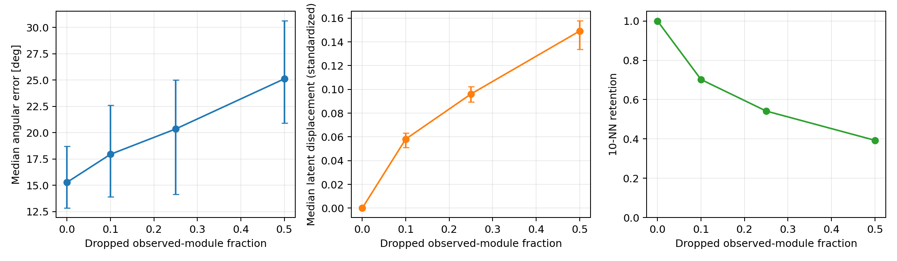

# NuBench Hexagon Ice LE / DynEdge direction: V0 and development pilot

Run date: 2026-07-27. These are feasibility results, not confirmatory paper
results. Scripts are in `paper3/scripts/` and machine-readable outputs are in
this directory.

## V0-A: published metric from released checkpoint predictions

The 2,989,339 released DynEdge test predictions were rescored against their
released truth columns using the opening angle between the Cartesian prediction
and the direction derived from truth zenith/azimuth.

| Group | N | Published median | Recomputed median | Published ≤1° | Recomputed ≤1° | Published ≤5° | Recomputed ≤5° |
| --- | ---: | ---: | ---: | ---: | ---: | ---: | ---: |
| CC / track | 1,715,758 | 23.60° | 23.6548° | 2.26% | 2.2508% | 22.24% | 22.2911% |
| NC / cascade | 1,273,581 | 56.12° | 56.1553° | 0.04% | 0.0415% | 1.03% | 1.0477% |

This is a close reproduction (maximum discrepancy 0.055° or 0.051 percentage
point), but it **does not pass** the deliberately strict 0.01-unit identity
tolerance. Likely causes to resolve with a NuBench author are a paper/release
artifact version difference or an unreleased evaluation detail. The result
must not be rounded into a pass.

## V0-B: checkpoint re-inference identity

The trusted official checkpoint restores as a `StandardModel` with 1,358,099
parameters and a 128-dimensional DynEdge backbone output. Its pickle contains
Python 3.10-era custom-detector bytecode and historical GraphNeT module paths.
The smoke script installs the three path aliases, reconstructs the exact
official NuBench feature transforms from their constants/current source, and
supplies two later-added GraphDefinition defaults.

On the 256-event development subset, CPU re-inference versus the released
prediction has median direction disagreement **0.944°**, 95th percentile
**7.708°**, and maximum **21.834°**. The subset median angular error is 15.283°
from re-inference versus 15.561° from the released predictions. This does not
pass per-event identity. Backend-dependent k-NN tie handling, package/version
drift, and release provenance are candidate explanations, not established
causes. A matching training environment or author-supplied inference recipe is
needed before confirmatory use.

## P0: observed-module-dropout curve

The development sample contains 128 CC/track and 128 NC/cascade events selected
to have at least 20 observed modules. It is intentionally enriched in
higher-multiplicity events so 50% dropout leaves the 8-NN graph defined. It is
therefore not representative of the released test population. The same events
are paired across severities with deterministic module selection.

| Dropped modules | Median angular error (95% exploratory bootstrap CI) | Median prediction drift | Standardized embedding displacement | 10-NN retention |
| ---: | ---: | ---: | ---: | ---: |
| 0% | 15.28° (12.83–18.71) | 0.00° | 0.000 | 1.000 |
| 10% | 17.95° (13.89–22.60) | 5.80° | 0.058 | 0.702 |
| 25% | 20.36° (14.15–25.00) | 10.76° | 0.096 | 0.542 |
| 50% | 25.12° (20.94–30.66) | 16.35° | 0.149 | 0.393 |

All three diagnostic axes respond monotonically: error and standardized
displacement rise while neighborhood retention falls. This demonstrates that
the perturbation and hook are sensitive enough for protocol design. Because
V0-B remains open, the curve is a **software/feasibility positive control**, not
evidence for the proposed scientific claims.

## Immediate blocker and requested review

Ask a NuBench/GraphNeT author to confirm the exact commit, Python/PyTorch/PyG
versions, detector class, graph-construction backend, and prediction-generation
command used for the Hexagon Ice LE DynEdge archive. V0 is complete only when a
clean re-inference either matches the released predictions within an agreed
backend tolerance or a documented reason for deterministic backend variation
is established and the full downstream metric meets a predeclared tolerance.
